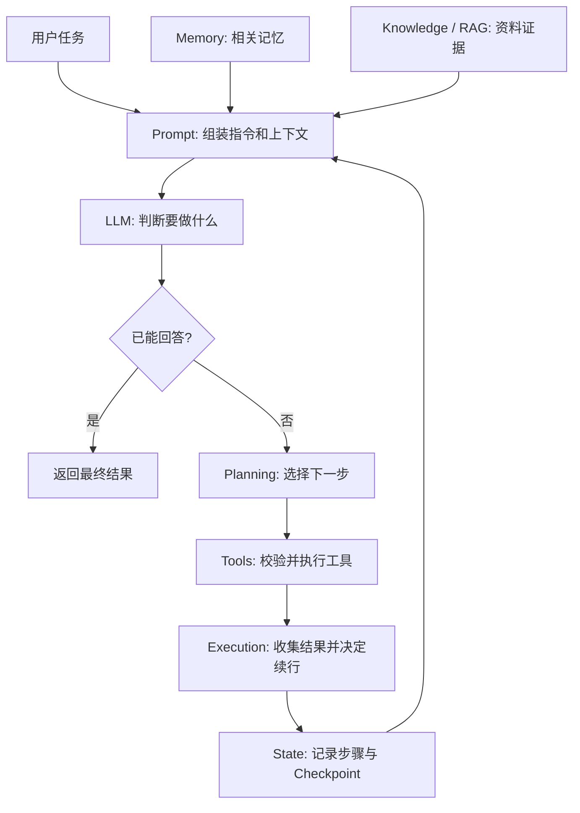
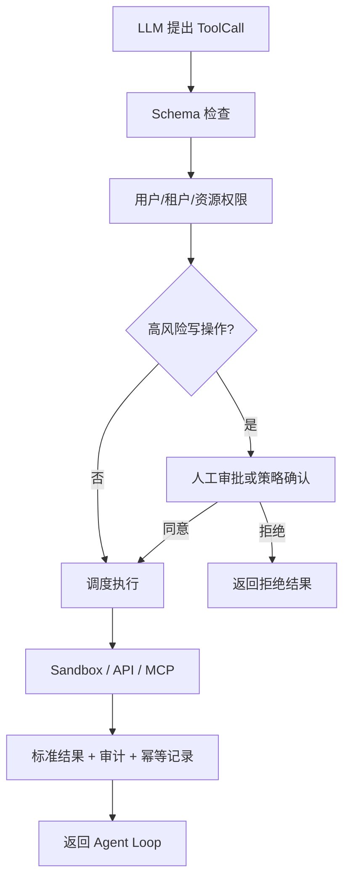
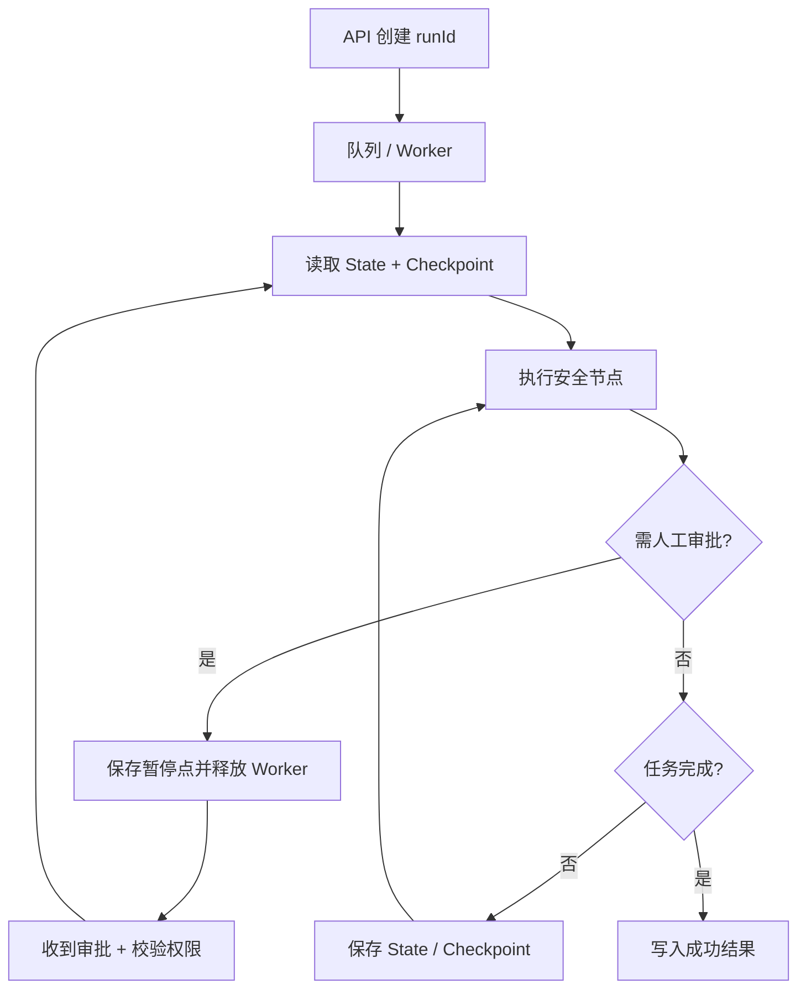
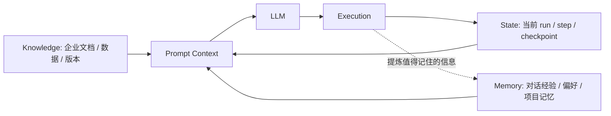
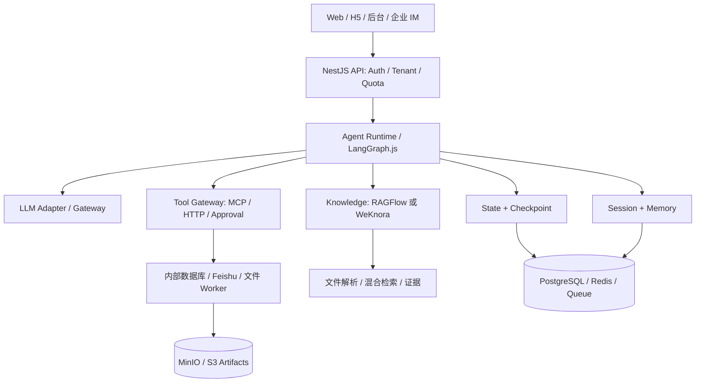

# AI Agent 七大模块｜快速学习与方案选型手册

> **定位**：15～30 分钟通读、实际开发时随时翻查；不是源码长篇研究报告。  
> **阅读方法**：先看第 0 节的选型速览；遇到问题，直接跳到对应模块的方案卡片。  
> **范围**：LLM、Prompt、Memory、Tools、Planning、Execution、State。以 Codex、DeepSeek Harness、ZCode、Pi、LangGraph、Dify、Flowise、RAGFlow、WeKnora、LlamaIndex、Haystack、GraphRAG 等开源项目的已核对代码入口作为参考。  
> **证据边界**：**“项目做法”**为可定位的源码设计；**“建议做法”**为综合选型建议，不代表某仓库原生实现。下面的“实施效果”均指可验证目标，不是未经测量的性能承诺。更新时间：2026-10-17。

## 0. 一页掌握七大模块

**一句话理解**：**LLM 负责想，Prompt 决定给它看什么，Memory 负责记，Tools 负责做，Planning 决定先后，Execution 推动执行，State 记录进度和恢复点。**

| 模块 | 本质问题 | 默认从什么做起 | 什么时候升级 |
|---|---|---|---|
| **LLM** | 模型怎么接、怎么选、失败怎么办 | 统一模型 Adapter | 多模型、多租户、容灾、成本治理 |
| **Prompt** | 每次请求应给模型哪些信息 | 分段组装 + 输出格式约束 | 大量知识、Skills、上下文超限 |
| **Memory** | 什么历史值得保留和找回 | 最近历史 + 压缩摘要 | 跨会话、长期个性化、项目经验 |
| **Tools** | 模型如何安全操作外界 | Function Calling + 服务端校验 | MCP、多工具、沙箱、审批 |
| **Planning** | 任务怎样拆、下一步做什么 | ReAct（未知任务）/固定流程（已知业务） | 长任务、多分支、多人或多 Agent |
| **Execution** | 怎么调度、重试、暂停和结束 | 有界 Agent Loop | Graph Runtime、可恢复任务、Worker |
| **State** | 现在执行到哪里、如何继续 | Typed State + 数据库任务记录 | Checkpoint、事件日志、并发恢复 |

**最容易搞混的四组：**

- **Memory ≠ State**：Memory 存过去值得回忆的信息；State 存现在运行到哪一步。
- **RAG/Knowledge ≠ Memory**：RAG 处理企业权威知识；Memory 处理对话、经历、偏好和已学经验。
- **Planning ≠ Execution**：Planning 生成或调整步骤；Execution 调度、执行并处理失败。
- **MCP ≠ 安全工具网关**：MCP 规范工具接入；权限、审批、隔离和审计仍由你的系统负责。

### Agent 的一条完整执行链

### 一眼选路线

| 你的任务 | 选择 | 不要急着加 |
|---|---|---|
| 企业 FAQ / 文档问答 | RAG + 单次 LLM / 少量工具 | Multi-Agent、复杂 Planning |
| 搜索 / 代码调试 / 未知信息探索 | ReAct + Function Calling + 步数限制 | 一开始就规划完整 DAG |
| 报表生成 / 固定审批 | Workflow + Typed State + 人工确认 | 完全自由的自主 Agent |
| 长时间研发任务 | ReAct + Compaction + Checkpoint + Sandbox | 把所有工具都放开 |
| 多角色产研协作 | Supervisor + 专业 Agent + Graph State | 没有分工价值的多 Agent |

---

# 1. LLM｜模型接入与治理

**先理解问题：**Agent 往往要连续请求模型。若把某模型 SDK 直接写进执行循环，以后更换供应商、处理限流、做模型分流都会困难。

## 方案 L1｜Provider Adapter（**最先掌握，默认推荐**）

- **背景·场景**：多个模型协议、Tool Calling 和流式结果不一致；适合所有准备长期迭代的 Agent。
- **思路**：Agent 只认识统一的 `generate/stream` 接口；每个 Provider Adapter 负责消息、ToolCall、Usage、结束原因、错误转换。
- **怎么实施**：① 定义 `ModelRequest/ModelResponse/ToolCall/Usage`；② 给每个供应商写 Adapter；③ 建“支持工具/视觉/结构化输出/上下文”等能力表；④ 做跨模型契约测试。
- **优 / 缺**：✓ 更换模型无需重写 Agent；✗ 统一抽象会遗漏某些供应商特性。
- **实施效果**：以跨模型工具调用正确率、结构化输出通过率、切换回归测试衡量。
- **方案结合·项目**：后续配 Gateway、Fallback；参照 [Pi Provider](https://github.com/earendil-works/pi/tree/main/packages/ai/src/providers)、[DeepSeek LLM](https://github.com/deepseek-ai/deepseek-harness/tree/master/packages/llm/llm/src)。

## 方案 L2｜Model Gateway + Fallback（**多应用 / 生产环境**）

- **背景·场景**：多租户统一配额、密钥管理；供应商超时或限流需降级。
- **思路**：Gateway 先鉴权、路由和限流；出错时按错误类别重试，再切到**能力兼容**的备用模型。
- **怎么实施**：① 定义租户/应用模型策略和预算；② 集中保存凭据；③ 只重试暂时性错误并设置总超时；④ Fallback 前检查工具、JSON、多模态支持；⑤ Trace 记录切换与费用。
- **优 / 缺**：✓ 治理集中、特定故障下可用性更高；✗ 增加中心依赖，备用模型结果可能不同。
- **实施效果**：关注调用失败率、Fallback 成功率、P95 延迟、租户成本归属准确率。
- **方案结合·项目**：依赖 L1；参考 [LangChain model_fallback](https://github.com/langchain-ai/langchain/blob/master/libs/langchain_v1/langchain/agents/middleware/model_fallback.py)、[ZCode Model Provider](https://github.com/zai-org/ZCode/tree/main/packages/services/src/model-provider)。

## 方案 L3｜任务级模型路由（**任务类型差异大时**）

- **背景·场景**：简单分类也用昂贵推理模型，导致成本过高；图片、代码、SQL 需要不同能力。
- **思路**：根据任务类型、质量要求和预算映射至快模型、强推理模型或视觉模型。
- **怎么实施**：① 收集真实任务并标注标准答案；② 比较各模型质量/成本/延迟；③ 先用规则路由；④ 小流量 A/B；⑤ 复杂场景才增加第二模型校验。
- **优 / 缺**：✓ 有机会优化总体成本；✗ 错误路由可能降低质量，双模型调用可能更慢。
- **实施效果**：同一评测集对比**任务成功率 + 平均成本 + P95**，不要只看 Token 单价。
- **方案结合·项目**：配 L1/L2 与评测系统；这是推荐的上层策略，非所有项目默认能力。

> **LLM 记忆口诀**：**先统一接口，再做容错，最后根据评测做智能路由。**

# 2. Prompt｜模型上下文怎么组装

**先理解问题：**真正影响 Agent 的不只是系统提示词，而是“每一轮模型实际看到的指令、工具、资料、记忆和进度”。

## 方案 P1｜模板 Prompt（**简单任务**）

- **背景·场景**：FAQ、分类、固定格式输出，角色和任务几乎不变。
- **思路**：System Prompt + 模板变量 + 输出约束。
- **怎么实施**：① 分离系统规则和用户输入；② 用带类型的变量模板；③ 缺失参数直接报错；④ 为 Prompt 编版本并建回归样本。
- **优 / 缺**：✓ 简单、容易测试；✗ 规则多了难维护，动态上下文支持弱。
- **实施效果**：看指令遵循率、结构化结果有效率、版本回归通过率。
- **方案结合·项目**：结合 L1、简单 Memory；参考 [Dify Prompt](https://github.com/langgenius/dify/tree/main/api/core/prompt)。

## 方案 P2｜Context Assembly / 分段组装（**复杂 Agent 默认推荐**）

- **背景·场景**：Coding Agent 需要项目规范、Git 环境、Skills、工具和当前任务，单一长 Prompt 容易冲突。
- **思路**：把指令按 `Policy / Role / Task / Tools / Knowledge / Memory / Runtime` 分成 Section，再按优先级、来源可信度和 Token 预算组装。
- **怎么实施**：① 为 Section 定义 `id/source/priority/trustLevel`；② 系统规则与外部文档分层；③ 组装时检查变量和冲突；④ 输出 Context Trace 记录注入了什么、用了多少 Token。
- **优 / 缺**：✓ 可替换、可调试；✗ 要解决截断、指令优先级、提示词注入问题。
- **实施效果**：看关键指令保留率、Token 超限率、错误上下文定位时间。
- **方案结合·项目**：通常配 P3、Memory 和 RAG；参考 [ZCode builder.ts](https://github.com/zai-org/ZCode/blob/main/apps/zcode-cli/packages/core/src/context/builder.ts)、[DeepSeek System Prompt](https://github.com/deepseek-ai/deepseek-harness/tree/master/packages/core/system-prompt)。

## 方案 P3｜按需上下文 + Token Budget（**长会话 / 海量资料**）

- **背景·场景**：历史工具输出、企业知识、Skills 全塞进去会超出窗口且产生噪声。
- **思路**：RAG/Skills 只加载相关内容；历史做 Compaction；超长工具结果存 Artifact，只把摘要和引用放入 Prompt。
- **怎么实施**：① 预留模型输出和工具 Schema 预算；② 高优先级保留当前任务、规则、最近工具关联；③ 动态检索证据并带来源；④ 历史摘要且保留原记录；⑤ 校验截断后工具调用对完整。
- **优 / 缺**：✓ 节省上下文、适合长任务；✗ 检索漏命中和摘要损失信息。
- **实施效果**：看相关证据命中率、约束遗忘率、上下文溢出率、每任务 Token。
- **方案结合·项目**：P2 + Knowledge + Memory Summary；参考 [Pi compaction](https://github.com/earendil-works/pi/blob/main/packages/coding-agent/src/core/compaction/compaction.ts)、[Dify Knowledge Layer](https://github.com/langgenius/dify/blob/main/dify-agent/src/dify_agent/layers/knowledge/layer.py)。

## 方案 P4｜Schema / Structured Output（**输出交给程序时**）

- **背景·场景**：LLM 返回 SQL 计划、报表参数、任务 DAG 或审批表单，不能随便解析自然语言。
- **思路**：模型生成候选 JSON，宿主用 Zod/Pydantic 和业务规则两次校验。
- **怎么实施**：① 设计 Schema；② 优先使用原生结构化输出；③ 类型校验 + 业务校验；④ 格式修复仅有限次数；⑤ 失败明确返回错误，禁止直接执行非法结果。
- **优 / 缺**：✓ 下游逻辑稳定；✗ 复杂 Schema 可能失败，需维护版本。
- **实施效果**：以 Schema 通过率、业务合法率、修复成功率验收。
- **方案结合·项目**：与 Tools、Planning 搭配；参考 [LangChain structured_output](https://github.com/langchain-ai/langchain/blob/master/libs/langchain_v1/langchain/agents/structured_output.py)。

> **Prompt 记忆口诀**：**指令分段、知识按需、预算可控、输出校验。**

# 3. Memory｜哪些信息值得记住

**先理解问题：**不是把所有历史永久塞入模型。记忆有保存、压缩、检索、更新、失效五个步骤。

## 方案 M1｜Window / Token Buffer（**短会话**）

- **背景·场景**：客服、普通聊天，只有最近几轮对话重要。
- **思路**：仅给模型最近 N 条或最近 X Token 的消息；完整历史可另存数据库。
- **怎么实施**：① 数据库持久化完整消息；② 构造 Prompt 时取近期历史；③ Token 超限按轮次或消息组裁剪；④ 保留 User/Tool 关联，避免不完整历史。
- **优 / 缺**：✓ 简单、省 Token；✗ 会遗忘较早关键约束。
- **实施效果**：看上下文开销、跨轮指令保持率。
- **方案结合·项目**：简单 Agent 首选；参考 [Dify TokenBufferMemory](https://github.com/langgenius/dify/blob/main/api/core/memory/token_buffer_memory.py)、Flowise 的 Buffer/Window 节点。

## 方案 M2｜Summary / Compaction（**长会话默认升级**）

- **背景·场景**：Coding Agent、长时间分析，终端输出和旧对话越积越多。
- **思路**：保留近期原文，较早历史概括为“事实、决定、未完成事项”；原日志仍可查。
- **怎么实施**：① 监测 Token 预算；② 到阈值时抽取待压缩历史；③ 用固定摘要结构保留任务目标、约束、文件和下一步；④ 替换模型上下文视图；⑤ 原始历史不覆盖。
- **优 / 缺**：✓ 延长有效会话；✗ 摘要可能漏掉细节。
- **实施效果**：看任务恢复时关键约束保持率、上下文溢出率、压缩后任务成功率。
- **方案结合·项目**：M1 + P3 + State/Event Log；参考 [Pi compaction](https://github.com/earendil-works/pi/blob/main/packages/coding-agent/src/core/compaction/compaction.ts)、[ZCode compact](https://github.com/zai-org/ZCode/tree/main/apps/zcode-cli/packages/core/src/compact)。

## 方案 M3｜长期事实 / 事件记忆（**跨会话**）

- **背景·场景**：企业内部助手需要记住历史决策、项目进度；个人助手需要记住稳定偏好。
- **思路**：从历史抽取 **Episodic（做过什么）+ Semantic（知道什么）** 两类记忆；按权限、时间和相关性检索。
- **怎么实施**：① 设计记录 `owner/tenant/project/source/type/validAt/expireAt`；② LLM 或规则提取候选；③ 去重、冲突处理和授权检查；④ PostgreSQL 存原始记录，必要时建向量索引；⑤ 查询时 Top-K + 过滤 + 溯源。
- **优 / 缺**：✓ 跨会话连续性强；✗ 可能保存错误、陈旧或不应长期保存的信息。
- **实施效果**：测记忆检索命中率、错误记忆率、过期误命中率。
- **方案结合·项目**：M2 + RAG，但记忆和权威知识分仓治理；参考 [ZCode memory](https://github.com/zai-org/ZCode/tree/main/apps/zcode-cli/packages/core/src/memory)、[WeKnora checkpoint](https://github.com/Tencent/WeKnora/blob/main/internal/agent/checkpoint.go)（后者是**上下文压缩检查点**，不要误认成长期语义记忆）。

## 方案 M4｜Procedural / Skills / Tree Session（**可复用方法与分支探索**）

- **背景·场景**：反复执行相似任务；研发 Agent 需要可复用流程，或从某历史节点探索新分支。
- **思路**：操作规范作为 Skills/文件版本化；会话历史作为树保留分支。
- **怎么实施**：① Skill 写适用条件、步骤、工具权限；② 按需加载而不是全部注入；③ 历史节点记录 parentId；④ 用户从旧节点继续时形成新分支；⑤ 严格区分“技能文件”和“当次 State”。
- **优 / 缺**：✓ 经验可复用、历史可回溯；✗ 版本、分支和失效管理更复杂。
- **实施效果**：看同类任务流程一致性、技能命中率、分支恢复正确率。
- **方案结合·项目**：P2 + Planning；参考 [Pi Session Manager](https://github.com/earendil-works/pi/blob/main/packages/coding-agent/src/core/session-manager.ts)、[ZCode memory](https://github.com/zai-org/ZCode/tree/main/apps/zcode-cli/packages/core/src/memory)。

> **Memory 记忆口诀**：**近处留原文，远处做摘要，跨会话存事实，重复工作变技能。**

# 4. Tools｜安全地让 Agent 做事

**先理解问题：**LLM 只是提出“我要执行某工具”，真正执行、授权和审计必须由你的系统完成。

## 方案 T1｜Function Calling + Tool Registry（**默认起步**）

- **背景·场景**：查数据库、搜索知识、生成 Excel、调用内部 API 等确定工具。
- **思路**：注册 `name/description/inputSchema`，模型返回 `tool_calls`，宿主校验后调用对应 Handler。
- **怎么实施**：① 建工具目录；② 每个工具定义 Zod Schema；③ 服务端绑定真实用户身份；④ 执行前校验租户和资源权限；⑤ 统一结果 `{ok,data,error,artifactIds}`；⑥ 写超时与错误测试。
- **优 / 缺**：✓ 成熟、易测；✗ 工具多时上下文膨胀，错误 Schema 会引发误调用。
- **实施效果**：工具选择正确率、参数有效率、调用成功率。
- **方案结合·项目**：Prompt P4 + Execution；参考 [Pi agent loop](https://github.com/earendil-works/pi/blob/main/packages/agent/src/agent-loop.ts)、[Codex Tool Router](https://github.com/openai/codex/blob/main/codex-rs/core/src/tools/router.rs)。

## 方案 T2｜MCP / OpenAPI Gateway（**外部服务集成**）

- **背景·场景**：接飞书、企业微信、钉钉及多种业务系统；工具不应全硬编码在 Agent 中。
- **思路**：用 MCP/HTTP/OpenAPI 统一接入，再由企业 Tool Gateway 添加授权、审计和策略。
- **怎么实施**：① MCP Server 暴露工具及 Schema；② Tool Gateway 根据用户、租户筛出允许的工具；③ 执行时下传受控身份凭据；④ 工具调用统一超时/审计；⑤ 对外部写操作增加幂等键。
- **优 / 缺**：✓ 扩展方便、接入协议统一；✗ MCP 本身不保证权限、安全沙箱或可靠恢复。
- **实施效果**：新工具接入成本、权限拦截准确率、失败率。
- **方案结合·项目**：T1 + T3；参考 [WeKnora Tools](https://github.com/Tencent/WeKnora/tree/main/internal/agent/tools)、[Dify Agent 知识工具](https://github.com/langgenius/dify/blob/main/dify-agent/src/dify_agent/layers/knowledge/layer.py)。

## 方案 T3｜审批 / 沙箱 / 并发与幂等（**生产环境必补**）

- **背景·场景**：终端执行、删除文件、发送消息、发布代码、写数据库等有副作用操作。
- **思路**：根据工具风险分级：只读直接执行；写操作验证或审批；Shell/Python/浏览器在沙箱执行。读可并发，冲突写应串行/加锁。
- **怎么实施**：① 为工具增加 `risk/permission/approval/concurrencySafe/idempotent` 元信息；② 后端做权限策略；③ 高风险动作暂停等待授权；④ 沙箱限制文件、网络、进程和资源；⑤ 记录调用 ID 和幂等键，非幂等失败不能盲重试。
- **优 / 缺**：✓ 防越权、防误操作、可审计；✗ 研发成本和操作等待时间增加。
- **实施效果**：越权拦截率、重复副作用数量、工具资源超限事件。
- **方案结合·项目**：State Checkpoint + HITL；参考 [Codex approvals](https://github.com/openai/codex/blob/main/codex-rs/core/src/tools/approvals.rs)、[DeepSeek tool-calls.ts](https://github.com/deepseek-ai/deepseek-harness/blob/master/packages/core/agent-loop/src/tool-calls.ts)。

## 方案 T4｜动态工具发现 / Agent as Tool（**工具规模很大时**）

- **背景·场景**：上百个工具不适合一次提供给模型；复杂子任务需要复用专业 Agent。
- **思路**：先搜索匹配工具，动态注入工具定义；或者把整个工作流/子 Agent 包装成一个工具。
- **怎么实施**：① 给工具打标签、描述和权限范围；② 用关键词或向量检索候选；③ 验证候选是否授权；④ 按需注册；⑤ 子 Agent 调用设置深度、步数和成本上限。
- **优 / 缺**：✓ 节约上下文、提升模块复用；✗ 工具漏选、递归调用失控风险。
- **实施效果**：工具发现召回率、误选率、任务成功率、平均调用步数。
- **方案结合·项目**：P3 + Planning；参考 [LangChain tool_selection](https://github.com/langchain-ai/langchain/blob/master/libs/langchain_v1/langchain/agents/middleware/tool_selection.py)、Codex Tool Router。

### Tools 最重要的安全流程

> **Tools 记忆口诀**：**模型只提议，宿主来校验；先授权，再执行；写操作必须防重。**

# 5. Planning｜怎样决定下一步

**先理解问题：**有些任务路径未知，需要边做边决定；另一些任务路径确定，必须遵循固定的审批和业务顺序。

## 方案 PL1｜ReAct（**未知路径的默认方案**）

- **背景·场景**：搜索问题、代码调试、知识探索；下一步依赖上一工具结果。
- **思路**：`模型选择动作 → 执行工具 → 观察结果 → 再选择动作`，循环直到得到答案。
- **怎么实施**：① 注册有限工具；② 每轮将工具结果变成模型可读消息；③ 设置 `maxSteps/maxTokens/timeout`；④ 重复相同失败时退出或更换策略；⑤ 严格区分“模型声称完成”和“工具确实完成”。
- **优 / 缺**：✓ 灵活、适应不确定性；✗ 步数不可预测，可能陷入循环。
- **实施效果**：任务成功率、平均轮次、无效调用比例、成本。
- **方案结合·项目**：T1 + Agent Loop；参考 [DeepSeek ReactLoopAgent](https://github.com/deepseek-ai/deepseek-harness/blob/master/packages/core/agent-loop/src/agent.ts)、[WeKnora Engine](https://github.com/Tencent/WeKnora/blob/main/internal/agent/engine.go)。

## 方案 PL2｜Plan-and-Execute + Replanning（**复杂长任务**）

- **背景·场景**：做月度报告、研发功能、跨系统操作，存在多步骤和依赖。
- **思路**：先得到结构化任务计划，执行时持续观察；失败或发现新信息时只修订必要的步骤。
- **怎么实施**：① Planner 输出 `{id,task,dependsOn,acceptance}`；② 校验无循环、权限和预算；③ Ready Queue 执行满足依赖的步骤；④ 每步产出可验证结果；⑤ 失败时局部重规划并保留成功节点。
- **优 / 缺**：✓ 任务可解释、可追踪；✗ 初始计划可能不正确，Replanning 增加推理开销。
- **实施效果**：计划可执行率、重规划次数、最终完成率、重复任务比例。
- **方案结合·项目**：Graph Runtime + State；参考 [ZCode workflow scheduler](https://github.com/zai-org/ZCode/blob/main/apps/zcode-cli/packages/core/src/workflow/scheduler.ts)。

## 方案 PL3｜固定 DAG / Workflow（**业务规则清晰**）

- **背景·场景**：审批、同步、报表 ETL、订单处理，步骤必须有确定性。
- **思路**：由工程师定义节点和转移条件；仅在某些节点内部调用 LLM/Agent。
- **怎么实施**：① 先画业务流程及异常分支；② 节点输入/输出类型化；③ 定义超时、重试和人工审批节点；④ 给关键节点存 Checkpoint；⑤ 只把需要判断的节点做成 Agent。
- **优 / 缺**：✓ 可控、测试清晰；✗ 不适合完全未知任务。
- **实施效果**：业务流程完成率、违规顺序数量、人工补救次数。
- **方案结合·项目**：LangGraph / Dify / Flowise；源码参考 [LangGraph StateGraph](https://github.com/langchain-ai/langgraph/blob/main/libs/langgraph/langgraph/graph/state.py)、[Flowise Agentflow nodes](https://github.com/FlowiseAI/Flowise/tree/main/packages/components/nodes/agentflow)。

## 方案 PL4｜Multi-Agent / Supervisor / Handoff（**专业分工明确**）

- **背景·场景**：产品、设计、研发、测试多角色；各角色拥有不同工具、上下文或交付物。
- **思路**：Supervisor 拆任务并路由到 Worker；或 Agent 之间 Handoff；独立任务可并行，结果统一验证。
- **怎么实施**：① 先定义角色独占能力，而不是只换角色 Prompt；② 规定输入/输出 Schema；③ 限制最大深度、任务数和时间；④ 共享必要 State，隔离私有权限；⑤ Supervisor 根据验收标准汇总。
- **优 / 缺**：✓ 专业化、隔离复杂性；✗ 通信消耗大、调试困难、失败可能层层传播。
- **实施效果**：与单 Agent 对比成功率、耗时、Token、重复劳动；无收益就不要拆分。
- **方案结合·项目**：PL2/PL3 + Agent as Tool；参考 [LlamaIndex multi_agent_workflow](https://github.com/run-llama/llama_index/blob/main/llama-index-core/llama_index/core/agent/workflow/multi_agent_workflow.py)、[AutoGen BaseGroupChat](https://github.com/microsoft/autogen/blob/main/python/packages/autogen-agentchat/src/autogen_agentchat/teams/_group_chat/_base_group_chat.py)。

> **Planning 记忆口诀**：**未知用 ReAct，已知用 Workflow，复杂用计划，真有分工再多 Agent。**

# 6. Execution｜怎样把任务可靠执行完

**先理解问题：**工具调用不仅要发生，还要保证取消、超时、失败、并行、等待审批、服务重启后的处理都可控。

## 方案 E1｜有界 Agent Loop（**最小执行器**）

- **背景·场景**：短时会话、单进程原型、简单工具探索。
- **思路**：Prompt → LLM → Tool → ToolResult → 下一轮；遇到最终答案或预算/取消条件退出。
- **怎么实施**：① 每个 Run 设置 `runId`；② 请求和工具都绑定 AbortSignal/Cancel；③ 最大步数、总超时、Token 上限；④ 工具结果回写历史；⑤ 结束时输出明确 `succeeded/failed/cancelled`。
- **优 / 缺**：✓ 简洁、好理解；✗ 进程崩溃后无法凭空续跑。
- **实施效果**：有限循环率、超时取消准确率、工具结果完整率。
- **方案结合·项目**：ReAct + Typed State；参考 [Pi agent-loop.ts](https://github.com/earendil-works/pi/blob/main/packages/agent/src/agent-loop.ts)。

## 方案 E2｜Graph Runtime + 并行调度（**复杂 Workflow**）

- **背景·场景**：多个分支、依赖和人工节点；部分任务可并行。
- **思路**：把执行组织为图；调度就绪节点、合并状态；对互斥写操作加调度限制。
- **怎么实施**：① 定义图节点、边和 State；② 输入输出 Schema；③ 依赖满足才调度；④ 通过 Reducer 合并并行结果；⑤ 限制并发并记录每节点耗时与错误。
- **优 / 缺**：✓ 编排清楚、可恢复性更好；✗ 状态合并和并发错误需要专门设计。
- **实施效果**：节点完成率、关键路径耗时、状态冲突率。
- **方案结合·项目**：PL2/PL3 + Checkpoint；参考 [LangGraph StateGraph](https://github.com/langchain-ai/langgraph/blob/main/libs/langgraph/langgraph/graph/state.py)、[RAGFlow Canvas](https://github.com/infiniflow/ragflow/tree/main/internal/agent/canvas)。

## 方案 E3｜Durable Execution / 人工暂停恢复（**长任务**）

- **背景·场景**：需要等待审批、用户稍后补充材料、服务意外重启。
- **思路**：执行到安全边界时保存 Checkpoint；审批后根据 `runId` 加载状态继续；涉及外部副作用必须防重。
- **怎么实施**：① 状态持久化；② 每个副作用绑定幂等键；③ 暂停前持久化审批请求与节点位置；④ 恢复时校验版本、权限及审批；⑤ 做强制杀进程与重复投递测试。
- **优 / 缺**：✓ 长任务更可控；✗ 恢复不是“从中断代码行直接接着跑”，需遵守框架恢复语义。
- **实施效果**：故障后恢复成功率、重复外部写次数、恢复耗时。
- **方案结合·项目**：E2 + S2/S3 + 工具审批；参考 [RAGFlow interrupt_resume](https://github.com/infiniflow/ragflow/blob/main/internal/agent/canvas/interrupt_resume.go)、[LangGraph interrupt](https://github.com/langchain-ai/langgraph/blob/main/libs/langgraph/langgraph/types.py)。

## 方案 E4｜任务队列 + Worker（**多用户 / 高吞吐**）

- **背景·场景**：文件转换、代码生成、长期研究等任务持续几十秒到数小时；API 不适合一直阻塞。
- **思路**：API 创建任务、队列分发、Worker 执行，状态和事件写数据库，前端订阅进度。
- **怎么实施**：① `POST /runs` 返回 runId；② 持久队列投递；③ Worker 领取租约并心跳；④ 状态版本控制、幂等执行；⑤ 失败按类别重试并转 DLQ；⑥ SSE 推送事件。
- **优 / 缺**：✓ 支持扩容，API 与执行解耦；✗ 分布式一致性更复杂。
- **实施效果**：排队时长、任务吞吐、租约过期恢复率、死信数量。
- **方案结合·项目**：E3 + Event Log。**注意**：[Dify 当前独立 Agent Run Scheduler](https://github.com/langgenius/dify/blob/main/dify-agent/src/dify_agent/runtime/run_scheduler.py) 在所核对版本明确是进程内调度，不能把它当作现成的跨进程持久任务队列。

### 长任务恢复的核心流程

> **Execution 记忆口诀**：**先有界循环，再做图调度，长任务加 Checkpoint，高并发加 Worker。**

# 7. State｜运行状态和恢复点

**先理解问题：**仅保存聊天记录，不等于知道任务执行到了哪一步。尤其需要区分“已调用模型”和“外部工具已经成功写入”。

## 方案 S1｜Typed State / 状态机（**默认起步**）

- **背景·场景**：一个任务有多步，需要明确当前步骤、结果和结束状态。
- **思路**：用显式字段记录 `runId/status/currentStep/outputs/attempt`，禁止非法状态转换。
- **怎么实施**：① TypeScript 接口/Zod 定义 Schema；② 枚举 `pending/running/paused/succeeded/failed/cancelled`；③ 为每个转换定义条件；④ 定义状态归属和并发写策略；⑤ 单元测试非法转换。
- **优 / 缺**：✓ 最容易维护和定位问题；✗ 进程内状态丢失后无法恢复。
- **实施效果**：非法转换数、错误状态率、开发排障耗时。
- **方案结合·项目**：所有 Agent 都应有；参考 [ZCode turn-state.ts](https://github.com/zai-org/ZCode/blob/main/apps/zcode-cli/packages/core/src/agent/turn-state.ts)。

## 方案 S2｜Graph Shared State + Reducer（**并行节点**）

- **背景·场景**：多节点并行写状态，直接修改同一对象容易覆盖彼此结果。
- **思路**：每个节点返回局部更新；Reducer 决定 append、merge 或 replace。
- **怎么实施**：① State 字段明确 owner；② 对并行累积字段设计 Reducer；③ 大文件只存 Artifact ID；④ 对竞争更新和顺序做测试。
- **优 / 缺**：✓ 并发安全语义清楚；✗ 合并策略设计错会造成状态污染。
- **实施效果**：状态冲突率、节点结果丢失率、可重现性。
- **方案结合·项目**：E2、PL2；参考 [LangGraph StateGraph](https://github.com/langchain-ai/langgraph/blob/main/libs/langgraph/langgraph/graph/state.py)、[Haystack State](https://github.com/deepset-ai/haystack/blob/main/haystack/components/agents/state/state.py)。

## 方案 S3｜Checkpoint / Snapshot（**暂停与恢复**）

- **背景·场景**：执行中断、用户审批、服务重启，需要继续未完成工作。
- **思路**：在可靠边界保存状态快照，包括节点位置、必要中间结果引用和版本。
- **怎么实施**：① 为 Checkpoint 绑定 `threadId/runId/version`；② 在节点前后确定保存时机；③ 采用持久存储；④ Resume 前验证快照版本和权限；⑤ 外部副作用通过幂等键避免重复。
- **优 / 缺**：✓ 支持恢复和重试；✗ 快照增多、Schema 迁移复杂。
- **实施效果**：恢复成功率、快照写入耗时、恢复后重复动作数。
- **方案结合·项目**：E3、HITL；参考 [RAGFlow Checkpoint Store](https://github.com/infiniflow/ragflow/blob/main/internal/agent/canvas/checkpoint_store.go)、LangGraph Checkpointer。

## 方案 S4｜Event Log + Snapshot / Session Tree（**审计、回放、分支**）

- **背景·场景**：要追踪工具到底做了什么、复盘为什么出错，或从历史节点开新分支。
- **思路**：追加事件 `run.started/tool.called/tool.result/state.updated`；定期 Snapshot 加速恢复；会话树保存 parentId。
- **怎么实施**：① 定义事件 Schema 和 seq；② 同一 Run 保证事件有序；③ 关键事件可持久化/去重；④ 快照记录最后事件序号；⑤ 回放投影不应重放真实副作用；⑥ 设计数据保留与脱敏策略。
- **优 / 缺**：✓ 审计和排错能力强；✗ 数据量、版本迁移和事件一致性成本更高。
- **实施效果**：事件丢失/重放一致性、审计覆盖、历史分支恢复率。
- **方案结合·项目**：S3 + E3；参考 [DeepSeek Session](https://github.com/deepseek-ai/deepseek-harness/tree/master/packages/core/session/src)、[Pi Session Manager](https://github.com/earendil-works/pi/blob/main/packages/coding-agent/src/core/session-manager.ts)。

### Memory、Knowledge、State 的区别图

> **State 记忆口诀**：**运行看 State，暂停存 Checkpoint，审计看 Event Log，回忆找 Memory。**

---

# 8. 四个场景，直接照着选

| 场景 | LLM | Prompt | Memory | Tools | Planning | Execution | State |
|---|---|---|---|---|---|---|---|
| **企业知识问答** | L1 | P2+P3 | M1 | T1（检索工具） | 无 / PL1 | E1 | S1 |
| **复杂文档问答** | L1+L2 | P2+P3 | M2 | T1+T2 | PL1 | E1/E2 | S1/S3 |
| **生成报表并发飞书** | L1+L2 | P2+P4 | M2 | T1+T2+T3 | PL2+PL3 | E2+E3 | S1+S3 |
| **Coding Agent** | L1+L2 | P2+P3 | M2+M4 | T1+T3 | PL1+PL2 | E1/E3 | S1+S3+S4 |
| **多角色产研 Agent** | L1+L3 | P2+P4 | M2+M3 | T1+T4 | PL2+PL4 | E2+E3 | S2+S3 |

**企业 AI 中台的最小闭环（推荐）：**

**组合原则**：一个职责尽量只有一个主执行者。例如 LangGraph 负责统一编排时，Dify / Flowise 可以用于部分低代码应用，但不要在同一个任务链上无必要地叠两套通用编排引擎。

# 9. 从 0 到可用：实施清单（按顺序做）

- [ ] **第 1 步：可调用**：完成 LLM Adapter、Prompt Assembly、Agent Loop、基础 Function Calling。
- [ ] **第 2 步：可控制**：增加 Schema 校验、权限过滤、最大步数、Token/时间预算、工具审计。
- [ ] **第 3 步：可记忆**：会话数据库 + Window + Compaction；知识库单独建设。
- [ ] **第 4 步：可编排**：固定 Workflow + 局部 ReAct；复杂任务再引入 Plan-and-Execute。
- [ ] **第 5 步：可恢复**：Typed State + Checkpoint + 审批暂停 + 幂等工具写操作。
- [ ] **第 6 步：可运营**：Trace、监控、评测集、费用统计、故障演练。
- [ ] **第 7 步：可扩展**：必要时增加 MCP Gateway、动态工具发现、队列 Worker、多 Agent、长期 Memory。

### 每模块最少测什么？

| 模块 | 只记住两个验收指标 |
|---|---|
| LLM | 任务成功率、调用成本/P95 |
| Prompt | 指令/Schema 遵守率、上下文超限率 |
| Memory | 关键历史召回率、错误/过期记忆率 |
| Tools | 参数与权限校验通过情况、重复副作用数量 |
| Planning | 计划可执行率、最终任务完成率 |
| Execution | 超时取消正确率、故障恢复成功率 |
| State | 状态一致性、Checkpoint 恢复正确率 |

# 10. 开源源码速查（不必通读所有仓库）

| 想学什么 | 先看源码 |
|---|---|
| **最小 Agent Loop** | [Pi agent-loop.ts](https://github.com/earendil-works/pi/blob/main/packages/agent/src/agent-loop.ts) |
| **插件式 Harness / Tool 并行** | [DeepSeek agent.ts](https://github.com/deepseek-ai/deepseek-harness/blob/master/packages/core/agent-loop/src/agent.ts) · [tool-calls.ts](https://github.com/deepseek-ai/deepseek-harness/blob/master/packages/core/agent-loop/src/tool-calls.ts) |
| **状态机 / Context Builder** | [ZCode turn-machine.ts](https://github.com/zai-org/ZCode/blob/main/apps/zcode-cli/packages/core/src/agent/turn-machine.ts) · [builder.ts](https://github.com/zai-org/ZCode/blob/main/apps/zcode-cli/packages/core/src/context/builder.ts) |
| **工具路由 / 安全** | [Codex router.rs](https://github.com/openai/codex/blob/main/codex-rs/core/src/tools/router.rs) · [approvals.rs](https://github.com/openai/codex/blob/main/codex-rs/core/src/tools/approvals.rs) |
| **状态图 / Checkpoint** | [LangGraph state.py](https://github.com/langchain-ai/langgraph/blob/main/libs/langgraph/langgraph/graph/state.py) |
| **低代码 Agent Runtime** | [Dify Agent Factory](https://github.com/langgenius/dify/blob/main/dify-agent/src/dify_agent/runtime/agent_factory.py) · [Flowise Agentflow](https://github.com/FlowiseAI/Flowise/tree/main/packages/components/nodes/agentflow) |
| **知识 Agent / 检索工具** | [RAGFlow agentic_rag](https://github.com/infiniflow/ragflow/tree/main/internal/agentic_rag) · [WeKnora Agent](https://github.com/Tencent/WeKnora/tree/main/internal/agent) |
| **数据检索与查询 Agent** | [LlamaIndex FunctionAgent](https://github.com/run-llama/llama_index/blob/main/llama-index-core/llama_index/core/agent/workflow/function_agent.py) · [Haystack Agent](https://github.com/deepset-ai/haystack/blob/main/haystack/components/agents/agent.py) |
| **GraphRAG Local/Global** | [Microsoft GraphRAG structured search](https://github.com/microsoft/graphrag/tree/main/packages/graphrag/graphrag/query/structured_search) |
| **多 Agent 交接** | [LlamaIndex MultiAgentWorkflow](https://github.com/run-llama/llama_index/blob/main/llama-index-core/llama_index/core/agent/workflow/multi_agent_workflow.py) · [AutoGen GroupChat](https://github.com/microsoft/autogen/blob/main/python/packages/autogen-agentchat/src/autogen_agentchat/teams/_group_chat/_base_group_chat.py) |

---

## 最后只记这 7 句

1. **LLM**：先封装接口，后做路由。
2. **Prompt**：每轮拼正确上下文，不是越长越好。
3. **Memory**：近的保原文，远的做摘要，长期记忆要能更新和过期。
4. **Tools**：模型只提出调用，宿主负责安全执行。
5. **Planning**：未知用 ReAct，已知用 Workflow，复杂任务才专门规划。
6. **Execution**：循环必须有边界；长任务必须考虑恢复和幂等。
7. **State**：运行事实要可持久化、可审计，不要与 Memory 混用。

> **继续深挖时**：可再阅读原始 164 KB《Agent 七大模块｜主流方案与源码分析（完整版）》。本文件仅保留最能指导“选什么、为什么、怎么做、如何验收”的核心内容。
