# AI Agent 七大模块：方案背景、实现思路、优缺点、实施步骤、效果与主流组合（源码研究版）

> **文档定位：以七大模块为主线的「方案研究 + 工程实施」参考手册，而不是按开源项目罗列功能。** 版本日期：2026-10-17。第一部分为重构的主体研究；第二部分附有上一版完整分析归档（保留原有文字、链接和图）。
>
> **证据与边界：**下列源码链接来自对 Codex、DeepSeek Harness、ZCode、Pi、Dify、LangChain/LangGraph、RAGFlow、WeKnora、LlamaIndex、GraphRAG、Haystack、Flowise、AutoGen、CrewAI 的关键入口文件核对；并非对所有仓库所有函数的逐行审计。标为「项目实践」的是源码体现的具体实现，标为「推荐实施」的是本研究提出的组合方案，不能混为项目原生功能。没有统一基准压测，所有实施效果均用**预期机制与验收指标**表述，不编造提升百分比。代码示意均为设计伪代码/接口草案，不代表这些仓库的原始 API。

## 目录

1. [如何使用本手册：六项分析法](#一如何使用本手册六项分析法)
2. [LLM：模型调用、路由与容错](#二llm模型调用路由与容错)
3. [Prompt：提示词组装与上下文工程](#三prompt提示词组装与上下文工程)
4. [Memory：记忆的写入、压缩、检索与治理](#四memory记忆的写入压缩检索与治理)
5. [Tools：工具发现、授权与安全执行](#五tools工具发现授权与安全执行)
6. [Planning：任务规划、重规划与多 Agent](#六planning任务规划重规划与多-agent)
7. [Execution：循环执行、图调度、任务恢复](#七execution循环执行图调度任务恢复)
8. [State：运行时状态、事件与检查点](#八state运行时状态事件与检查点)
9. [跨模块组合、端到端案例与实施顺序](#九跨模块组合端到端案例与实施顺序)
10. [源码研究索引与决策清单](#十源码研究索引与决策清单)
11. [附录：上一版完整内容归档](#附录上一版完整内容归档)

---

# 一、如何使用本手册：六项分析法

每一种技术方案都固定回答六个问题，避免「罗列术语，但不知道为什么用、如何做、怎么判断值不值」：

1. **背景（解决什么问题；什么情况下使用）**：触发这一方案的工程问题、边界、优先适用场景。
2. **方案（思路、优缺点）**：运行机制和数据流；为什么优于基础做法、引入什么代价。
3. **怎么实施（实施方案）**：服务拆分、关键接口、具体落地步骤、故障处理与安全约束。
4. **实施效果**：可预期的工程收益、会失败的地方、具体如何评测；不把设想写成真实测量结果。
5. **方案结合**：应该搭配哪些其他模块、何时升级、什么不要重复建设。
6. **主流方案与源码依据**：在所列开源仓库中找到确切的设计/代码入口；区分借鉴思想与原生支持范围。

## 1.1 七模块关系与边界

| 模块 | 核心问题 | 输入 | 输出 | 不能代替什么 |
|---|---|---|---|---|
| **LLM** | 选哪个模型，怎样可靠调用 | 消息、工具定义、配置 | 文本/结构化输出/工具调用 | 不能代替真实工具执行 |
| **Prompt** | 本轮模型应看到哪些信息 | 规则、任务、知识、记忆、状态 | 经预算控制的模型上下文 | 不能代替权限检查 |
| **Memory** | 哪些历史应存、何时回忆 | 对话/事实/经验 | 与当前任务有关的记忆 | 不是权威企业知识数据库 |
| **Tools** | 外部动作如何受控发生 | 调用意图、参数、用户身份 | 结果、工件、错误 | MCP 不自动等于授权和沙箱 |
| **Planning** | 下一步做什么，依赖如何组织 | 用户目标和观察结果 | 步骤、依赖、计划更新 | 不保证步骤执行可靠性 |
| **Execution** | 计划如何实际推进、失败如何处理 | 步骤、工具、执行策略 | 执行事件和完成结果 | 不等于业务状态仓库 |
| **State** | 现在进行到哪里，如何恢复 | 运行事件和节点结果 | 当前状态、检查点 | 不是长期语义记忆 |

**明确三区分：**
- **Knowledge**：企业资料、数据库、知识图谱，强调权威、版本、权限与证据。
- **Memory**：从历史互动中提取的用户习惯、任务经验与会话上下文，可回忆、可纠错、可过期。
- **State**：任务运行事实（步骤、状态、结果引用、审批、重试/租约、检查点），用于编排和恢复。

## 1.2 企业级 Agent 整体流程（总览图）

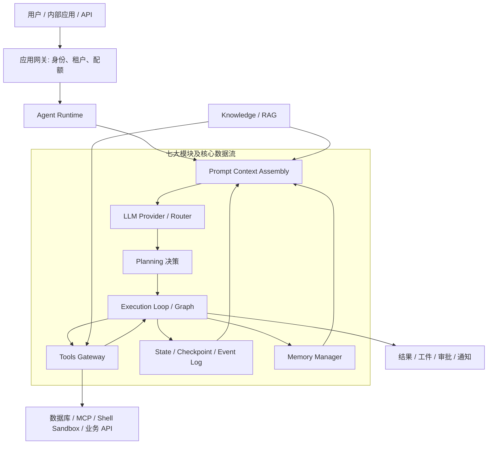

## 1.3 为什么主流系统强调 Runtime 而不是只强调七个名词

- Pi、DeepSeek Harness：强调 **LLM 调用—工具结果—继续推理的执行闭环**及会话边界。
- ZCode：进一步明确 **Turn State Machine、上下文组装、工具调度、Workflow Scheduler**。
- Codex：增加 **工具路由、权限、审批、沙箱和安全执行**。
- LangGraph：强调 **状态图、Reducer、Checkpoint、Interrupt**。
- Dify、Flowise：强调 **应用组装和可视化交付**。
- RAGFlow、WeKnora、LlamaIndex、Haystack、GraphRAG：增强 **Knowledge/RAG、检索工具与数据编排**；它们不能不加区分地与完整 Coding Agent Harness 做同类排名。

---

# 二、LLM：模型调用、路由与容错

## 2.1 模块背景

**核心问题：**模型供应商的协议、工具格式、多模态能力、可用性、价格和推理表现均不同；复杂 Agent 常含多次模型调用，直接将供应商 SDK 散落在业务代码中会形成耦合。**什么时候需要升级：**只有单一模型时直连通常足够；当企业有多模型、容灾、成本约束、租户隔离、模型评测或安全合规需求时增加抽象。

## 2.2 方案 L1：单模型直连（Baseline）

- **背景与场景：**原型、固定模型的内部工具、短时间 POC，不需要动态模型治理。
- **方案思路：**使用官方 SDK 直接传入 messages/tools，拿到文本或 tool calls，异常返回调用者。
- **优点：**抽象少、调试简单、调用链短。**缺点：**协议耦合、难切换模型、限流/成本统计零散。
- **怎么实施：**① 在一个 `ModelClient` 中封装 SDK，而不是散布到 Agent；② 为流式输出、超时、usage、ToolCall 定义返回结构；③ 记录 provider、model、traceId 和 token；④ 写超时/限流测试。
- **实施效果：**最短路径验证任务可行性；衡量单任务成功率、P95、Token 成本、限流错误。
- **方案结合：**与简单 Agent Loop + 静态 Prompt + Function Calling 组合；出现多模型需求时平滑迁移 L2。
- **主流源码：**Pi [模型定义与 Provider](https://github.com/earendil-works/pi/tree/main/packages/ai/src/providers) 说明即使轻量 Agent 也把模型调用单独分层。

## 2.3 方案 L2：Provider Adapter / 统一模型协议

- **背景与场景：**同一 Agent 需要 GPT、Claude、Qwen、DeepSeek 或私有模型；Tool Calling、流式事件、结构化输出不一致。
- **方案思路：**定义中立的 `ModelRequest`、`ModelResponse`、`ToolCall`、`Usage`、`ModelCapabilities`；每个适配器完成字段转换、流解析、错误分类、特性探测。
- **优点：**Agent 运行核心独立于模型厂商，支持测试替身；**缺点：**过度统一会遮蔽模型特色，细节不全会引起输出/工具协议错误。
- **怎么实施：**① 抽象 `generate/stream/capabilities`；② 每供应商一个 Adapter；③ 显式维护工具并行、JSON Schema、视觉、上下文上限等能力表；④ 规范化结束原因、Token、请求 ID；⑤ 进行跨模型协议契约测试；⑥ 未支持的能力在路由前拒绝，而非静默降级。
- **实施效果：**切换模型不必重写 Agent Loop；通过跨 Provider 的工具调用正确率、结构化输出通过率验证。
- **方案结合：**与 L3 Gateway、L4 Fallback、Prompt Budget Manager 结合；所有可替换 Agent 框架基本应优先使用此层。
- **主流源码：**Pi [packages/ai/src](https://github.com/earendil-works/pi/tree/main/packages/ai/src)、DeepSeek Harness [packages/llm/llm/src](https://github.com/deepseek-ai/deepseek-harness/tree/master/packages/llm/llm/src)、Dify [agent_factory.py](https://github.com/langgenius/dify/blob/main/dify-agent/src/dify_agent/runtime/agent_factory.py)。

## 2.4 方案 L3：Model Gateway / 多租户治理

- **背景与场景：**多个业务应用共享模型供应商账号，需要统一鉴权、配额、日志、模型权限和费用归属。
- **方案思路：**所有模型请求先经过内部 Gateway：模型别名解析、应用/租户限额、凭据托管、日志脱敏和使用量核算。
- **优点：**集中治理、方便更换 Provider 和成本分摊；**缺点：**引入中心依赖，网关故障影响多业务；必须正确处理隐私数据。
- **怎么实施：**① 建立 `tenant/app/user/model-policy` 数据表；② Gateway 验证租户和请求授权；③ 映射业务模型档位而非在应用写具体型号；④ 实现限流、预算和敏感日志脱敏；⑤ Trace ID 穿透模型响应；⑥ 提供用量账单和降级策略。
- **实施效果：**可按团队追踪成本、限制异常消耗；关注租户隔离、网关可用性、计费误差和额外延迟。
- **方案结合：**L2 + L3 通常是企业多应用共享模型的稳定基础；若小规模单应用不必急于引入网关。
- **主流源码：**Dify [model-manager 等相关模块](https://github.com/langgenius/dify/tree/main/api/core)、ZCode [model-provider](https://github.com/zai-org/ZCode/tree/main/packages/services/src/model-provider) 展示模型接入与提供方配置独立管理的思路。上述中心网关是**推荐实施架构**，不表示这些仓库均使用同一个独立网关部署形态。

## 2.5 方案 L4：Fallback + Retry + Circuit Breaker

- **背景与场景：**模型限流、超时、暂时性 5xx；业务不能因为一个供应商短时失效就全部失败。
- **方案思路：**先对明确可重试错误做有界指数退避；失败后在**能力兼容**的备用模型间切换；连续故障时短暂熔断。
- **优点：**提升部分故障情形下的可用性；**缺点：**备用模型可能不支持相同工具或输出格式，延迟/费用可能更高。
- **怎么实施：**① 错误分类（限流/网络/超时/参数/安全策略）；② 定义最大重试数和整个步骤的总时限；③ 模型能力矩阵筛选备份；④ 如已产生可见流式内容，明确续传/重新生成策略；⑤ 将本次 fallback 写入事件；⑥ 用故障注入测试重复工具调用不会发生。
- **实施效果：**记录故障切换成功率、任务成功率和 P95 退化；不可把所有业务或策略错误重试。
- **方案结合：**必须建立在 L2 能力适配基础上；与 State/Execution 幂等机制联动。
- **主流源码：**LangChain [model_fallback.py](https://github.com/langchain-ai/langchain/blob/master/libs/langchain_v1/langchain/agents/middleware/model_fallback.py)、[model_retry.py](https://github.com/langchain-ai/langchain/blob/master/libs/langchain_v1/langchain/agents/middleware/model_retry.py)，DeepSeek Harness [LLM retry](https://github.com/deepseek-ai/deepseek-harness/tree/master/packages/llm/llm-retry)。

## 2.6 方案 L5：任务级路由 / 多模型协作

- **背景与场景：**简单分类和复杂推理统一用高价强模型，导致成本高；视觉、代码、结构化提取又各有模型专长。
- **方案思路：**根据任务标签、能力要求、质量阈值和预算选择模型；必要时采用生成模型 + 校验模型或多个模型交叉评测。
- **优点：**有机会降低平均成本或提高特定类型任务质量；**缺点：**错误路由引入隐性质量损失，多模型校验显著增加耗时和费用。
- **怎么实施：**① 构建真实任务集并标注质量要求；② 离线对比各模型正确率/成本/延迟；③ 用规则策略作为首版路由；④ 建影子评测/灰度分流；⑤ 只在高价值场景增加第二模型审查；⑥ 定期修订路由策略。
- **实施效果：**对同一批任务比较质量、成本、P95；不得仅比较平均 Token 单价。
- **方案结合：**与模型 Gateway、Typed Output、评测体系组合；少量任务先从规则路由做起。
- **主流源码：**Pi/DeepSeek Harness 的 Provider 抽象可作为路由底座；多模型智能路由属于**上层推荐策略**，不是上述所有 Agent Loop 默认具备的特性。

## 2.7 LLM 实施总流程

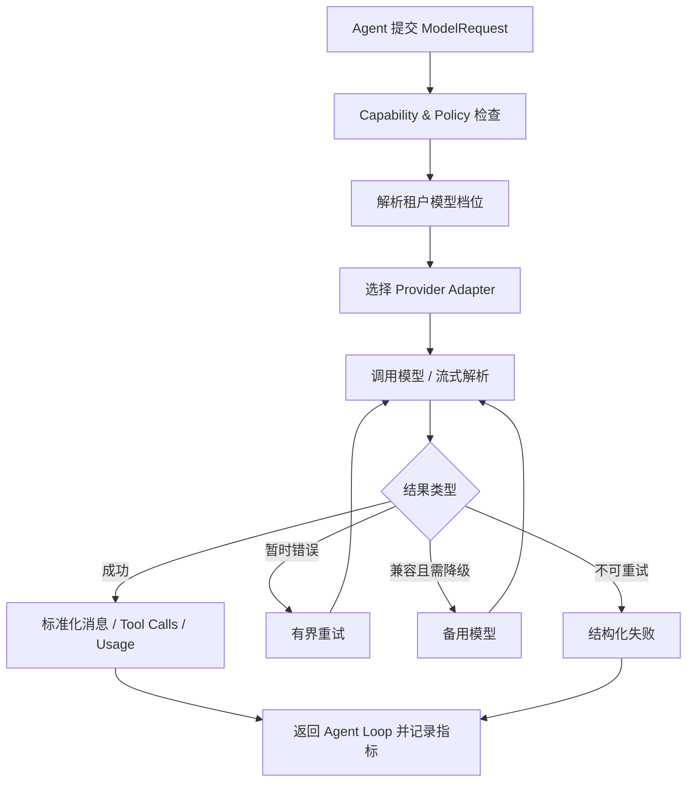

**建议先做：**L2；需要多业务治理才做 L3；稳定性要求出现后做 L4；L5 必须有评测数据支撑。

---

# 三、Prompt：提示词组装与上下文工程

## 3.1 模块背景

**核心问题：**模型每次调用只能看到有限上下文，而且系统规则、工具说明、任务目标、记忆、RAG 证据和执行状态的来源及权限不同。Prompt 不再只是写一段 System Prompt，而是**决定本轮模型看到什么、何时看到、按何种优先级组织**。

## 3.2 方案 P1：静态 System Prompt + 模板变量

- **背景与场景：**单一 Agent、简单客服、固定文本分类，业务规则变化不频繁。
- **方案思路：**给 Agent 固定角色说明、输入约束和输出要求，通过模板变量注入任务参数。
- **优点：**简单、确定性相对容易控制；**缺点：**一旦规则变多便难维护，无法应对动态知识和复杂上下文。
- **怎么实施：**① 固定 System/Developer/User 层次；② 模板变量逐个定义类型；③ 对缺失变量报错；④ 版本化 Prompt；⑤ 用标准输入集测输出稳定性。
- **实施效果：**角色行为和格式更可控；测结构化输出合格率、指令遵循率。
- **方案结合：**配 LLM Adapter、简单 Memory；不适合把大量 RAG 文件直接拼成无限长模板。
- **主流源码：**Dify [core/prompt](https://github.com/langgenius/dify/tree/main/api/core/prompt) 的模板转换模块。

## 3.3 方案 P2：分段式 Prompt Assembly / Context Builder

- **背景与场景：**Coding Agent、多个业务身份、Tools/Skills/环境信息不断变化；一份大 Prompt 难审计。
- **方案思路：**将模型上下文拆成规则、身份、环境、任务、工具、知识、记忆、状态等 Section，分别管理注入优先级、可见范围与预算。
- **优点：**可测试、可替换、可观测，组件职责明确；**缺点：**Section 冲突、优先级/Token 截断策略更复杂。
- **怎么实施：**① 定义 `ContextSection{id,source,priority,trustLevel,render}`；② 按固定顺序组装可信系统指令；③ 动态注入仅属于数据的检索内容；④ 校验变量和总预算；⑤ 输出结构化 `ContextBuildTrace` 记录来源及 Token；⑥ 对相互冲突规则做优先级测试。
- **实施效果：**能定位是哪一段导致错误；测上下文组装完整率、Token 预算达标率、指令冲突率。
- **方案结合：**P2 + P3 按需检索 + P4 Budget 通常是高级 Agent 最实用组合。
- **主流源码：**ZCode [context/builder.ts](https://github.com/zai-org/ZCode/blob/main/apps/zcode-cli/packages/core/src/context/builder.ts)、DeepSeek Harness [system-prompt](https://github.com/deepseek-ai/deepseek-harness/tree/master/packages/core/system-prompt)。

## 3.4 方案 P3：动态上下文 / RAG / Skills 渐进披露

- **背景与场景：**资料多，模型无法一次性看到所有文件、工具说明与技能；实时任务需要只看相关上下文。
- **方案思路：**根据用户问题先检索相关知识，针对任务加载特定 Skills/Tool schema；某些固定高价值上下文可以预取，其余按需查询。
- **优点：**减少无关 Token，提升相关性；**缺点：**预检索错误可能漏掉资料，工具发现可能漏选工具。
- **怎么实施：**① 意图归类与数据源范围筛选；② 关键词 + 向量 + 权限过滤检索；③ 引用来源、时间和可信度元信息一起注入；④ 工具/Skills 先注入简述，需要时展开详细内容；⑤ 缺证据时允许再检索；⑥ 记录检索命中与最终答案引用。
- **实施效果：**关注命中率、证据覆盖率、引用准确率、Token 消耗；不能保证“检索多就一定更准”。
- **方案结合：**Knowledge/RAG 服务 + P2 + Memory Retrieval；高频问题可缓存权威检索结果，但要有失效规则。
- **主流源码：**Dify Agent V2 [knowledge/layer.py](https://github.com/langgenius/dify/blob/main/dify-agent/src/dify_agent/layers/knowledge/layer.py) 区分进入上下文前的检索与模型主动调用 `knowledge_base_search`；ZCode 的 [skills Section](https://github.com/zai-org/ZCode/tree/main/apps/zcode-cli/packages/core/src/context/sections)。

## 3.5 方案 P4：Token Budget + Compaction + 历史结果裁剪

- **背景与场景：**长会话、终端输出过长、大量工具结果使模型上下文溢出。
- **方案思路：**每个上下文来源占用预算；必要时摘要旧历史、裁剪重复工具输出或保留文件引用，只注入需要的信息。
- **优点：**降低上下文溢出风险，避免无意义长上下文；**缺点：**压缩可能丢失隐含约束，错误截断会破坏工具调用对。
- **怎么实施：**① 根据模型能力得到 context window；② 预留响应和工具 Schema Token；③ 优先保留强制规则、当前任务和最近工具关联；④ 旧历史做摘要并保留可回溯的原日志；⑤ 大工具结果转 artifact id 和可查询摘要；⑥ 对截断后的对话做完整性校验。
- **实施效果：**测上下文溢出率、保留关键约束率、每任务平均 Token；不能只追求更短输入。
- **方案结合：**P2 + Memory Summary + Event Log；长期检索和运行状态必须分开保存。
- **主流源码：**Pi [compaction.ts](https://github.com/earendil-works/pi/blob/main/packages/coding-agent/src/core/compaction/compaction.ts)、ZCode [compact/policy.ts](https://github.com/zai-org/ZCode/blob/main/apps/zcode-cli/packages/core/src/compact/policy.ts)、Dify [runtime/compaction.py](https://github.com/langgenius/dify/blob/main/dify-agent/src/dify_agent/runtime/compaction.py)。

## 3.6 方案 P5：Typed Output / Schema-first Prompt / Prompt 版本治理

- **背景与场景：**Agent 输出将由程序执行，例如 Text-to-SQL、数据分析参数、审批表单、任务计划。
- **方案思路：**将输出字段与类型变为外部 Schema；模型生成只是候选结果，宿主用验证器确认可用，再决定执行与否。
- **优点：**减少解析歧义、利于可靠工具编排；**缺点：**模型有时无法满足复杂 Schema，需错误恢复与格式修复。
- **怎么实施：**① 为每个任务定义 Zod/Pydantic Schema；② 优先使用模型原生结构化输出；③ 对结果做类型、业务、权限三层校验；④ 不合规进行有界修复而非无限重试；⑤ Prompt 与 Schema 一起版本化；⑥ 回放样本评测升级版本。
- **实施效果：**测 Schema 通过率、业务有效率、修复成功率、回归不通过数。
- **方案结合：**用于 Planning 的 DAG 输出、Tool Calling 的参数以及报告 JSON 结构；权限安全仍由业务服务负责。
- **主流源码：**LangChain [structured_output.py](https://github.com/langchain-ai/langchain/blob/master/libs/langchain_v1/langchain/agents/structured_output.py)、Dify Agent V2 [output_type_checker.py](https://github.com/langgenius/dify/blob/main/api/core/workflow/nodes/agent_v2/output_type_checker.py)。

## 3.7 Prompt 实施流程图

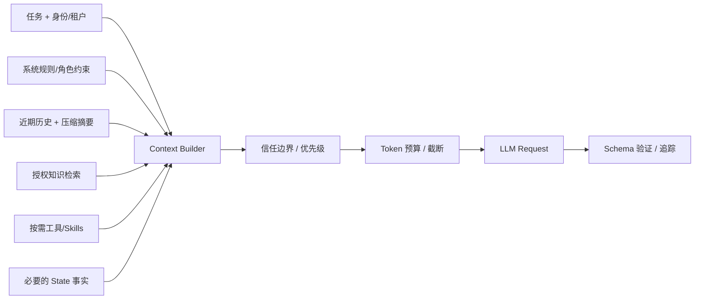

**实施要点：**RAG 和网页内容只能作为引用数据，不应升级为可覆盖系统策略的指令；`ContextBuildTrace` 是排查 Prompt 问题的重要工件。

---
# 四、Memory：记忆的写入、压缩、检索与治理

## 4.1 模块背景

**核心问题：**Agent 需要跨轮保持约束、跨会话记住决策，又受模型上下文窗口限制。原始对话、长期偏好、可复用操作经验、企业权威知识是不同性质的数据。**什么时候需要：**单轮回答不必设计长期记忆；多轮任务需会话记忆；跨会话长期助手需记忆提取、冲突检测、有效期和检索。

## 4.2 方案 M1：Full History / Window / Token Buffer

- **背景与场景：**用户连续追问、简单客服；历史不会无限增长或只需最近上下文。
- **方案思路：**存储完整聊天历史用于审计，模型输入时只取最近 N 轮或最多 K Token 的会话片段；Full History 仅在预算允许时整体注入。
- **优点：**实现极简，无额外摘要模型成本；**缺点：**早期重要约束可能被窗口挤出，上下文成本持续增长。
- **怎么实施：**① 对话数据库保存 `conversationId/turnId/role/content/time`；② 取历史时按 Token 而非只按条数裁剪；③ 保留 system 和工具调用/响应完整配对；④ 增加查询权限、历史删除及会话过期策略；⑤ 统计上下文长度。
- **实施效果：**能满足短周期多轮；测早期约束遗忘率、平均输入 Token、上下文溢出率。
- **方案结合：**M1 + P1 静态 Prompt 是最小系统；长期会话再引入 M2。
- **主流源码：**Dify [token_buffer_memory.py](https://github.com/langgenius/dify/blob/main/api/core/memory/token_buffer_memory.py)、Flowise [Buffer/Window Memory](https://github.com/FlowiseAI/Flowise/tree/main/packages/components/nodes/memory)。

## 4.3 方案 M2：Summary / Compaction（旧历史摘要与渐进压缩）

- **背景与场景：**Coding Agent 和长对话中工具结果、文件输出过多；全部放入上下文会超额。
- **方案思路：**保留最近消息作为高保真上下文，对旧消息按安全边界摘要；将当前目标、未完成任务、修改文件、关键错误、重要约束写入摘要；保留可回溯原历史。
- **优点：**控制 Token，长任务能连续执行；**缺点：**抽象摘要可能漏掉前提，重复总结存在信息漂移。
- **怎么实施：**① 根据模型窗口和剩余预算决定触发阈值；② 将对话切成可压缩旧段和保留新段；③ 摘要模板要求包含关键约束、决定、工件引用与未决事项；④ 保留原始事件/消息；⑤ 摘要写入 Session State；⑥ 溢出后有界重试，不无限递归压缩；⑦ 测试摘要后续任务的一致性。
- **实施效果：**降低溢出与反复重放长历史的概率；测摘要保真度、后续任务成功率、Token 花费。
- **方案结合：**与 P4 Token Budget、S4 Checkpoint、E3 长任务结合；摘要不等于永久事实记忆。
- **主流源码：**Pi [compaction](https://github.com/earendil-works/pi/blob/main/packages/coding-agent/src/core/compaction/compaction.ts)、WeKnora [compaction](https://github.com/Tencent/WeKnora/tree/main/internal/agent/compaction)、Dify Agent [compaction](https://github.com/langgenius/dify/blob/main/dify-agent/src/dify_agent/runtime/compaction.py)。

## 4.4 方案 M3：Episodic Memory（任务事件/项目决策记忆）

- **背景与场景：**Agent 下次要记得“上次做了什么、为什么这样做、哪里失败”，例如研发 Agent、团队项目助手。
- **方案思路：**将完成任务、关键决策、故障处理和用户纠正保存为带来源的情景事件；召回时结合任务/项目 ID、时间和相似度过滤。
- **优点：**跨会话延续项目背景、支持决策回顾；**缺点：**提取噪声大、容易把未经证实的推断记为事实。
- **怎么实施：**① 定义 `memoryEvent{id,tenant,project,type,statement,sourceTurn,createdAt,confidence}`；② 仅从明确发生的事件/用户确认内容提取；③ 去重、关联原始会话；④ 按项目、用户、权限检索；⑤ 重要记忆允许用户纠错/撤销；⑥ 未验证内容标记来源或置信度。
- **实施效果：**减少相同项目背景重复输入；测跨会话任务接续正确率、事实来源可追溯率、误记率。
- **方案结合：**M1/M2 提供原历史，M3 提取事件；与长期项目 State 关联，但不把 State 快照作为语义记忆。
- **主流源码：**ZCode [memory/extraction.ts、origin-session.ts](https://github.com/zai-org/ZCode/tree/main/apps/zcode-cli/packages/core/src/memory) 展现记忆抽取与来源管理的实现分层；此处字段设计为**推荐实施**。

## 4.5 方案 M4：Semantic Memory（事实、偏好、长期记忆检索）

- **背景与场景：**个人助手和企业知识协作需要跨多次会话复用稳定信息，例如用户偏好、项目技术方案，而不是每轮重复询问。
- **方案思路：**提取“可持续复用的事实”，结构化保存，结合元数据过滤和关键词/语义检索；记忆检索结果有生命周期和来源。
- **优点：**跨会话个性化、减少重复交代；**缺点：**记忆过期或冲突会污染决策，自动保存也有隐私风险。
- **怎么实施：**① 设计 `subject/predicate/value/source/version/validFrom/validTo`；② 建立写入门槛：明确性、重要性、隐私策略；③ 保存原文和结构化值，可选生成 embedding；④ query 时按租户、用户、项目过滤，再按语义/关键词召回；⑤ 时间衰减/权威级别排序；⑥ 冲突时优先经过确认的较新事实；⑦ 支持查阅、更正、过期和删除。
- **实施效果：**测正确记忆召回率、过期事实误命中率、删除生效范围、用户确认次数。
- **方案结合：**M4 + RAG 不混库无条件混搜；权威企业文档优先由 Knowledge Service 给出处，不让个人推断覆盖组织事实。
- **主流源码：**ZCode [memory/recall](https://github.com/zai-org/ZCode/tree/main/apps/zcode-cli/packages/core/src/memory/recall)、Flowise [Mem0/Zep 接入](https://github.com/FlowiseAI/Flowise/tree/main/packages/components/nodes/memory)。

## 4.6 方案 M5：Procedural Memory / Skills（可复用做事方法）

- **背景与场景：**Agent 重复同类项目操作，需要稳定遵守组织 SOP、工程规范和工具用法。
- **方案思路：**将“操作步骤和约束”保存为受版本控制的 Skill/规范文件，按任务激活；不同于记录个人事实的 Semantic Memory。
- **优点：**重复任务更一致，知识可审核和共享；**缺点：**文档/工具版本变化时操作过程易失效，动态更新需审批。
- **怎么实施：**① 为 SOP 建立 `name/version/owner/applicability/permissions`；② 对步骤提供示例、输入输出和错误处理；③ 项目或任务选择相关 Skill；④ 采用按需加载、必要时展开详情；⑤ 测版本升级后回归；⑥ 高权限步骤始终经过工具权限层。
- **实施效果：**测标准作业通过率、工具错误率、规范偏离率。
- **方案结合：**P3 Progressive Disclosure + T2 Tool Registry + 项目长期记忆；Skill 不能替代宿主侧安全策略。
- **主流源码：**ZCode [context/sections/skills.ts](https://github.com/zai-org/ZCode/tree/main/apps/zcode-cli/packages/core/src/context/sections)、Pi [skills.ts](https://github.com/earendil-works/pi/blob/main/packages/coding-agent/src/core/skills.ts)。

## 4.7 方案 M6：Tree / Hierarchical Memory + Memory Agent

- **背景与场景：**长生命周期项目存在多个会话分支、几十项任务，既要快速恢复概览，也要回溯详细证据。
- **方案思路：**原始事件永久/按策略保留，摘要按会话、任务、项目分层；可在历史节点创建新分支。后台 Memory Agent 可以候选提取、合并、去重记忆，但不能绕开权限和审批。
- **优点：**能在不同粒度查找历史并支持探索式分叉；**缺点：**分支一致性、跨摘要合并和维护成本高。
- **怎么实施：**① 会话项保存 `id,parentId,sessionId`；② 当前分支单独形成模型上下文；③ 建立会话摘要→任务摘要→项目摘要索引；④ 用户可选择恢复历史分支；⑤ 记忆提取 Agent 输出候选，经过校验才入正式记忆；⑥ 定期过期/合并处理。
- **实施效果：**测跨任务定位成功率、分支恢复正确性、摘要一致性。
- **方案结合：**M2 + M3 + M4 + S5 Event Log；普通聊天业务不要一开始采用复杂树形状态。
- **主流源码：**Pi [session-manager.ts](https://github.com/earendil-works/pi/blob/main/packages/coding-agent/src/core/session-manager.ts)、ZCode [memory-agent-loop.ts](https://github.com/zai-org/ZCode/blob/main/apps/zcode-cli/packages/core/src/memory/memory-agent-loop.ts)。

## 4.8 Memory 生命周期与实施顺序

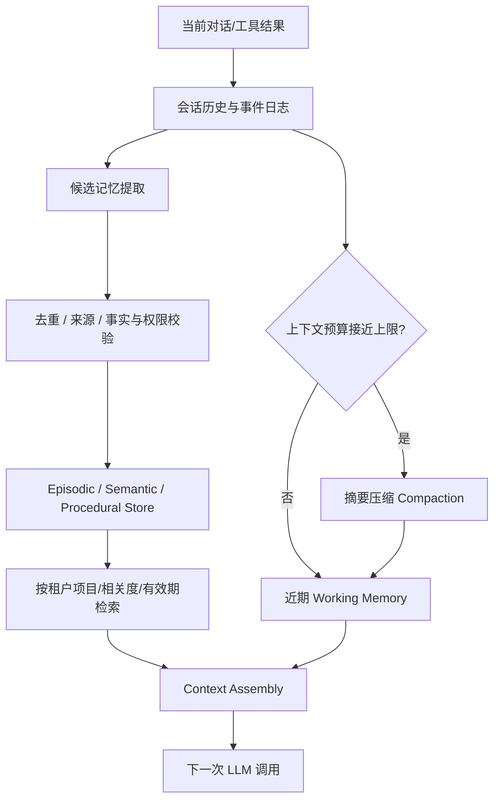

**落地顺序：**M1 → M2 →（跨会话价值明确才做）M3/M4 →（重复执行模式充分积累后做）M5/M6。必须同时提供记忆更正、删除、过期和权限隔离。

---

# 五、Tools：工具发现、授权与安全执行

## 5.1 模块背景

**核心问题：**模型输出的是“请求调用某工具的参数”，并非动作真正成功；企业工具可能读取隐私、修改数据、发送消息或执行命令。要避免错误参数、越权、无限重试、并发冲突以及超长输出污染上下文。

## 5.2 方案 T1：Function Calling + Typed Tool Contract

- **背景与场景：**只有少量内部函数/HTTP API，模型需要能查订单、生成报表、调用业务数据服务。
- **方案思路：**把每个工具注册为 `name/description/JSON Schema`，LLM 生成工具调用，宿主验证后执行，再把结果作为 Tool Message 回传。
- **优点：**简单、生态成熟；**缺点：**工具数量大时 Prompt 膨胀，模型可能误选或生成错误参数。
- **怎么实施：**① 定义 Zod/Pydantic Schema；② `ToolRegistry.register` 并标注服务端 permission；③ 模型返回 `tool_call` 后做 Schema 校验；④ 绑定服务端真实用户/租户身份；⑤ 超时执行并返回规范化结果；⑥ 记录 `callId/traceId/status`。
- **实施效果：**工具选择、参数格式和业务结果可自动测试；统计参数失败、重试与成功率。
- **方案结合：**配合 P5 结构化输出、E1 Agent Loop；用工具执行权限阻止越权，不能依赖 Prompt。
- **主流源码：**Pi [agent-loop.ts](https://github.com/earendil-works/pi/blob/main/packages/agent/src/agent-loop.ts)、LlamaIndex [function_agent.py](https://github.com/run-llama/llama_index/blob/main/llama-index-core/llama_index/core/agent/workflow/function_agent.py)。

## 5.3 方案 T2：Tool Registry + Dynamic Discovery / Tool Retrieval

- **背景与场景：**有数百个工具、不同应用授权各异，完整工具清单会超出上下文并降低模型选择质量。
- **方案思路：**服务端维护工具目录（描述、输入 Schema、风险等级、租户范围）；按任务和权限查询候选工具；只对模型暴露必要的工具。
- **优点：**上下文更小、治理集中；**缺点：**检索错误会造成工具漏选，动态变更须保持可恢复性。
- **怎么实施：**① 建工具元数据库和命名空间；② 每次运行以租户/角色/应用白名单过滤；③ 再做关键词+语义召回；④ 对工具 Schema 进行版本锁定；⑤ 回传工具调用时依服务器目录重新校验；⑥ 配缺失工具反馈与重试发现策略。
- **实施效果：**测工具召回率、误选率、工具 Schema Token、未授权暴露数量。
- **方案结合：**T1 + T2 + T4 Policy；少量工具时直供即可，避免过度工程。
- **主流源码：**Codex [tools/router.rs](https://github.com/openai/codex/blob/main/codex-rs/core/src/tools/router.rs)、[tools/registry.rs](https://github.com/openai/codex/blob/main/codex-rs/core/src/tools/registry.rs) 含工具可见性与路由抽象；ZCode [tool/registry.ts](https://github.com/zai-org/ZCode/blob/main/apps/zcode-cli/packages/core/src/tool/registry.ts)。

## 5.4 方案 T3：MCP / OpenAPI Connector / 业务 Tool Gateway

- **背景与场景：**需要接入飞书、钉钉、企业微信、CRM、数据库和外部 SaaS，不应每个 Agent 重写不同的调用层。
- **方案思路：**MCP Client 调用 MCP Server 暴露的标准工具/资源；现有 HTTP 服务可由内部 Tool Adapter 包装；在 Gateway 侧管理凭据与工具权限。
- **优点：**工具解耦、集成扩展容易；**缺点：**MCP 协议本身不替企业完成用户授权、租户隔离和业务审计；第三方工具质量不一。
- **怎么实施：**① 将读写工具分离；② MCP Server/HTTP Adapter 注册能力；③ Gateway 维护用户授权凭据和工具白名单；④ 对入参、响应做 Schema 和内容边界校验；⑤ 连接超时和熔断；⑥ 每次调用传递 traceId，敏感信息只在服务端处理；⑦ 工具变更按版本发布。
- **实施效果：**缩短新增系统接入工作量；测工具接入时间、授权失败、调用链覆盖率、越权拦截。
- **方案结合：**T2 Registry + T4 Policy + E3 Durable Tool Execution；外部文件下载应经过安全扫描。
- **主流源码：**WeKnora [MCP Tool](https://github.com/Tencent/WeKnora/tree/main/internal/agent/tools)、Dify [MCP/Tools](https://github.com/langgenius/dify/tree/main/api/core)、Flowise [custom MCP servers](https://github.com/FlowiseAI/Flowise/tree/main/packages/server/src/services/custom-mcp-servers)。

## 5.5 方案 T4：Policy Engine + Approval / HITL + Sandboxing

- **背景与场景：**工具具有删除、写库、发布、付款、系统命令等副作用；模型会犯错，必须有实际的安全边界。
- **方案思路：**先验证用户/租户资源权限和操作风险，再决定拒绝、直接执行还是暂停等待审批；终端、浏览器、代码在隔离沙箱中运行。
- **优点：**限制风险、便于审计；**缺点：**审批增加等待时间，沙箱部署和文件访问控制复杂。
- **怎么实施：**① 工具标注 `read/write/delete/external-send` 与资源权限；② 后端 RBAC/ABAC 判断，不信任模型提供的 userId；③ 高风险生成 Approval Request 并持久化；④ 审批结果关联当前 runId、toolCallId 和参数哈希；⑤ 在沙箱中设定文件/网络/CPU/内存限制；⑥ 审批通过后仅执行原已确认的参数；⑦ 全流程留审计日志。
- **实施效果：**验收未授权工具无法执行；审计每次副作用归属，测审批耗时和沙箱逃逸测试覆盖率。
- **方案结合：**T4 + S4 Checkpoint + E4 Human Interrupt；用户确认前任务不能靠重复 Tool Call 绕过审批。
- **主流源码：**Codex [approvals.rs](https://github.com/openai/codex/blob/main/codex-rs/core/src/tools/approvals.rs)、[sandboxing.rs](https://github.com/openai/codex/blob/main/codex-rs/core/src/tools/sandboxing.rs)；WeKnora [approval/gate.go](https://github.com/Tencent/WeKnora/blob/main/internal/agent/approval/gate.go)；LangChain [human_in_the_loop.py](https://github.com/langchain-ai/langchain/blob/master/libs/langchain_v1/langchain/agents/middleware/human_in_the_loop.py)。

## 5.6 方案 T5：并行调度 / 独占写 / 幂等 / 工具结果治理

- **背景与场景：**模型一次提出多个查询，可并行提高吞吐；但多个修改同一文件或数据库记录的动作可能冲突，失败重试可能重复发送消息。
- **方案思路：**工具声明并行安全性，有界并发执行无冲突调用；对写操作建立独占/资源锁；副作用依赖业务幂等键；大结果只回传摘要与文件引用。
- **优点：**并行读提升效率，副作用更可控；**缺点：**锁、事务边界和取消后结果归集更复杂。
- **怎么实施：**① Tool Spec 标注 `effect/parallelSafe/idempotent`；② 独立读允许并发，资源冲突操作串行；③ 调度器有最大并发、AbortSignal、超时；④ 使用 `runId:toolCallId` 等稳定业务幂等键；⑤ 结果按预期顺序提交，未执行调用补齐取消状态；⑥ 巨型结果写对象存储，返回摘要 + ArtifactRef。
- **实施效果：**测任务总时长、工具成功率、并发冲突、重复副作用、上下文占用。
- **方案结合：**E2 Executor Scheduler + S5 Event Log；对外发消息等操作不能在不知道第一次是否成功时盲目重试。
- **主流源码：**DeepSeek Harness [tool-calls.ts](https://github.com/deepseek-ai/deepseek-harness/blob/master/packages/core/agent-loop/src/tool-calls.ts) 展示有界并发池、独占执行屏障、模型调用顺序回写和取消结果。

## 5.7 方案 T6：Workflow as Tool / Agent as Tool / Code Sandbox

- **背景与场景：**复杂业务流程、文档生成、数据分析或其他专用 Agent 的能力需要复用，而不应在一个大 Agent 中重复实现。
- **方案思路：**将可靠的确定性 Workflow 封装为单一 Tool；专用 Agent 提供清晰输入输出契约；代码执行则放在有边界的解释器/终端沙箱中。
- **优点：**模块复用、缩小主 Agent 负担；**缺点：**多层调用增加成本与调试难度，嵌套流程难管理取消及授权。
- **怎么实施：**① 把 `analyzeWorkbook/generateDocument` 等稳定流程封装为工具；② 标注耗时、返回 artifactId；③ 子 Agent 只访问必要工具和数据源；④ 子流程传播 traceId、budget、deadline；⑤ 返回精简结构化结果；⑥ Sandbox 仅开放授权目录和网络目标。
- **实施效果：**测流程复用比例、失败定位时间、嵌套调用次数和成本。
- **方案结合：**T6 + Planning 的 Supervisor；不把每个 API 都包装为一个 Agent，优先普通 Tool。
- **主流源码：**LlamaIndex [multi_agent_workflow.py](https://github.com/run-llama/llama_index/blob/main/llama-index-core/llama_index/core/agent/workflow/multi_agent_workflow.py)、Codex [tools/handlers](https://github.com/openai/codex/tree/main/codex-rs/core/src/tools/handlers)、Flowise [Agentflow nodes](https://github.com/FlowiseAI/Flowise/tree/main/packages/components/nodes/agentflow)。

## 5.8 Tools 执行流程图

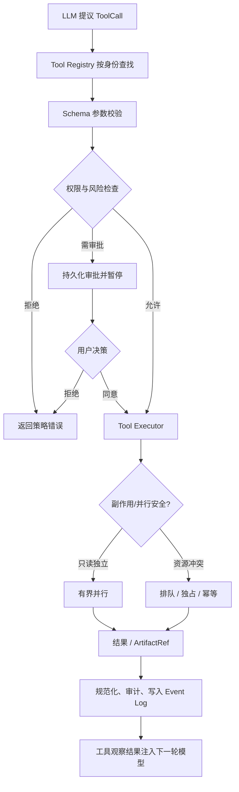

**实施顺序：**T1 → T4（最小安全约束必须从一开始有）→ T3 → T5 → T2/T6；不要把 MCP 当成权限控制或让模型决定资源访问权限。

---
# 六、Planning：任务规划、重规划与多 Agent

## 6.1 模块背景

**核心问题：**用户描述目标而非可执行步骤；任务存在依赖关系，工具结果也可能改变下一步决策。规划必须处理**灵活探索 vs 确定性业务流程**之间的平衡。**什么时候需要：**一次查询不需要 Planner；未知探索用 ReAct；跨多个系统且存在固定顺序用 Workflow；长期多步骤目标才需要外置任务计划和重规划。

## 6.2 方案 PL1：ReAct（模型按观察结果决定下一步）

- **背景与场景：**代码排错、动态检索、知识探索，事先不知道需要查几次、使用什么工具。
- **方案思路：**每轮 LLM 依据当前消息/工具结果，决定调用工具还是输出答案；工具反馈进入下一次决策。它既是轻量规划方式，也依赖 Execution 的循环执行。
- **优点：**适应未知情况、工程门槛低；**缺点：**步骤数不稳定、可能无效循环、难保证成本上界和正确结束。
- **怎么实施：**① 让模型收到明确任务、允许工具与终止条件；② 一轮模型输出若有 ToolCall 则执行；③ 结果回写模型上下文和事件；④ 逐轮检查 `maxSteps/maxTokens/deadline`；⑤ 根据业务结果校验完成，不只相信自述“完成了”；⑥ 限制重复调用、允许反馈证据不足。
- **实施效果：**测任务完成率、每任务工具调用数、重复调用比例、预算超限率。
- **方案结合：**PL1 + E1 Agent Loop + T1 Tool Calling + P4 Context Budget；企业重要写操作必须配权限/审批。
- **主流源码：**DeepSeek Harness [agent-loop/agent.ts](https://github.com/deepseek-ai/deepseek-harness/blob/master/packages/core/agent-loop/src/agent.ts)、Pi [agent-loop.ts](https://github.com/earendil-works/pi/blob/main/packages/agent/src/agent-loop.ts)、WeKnora [agent/engine.go](https://github.com/Tencent/WeKnora/blob/main/internal/agent/engine.go)、RAGFlow [agentic_rag/agent.go](https://github.com/infiniflow/ragflow/blob/main/internal/agentic_rag/agent.go)。

## 6.3 方案 PL2：Plan-and-Execute（显式计划）

- **背景与场景：**报告生成、项目开发、跨多个数据源的复杂分析；需要展示完成进度与后续步骤。
- **方案思路：**Planner 将目标拆成 `Task{id,description,dependencies,acceptanceCriteria}`；Executor 按计划执行，必要时子任务用 ReAct；每一步完成后记录实际结果。
- **优点：**过程可视化、阶段验收、便于并行和审计；**缺点：**初始计划可能错误，额外增加一次规划模型调用。
- **怎么实施：**① 定义有类型任务 Schema；② Planner 输出任务列表和依赖；③ 验证必须存在可执行节点、无循环依赖、任务数/耗时有上限；④ 对每个子任务分配工具白名单；⑤ Executor 执行并存结果引用；⑥ 对步骤运行验收函数，失败时回退或交由 PL3 修订。
- **实施效果：**测计划可执行率、任务整体完成率、超时及计划偏离次数。
- **方案结合：**PL2 + E2 Graph Runtime + S2 Shared State；具备可重复业务规则时可将固定步骤固化为 PL4 Workflow。
- **主流源码：**ZCode [workflow/definition.ts](https://github.com/zai-org/ZCode/blob/main/apps/zcode-cli/packages/core/src/workflow/definition.ts)、[scheduler.ts](https://github.com/zai-org/ZCode/blob/main/apps/zcode-cli/packages/core/src/workflow/scheduler.ts) 体现任务图和调度的分离。

## 6.4 方案 PL3：Replanning / Reflection / Critic

- **背景与场景：**执行中发现原计划不可行、资料缺失、API 返回意外结构；高价值报告需要质量复核。
- **方案思路：**基于当前完成情况、证据和错误，重建剩余任务计划；可加入独立 Critic 对结果结构、引用和业务校验进行复核。
- **优点：**可以绕开不可行步骤、提高某些复杂任务的鲁棒性；**缺点：**容易因反复评估导致高成本或循环，Critic 不一定比原模型正确。
- **怎么实施：**① 设定可触发重规划的明确事件（阻塞、失败、证据不足）；② Planner 只能修改未完成步骤，保留已产生的事实和副作用；③ 限定重规划次数；④ 维护 `planVersion`；⑤ Reviewer 先做可确定的程序化校验，再考虑模型复核；⑥ 结果不合格时仅重做相关子任务。
- **实施效果：**测重规划后完成率、总 Token、无效重规划比例、报告质量改善；需和不重规划基线对比。
- **方案结合：**PL2 + PL3 适合研究/编码任务；固定审批链路不应允许模型修改必须执行的审批节点。
- **主流源码：**LangGraph [StateGraph](https://github.com/langchain-ai/langgraph/blob/main/libs/langgraph/langgraph/graph/state.py) 支持构建循环/条件控制的运行图；重规划策略属于**应用设计**，不代表每个 LangGraph 图自动提供通用 Planner。

## 6.5 方案 PL4：确定性 DAG / Workflow（流程优先）

- **背景与场景：**表单处理、审批、报表导出、数据清洗、定时操作；对业务顺序、审计和重复执行要求严格。
- **方案思路：**预定义节点、依赖、分支条件及重试策略；只在信息理解/文本分析等局部节点调用 Agent。
- **优点：**高可控、容易版本化和测试、便于最小权限；**缺点：**流程修改需发布，未知任务适应性不如 ReAct。
- **怎么实施：**① 将业务拆成 Start/LLM/Tool/Condition/Human/Output 节点；② 设计每个节点输入、输出、错误和超时；③ 按 DAG 拓扑调度就绪节点；④ 节点完成后持久化状态；⑤ 高风险节点按规则审批；⑥ 设置 Workflow 版本和迁移策略；⑦ 给每条分支建立测试样本。
- **实施效果：**测流程成功率、节点故障率、分支测试覆盖率、可恢复率和审计完整度。
- **方案结合：**PL4 + 局部 PL1 + E2 + S4 是多数企业稳定流程的优选。不要让模型决定必须遵守的监管/审批顺序。
- **主流源码：**LangGraph [graph/state.py](https://github.com/langchain-ai/langgraph/blob/main/libs/langgraph/langgraph/graph/state.py)、Flowise [Agentflow 节点](https://github.com/FlowiseAI/Flowise/tree/main/packages/components/nodes/agentflow)、Dify [workflow/nodes](https://github.com/langgenius/dify/tree/main/api/core/workflow/nodes)。

## 6.6 方案 PL5：Dynamic DAG / 并行规划与依赖调度

- **背景与场景：**大型软件研发、运营调查、批量资料分析：任务结构随用户目标变化，部分子任务互不依赖。
- **方案思路：**Planner 生成有依赖关系的图；调度器找出所有 ready 节点并有界并行执行，阻塞节点等待上游完成。
- **优点：**能利用子任务并行，加速多工作流；**缺点：**动态依赖错了会出现死锁、数据竞争、错误资源使用。
- **怎么实施：**① Planner 返回带 ID、依赖、输出契约的任务图；② 图验证器检查循环、不可达节点、权限和任务数；③ 调度器按依赖解锁；④ 限定最大并发数和资源锁；⑤ 子任务结果保存在共享 State 中，不直接把完整输出拼回主 Prompt；⑥ 节点完成、失败、取消均发事件；⑦ 支持图版本化和重规划差异审计。
- **实施效果：**测并行效率、总耗时、资源冲突、图验证失败率、失败后重试正确率。
- **方案结合：**PL2/PL3 + E2 Scheduler + S2 Shared Typed State；只要两步互不独立，就不应为了并行而并行。
- **主流源码：**ZCode [workflow/scheduler.ts](https://github.com/zai-org/ZCode/blob/main/apps/zcode-cli/packages/core/src/workflow/scheduler.ts) 使用就绪/阻塞节点和并发约束；RAGFlow [workflowx/parallel.go](https://github.com/infiniflow/ragflow/blob/main/internal/agent/workflowx/parallel.go)。

## 6.7 方案 PL6：Multi-Agent Supervisor / Handoff / Parallel Experts

- **背景与场景：**任务需要多个专业角色：产品、设计、研发、测试或知识、数据、文档代理，各自拥有不同工具和专属知识。
- **方案思路：**Supervisor 规划并分配任务；Worker Agent 具有独立 Prompt、工具权限和私有工作上下文；通过共享的结构化工件、状态或 Handoff 传递任务。
- **优点：**职责清晰、易做角色级质量控制；**缺点：**消息开销、协调与责任归属复杂，多 Agent 不天然优于一个 Agent。
- **怎么实施：**① 明确角色是否真有不同工具/知识/验收标准；② 定义 Worker 输入输出 Schema 和权限白名单；③ Supervisor 分解且控制最大并发；④ Agent 之间只传必要摘要和 artifactId；⑤ 设定 Handoff 可去向和回退策略；⑥ 汇总结果后对整体任务做验收；⑦ 记录所有子 run 的 trace 关系。
- **实施效果：**和单 Agent 基线比较完成率、Token、延迟、工具重复调用和协调错误；没增益可退回单 Agent。
- **方案结合：**PL6 + PL4（固定协作流程）或 PL5（动态协作）+ S2 Typed State + T6 Agent as Tool。
- **主流源码：**LlamaIndex [multi_agent_workflow.py](https://github.com/run-llama/llama_index/blob/main/llama-index-core/llama_index/core/agent/workflow/multi_agent_workflow.py) 的 Handoff；AutoGen [BaseGroupChat](https://github.com/microsoft/autogen/blob/main/python/packages/autogen-agentchat/src/autogen_agentchat/teams/_group_chat/_base_group_chat.py)；CrewAI [Flow](https://github.com/crewAIInc/crewAI/blob/main/lib/crewai/src/crewai/flow/flow.py)。

## 6.8 Planning 执行图和推荐规则

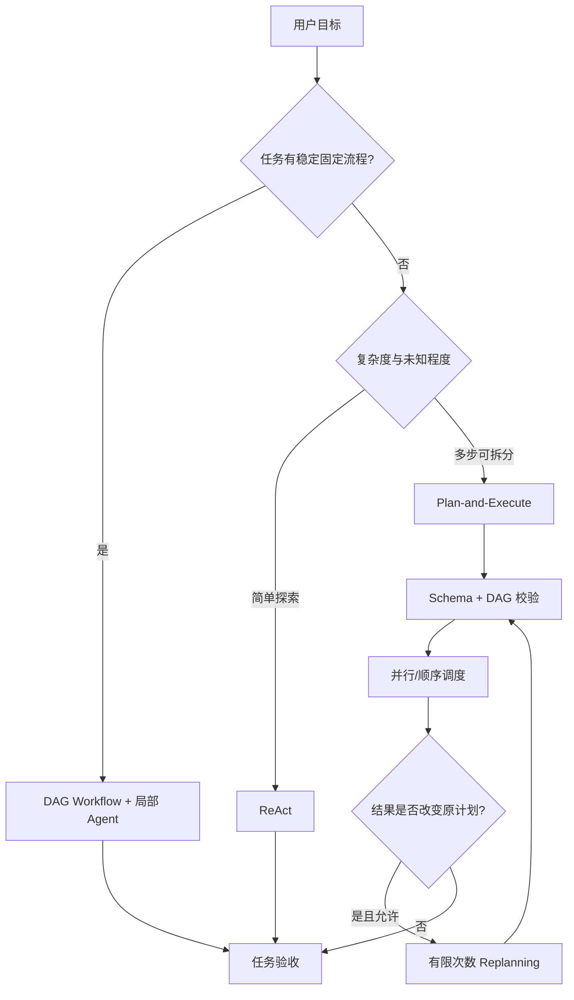

**主流组合原则：**从 PL1 或 PL4 开始；业务流程稳定优先 PL4；只有需要动态规划时才用 PL2/PL3；明确专业分工时才引入 PL6。

---

# 七、Execution：循环执行、图调度、任务恢复

## 7.1 模块背景

**核心问题：**Planning 产生的步骤如何运行？模型如何连续做多个决策？工具调用怎样取消、重试、暂停？服务崩溃后能否继续？Execution 不仅是 `while` 循环，还涉及**运行生命周期、并行、安全边界、持久化和故障恢复语义**。

## 7.2 方案 E1：单进程 Agent Loop（最小执行器）

- **背景与场景：**短时问答、Coding Agent 原型、少量工具的交互任务。
- **方案思路：**启动一轮 → 调用模型 → 识别 ToolCalls → 校验执行 → 把 Observation 写入消息 → 继续，直到模型结束或受限退出。
- **优点：**结构直观、易测试和扩展；**缺点：**长任务进程崩溃易丢失，取消和中断后处理要额外设计。
- **怎么实施：**① 实现 `runTurn`，把 Session、Context Builder、LLM、ToolExecutor 解耦；② 每一步前后记录 step/turn；③ 有统一成功/失败/取消状态；④ 使用 AbortSignal；⑤ 限制最大步骤/Token/时间；⑥ 对工具结果规范化；⑦ 单元测试无工具、单工具、多工具、失败、取消和结束。
- **实施效果：**可完成受控工具循环；测完成率、最大步数违规、取消响应、重复工具调用率。
- **方案结合：**E1 + L2 + P2 + M1 + T1 + S1；生产写操作从第一天就需 T4 Policy。
- **主流源码：**Pi [agent-loop.ts](https://github.com/earendil-works/pi/blob/main/packages/agent/src/agent-loop.ts)、DeepSeek Harness [agent.ts](https://github.com/deepseek-ai/deepseek-harness/blob/master/packages/core/agent-loop/src/agent.ts)。

## 7.3 方案 E2：Graph Runtime / Event-driven Execution

- **背景与场景：**一个任务需要并行查询、条件分支、人工审批、循环和多个 Agent；纯 while 循环渐渐难以维护。
- **方案思路：**用 Graph 定义节点及边，每个节点读 State、产出状态更新；执行器驱动就绪节点，事件流向 UI/监控推送进展。
- **优点：**流程可视、节点可单测、状态更新可控；**缺点：**状态合并、并发一致性和边界异常复杂。
- **怎么实施：**① 定义 Graph State Schema/Reducer；② 逐个节点定义输入/输出和确定性副作用边界；③ 增加 Conditional Edge/Loop；④ 并发节点使用无冲突的状态合并规则；⑤ 事件保存模型与工具的关键生命周期；⑥ UI 订阅事件而不是直接猜测状态。
- **实施效果：**测节点级错误率、状态一致性、分支覆盖率、并行执行效率。
- **方案结合：**E2 + PL4/PL5 + S2/S4；部分节点可以内部执行 E1 ReAct Loop。
- **主流源码：**LangGraph [StateGraph](https://github.com/langchain-ai/langgraph/blob/main/libs/langgraph/langgraph/graph/state.py)、RAGFlow [canvas/runner.go](https://github.com/infiniflow/ragflow/blob/main/internal/agent/canvas/runner.go)、Haystack [Pipeline](https://github.com/deepset-ai/haystack/blob/main/haystack/core/pipeline/pipeline.py)。

## 7.4 方案 E3：Durable Execution（长任务、故障恢复）

- **背景与场景：**视频处理、长文档解析、自动化研发、长时间报告；任务运行可能跨进程重启，不能仅存在进程内。
- **方案思路：**任务记录+检查点+可恢复节点+可靠调度队列；状态和副作用幂等，Worker 被异常终止后其他 Worker 能重新认领并继续。
- **优点：**减少任务丢失，支持暂停/恢复和长时间处理；**缺点：**系统复杂度较高；Checkpoint 并不自动让所有外部动作 Exactly Once。
- **怎么实施：**① `runId`/`taskId` 持久化；② 每完成可靠的节点边界写状态和输出引用；③ Worker 使用租约/心跳，超时重新认领；④ 恢复从最近可用 Checkpoint 开始；⑤ Tool 侧使用幂等 Key/事务出站模式；⑥ 恢复前检查审批、凭据及业务资源版本；⑦ 注入 kill -9、网络断连、存储断连做恢复实验。
- **实施效果：**测进程崩溃后恢复成功率、RTO、重复副作用次数、任务丢失率。
- **方案结合：**E3 + S4 Checkpoint + S5 Event Log + T5 幂等；短任务不必一开始部署分布式 worker。
- **主流源码：**LangGraph [Checkpoint](https://github.com/langchain-ai/langgraph/tree/main/libs/checkpoint)、RAGFlow [checkpoint_store.go](https://github.com/infiniflow/ragflow/blob/main/internal/agent/canvas/checkpoint_store.go)。**实现边界警示：**Dify 新版 Agent 的 [run_scheduler.py](https://github.com/langgenius/dify/blob/main/dify-agent/src/dify_agent/runtime/run_scheduler.py) 明确说明调度器是进程内任务，Redis 存储状态和事件，但不提供跨进程任务接管；不能将其描述为默认完整的 Durable Execution。

## 7.5 方案 E4：Human-in-the-loop / Pause-Resume / Approval

- **背景与场景：**发送合同、删除资料、部署上线、财务审批，需要人确认之后继续。
- **方案思路：**执行器在特定节点产生 `pause/interrupt`，保存 State 和待审批参数；用户确认后用相同 runId 恢复。
- **优点：**合规与控制更强；**缺点：**可能耗时长，恢复时业务上下文已改变。
- **怎么实施：**① 审批前保存节点状态、精确调用参数和 hash；② `waiting_approval` 持久化并通知有权审批人；③ 审批结论绑定审批请求及身份；④ 恢复时复查租户、数据状态、参数是否变化；⑤ 幂等执行最终动作；⑥ 拒绝、超时、撤回分别处理。
- **实施效果：**测审批越权拦截、过期审批阻止率、恢复正确率、错误重复执行次数。
- **方案结合：**E4 + PL4 固定审批节点 + T4 Policy + S4 Checkpoint；不能靠「模型说已授权」放行。
- **主流源码：**LangChain [human_in_the_loop.py](https://github.com/langchain-ai/langchain/blob/master/libs/langchain_v1/langchain/agents/middleware/human_in_the_loop.py)、LangGraph Interrupt、RAGFlow [interrupt_resume.go](https://github.com/infiniflow/ragflow/blob/main/internal/agent/canvas/interrupt_resume.go)、WeKnora [resume.go](https://github.com/Tencent/WeKnora/blob/main/internal/agent/resume.go)。

## 7.6 方案 E5：可插拔运行时 Hooks / Middleware / Plugin Lifecycle

- **背景与场景：**很多团队都想加 tracing、限额、结果裁剪、脱敏、工具审批；全写进 Loop 将形成巨型函数。
- **方案思路：**提供生命周期钩子：`beforeModel/afterModel/beforeTool/afterTool/onError/onFinish`；每个扩展只能在明确接口和权限范围内工作。
- **优点：**模块化、易扩展、支持自定义策略；**缺点：**Hooks 顺序、失败传播和不可见副作用需要严格控制。
- **怎么实施：**① 定义 Hook 点和 Input/Output Contract；② 分层执行顺序：安全策略优先，观察日志不得阻断业务；③ 约束超时和异常处理；④ Hook 不应直接修改受保护的核心 State；⑤ 为每个 Hook 提供 traceId；⑥ 制定同步/异步行为和退化策略。
- **实施效果：**评估扩展隔离度、Hook 错误率、核心 Loop 修改次数、执行开销。
- **方案结合：**E5 + P2 Prompt Sections + T4 Policy + L3 Gateway；扩展安全能力要由宿主保证不可绕过。
- **主流源码：**Haystack [agent.py](https://github.com/deepset-ai/haystack/blob/main/haystack/components/agents/agent.py)、LangChain [middleware](https://github.com/langchain-ai/langchain/tree/master/libs/langchain_v1/langchain/agents/middleware)、DeepSeek Harness [packages/core](https://github.com/deepseek-ai/deepseek-harness/tree/master/packages/core)。

## 7.7 方案 E6：异步任务队列与分布式 Worker

- **背景与场景：**大量并发解析/文件生成/批量工具调用，Web API 线程不应等待耗时业务。
- **方案思路：**API 只负责接单和授权，Queue 调度后台 Worker，Worker 拉取任务并管理 Lease、Heartbeat、Retry；事件流让用户查看进度。
- **优点：**隔离 API 延迟，可横向扩容；**缺点：**队列/数据库状态一致性、死信和重复投递要设计。
- **怎么实施：**① 定义任务创建幂等键；② 在事务中记录任务，并用事务出站/可靠发布机制入队；③ Worker 获取租约与心跳；④ 按任务类型隔离资源池（模型、OCR、视频、代码沙箱）；⑤ 错误分类、退避重试及死信队列；⑥ 发布任务状态与工件引用；⑦ 进程崩溃、队列重复投递和延迟消息演练。
- **实施效果：**测吞吐、等待时间、Worker 利用率、重试后最终成功率与重复执行率。
- **方案结合：**E6 + E3 + S3/S4；系统规模小可先用可靠数据库任务表，不必过早微服务化。
- **主流源码：**上述参考框架中存在不同程度的调度与状态设计；**这里的分布式 Worker 是推荐企业部署方案**，必须依据所选 Queue/调度组件单独验证，不应声称所有 Agent 框架原生具备。

## 7.8 Execution 运行闭环与恢复图

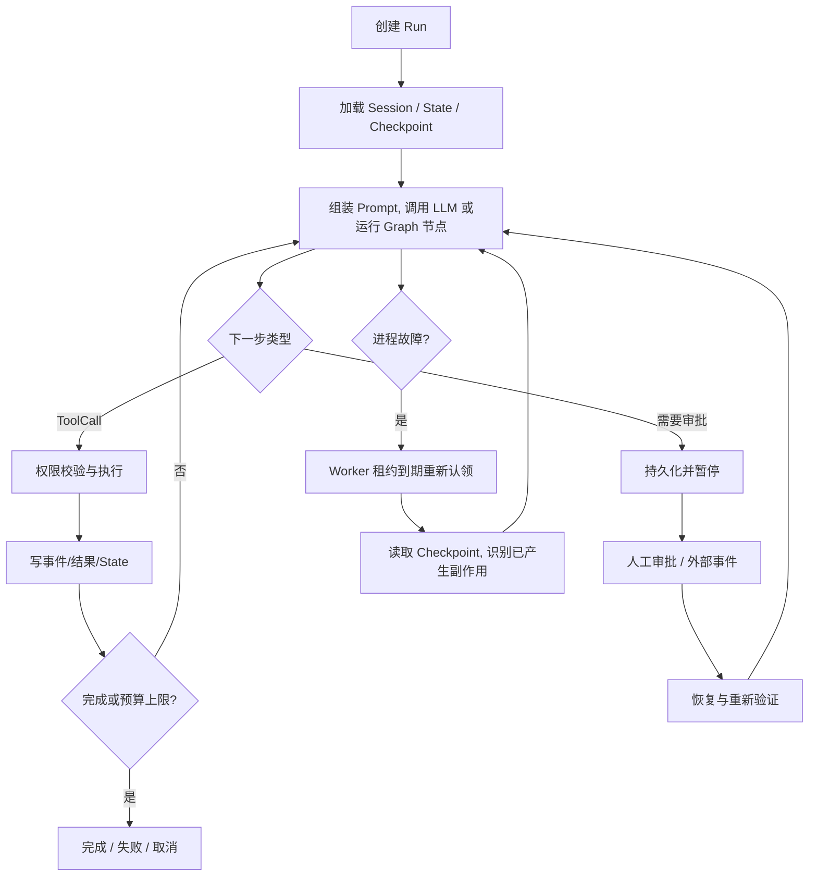

**关键陷阱：**恢复可能会重跑部分代码，因此每个带副作用的节点都必须设计业务幂等或补偿；“有 Checkpoint”不是“恰好执行一次”。

---

# 八、State：运行时状态、事件与检查点

## 8.1 模块背景

**核心问题：**Agent 必须知道当前执行到哪里、调用了哪些工具、哪些步骤完成、在等谁审批；长任务即使进程重启也不应丢失状态。State 属于执行真相源，而不是“给大模型读的所有历史内容”。

## 8.2 方案 S1：In-memory Typed State（显式状态机）

- **背景与场景：**单进程、短任务、原型阶段；需要避免散乱的布尔值控制执行。
- **方案思路：**将 Run State 定义为对象和有限状态枚举，约束合法状态转换，例如 `idle→running→waiting_approval→succeeded`。
- **优点：**极易理解和调试；**缺点：**无法跨进程恢复，复杂并行读写可能冲突。
- **怎么实施：**① 定义 `runId/phase/step/results/error` Schema；② 用状态机限制合法转移；③ 状态更新走一个函数；④ 记录转移事件；⑤ 给所有状态和异常路径写单元测试。
- **实施效果：**减少无效状态和隐蔽分支；测状态转移合法率、运行覆盖率。
- **方案结合：**S1 + E1；稍后可不改变业务接口升级 S3 持久化。
- **主流源码：**ZCode [turn-state.ts](https://github.com/zai-org/ZCode/blob/main/apps/zcode-cli/packages/core/src/agent/turn-state.ts)、[turn-machine.ts](https://github.com/zai-org/ZCode/blob/main/apps/zcode-cli/packages/core/src/agent/turn-machine.ts)。

## 8.3 方案 S2：Shared Typed Graph State + Reducer

- **背景与场景：**多个节点或 Agent 并行修改相同运行数据，直接共享可变对象会导致覆盖与不确定性。
- **方案思路：**State Schema 明确各字段类型；节点返回 Delta，不直接篡改其他节点私有对象；字段通过替换/追加/定制 Reducer 合并。
- **优点：**并发修改规则可解释，图执行清晰；**缺点：**Reducer 定义不当会重复、丢失或误合并数据。
- **怎么实施：**① 将 state 分成 `messages/plan/steps/artifacts/approval`；② 为每字段定义是否可并发写和合并规则；③ Agent 私有状态与全局 State 分开；④ 节点只输出结构化变更；⑤ 检测写冲突与版本冲突；⑥ 对并发分支做重放测试。
- **实施效果：**测并行执行的状态一致性、冲突率及可重放性。
- **方案结合：**S2 + E2 Graph Runtime + PL5 Dynamic DAG；不要把大文件本体放进共享 State。
- **主流源码：**LangGraph [graph/state.py](https://github.com/langchain-ai/langgraph/blob/main/libs/langgraph/langgraph/graph/state.py)、RAGFlow [runtime/state.go](https://github.com/infiniflow/ragflow/blob/main/internal/agent/runtime/state.go)。

## 8.4 方案 S3：数据库持久化状态 / 乐观锁 / 租约

- **背景与场景：**Web 服务或 Worker 会重启，执行状态必须跨进程保留，并发更新可能覆盖。
- **方案思路：**Run 记录持久化于 PostgreSQL 等数据库，更新时带版本号；Worker 使用租约字段标记执行者与有效期。
- **优点：**可靠查询、便于多实例协作；**缺点：**写入量和冲突重试成本增加。
- **怎么实施：**① `agent_runs(id,status,version,owner,lease_until,updated_at)`；② 更新条件 `WHERE id=? AND version=?`；③ 工具结果与状态更新使用事务边界；④ 长任务定期更新租约；⑤ 租约超时重新分配任务；⑥ 防止旧 Worker 使用失效租约继续提交结果。
- **实施效果：**测状态写冲突、租约接管正确率、最终任务一致性。
- **方案结合：**S3 + E6 分布式 Worker + S4 Checkpoint + T5 幂等。
- **主流源码：**RAGFlow [canvas/run_tracker.go](https://github.com/infiniflow/ragflow/blob/main/internal/agent/canvas/run_tracker.go) 和其他执行状态持久化边界提供借鉴；此处 SQL/租约模型为**推荐设计**。

## 8.5 方案 S4：Checkpoint / Snapshot + Resume

- **背景与场景：**任务跨分钟/小时执行，暂停审批或服务故障后不能从第一步全部重做。
- **方案思路：**在可恢复节点边界持久化 State 快照，恢复时定位最后一致点，重新构建运行环境并继续。
- **优点：**支持暂停/恢复、减少重复计算；**缺点：**Checkpoint 太频繁增加存储；太少则重做更多步骤；外部副作用不能仅靠快照保护。
- **怎么实施：**① 定义可序列化状态与 Schema 版本；② 每个重要阶段生成 checkpointId；③ 快照只存结果引用，不直接嵌入大文件；④ 关联 runId、graphVersion、nodeId；⑤ 恢复时验证输入版本、用户权限及待执行副作用；⑥ 兼容状态迁移；⑦ 对 kill/crash/restart 做演练。
- **实施效果：**测恢复正确率、恢复耗时、重跑节点数、Checkpoint 体积。
- **方案结合：**S4 + E3 Durable + E4 HITL；与 M2 上下文摘要 Checkpoint 区别在于**保存目的及恢复粒度**不同。
- **主流源码：**LangGraph [checkpoint 库](https://github.com/langchain-ai/langgraph/tree/main/libs/checkpoint)、RAGFlow [checkpoint_store.go](https://github.com/infiniflow/ragflow/blob/main/internal/agent/canvas/checkpoint_store.go)、[interrupt_resume.go](https://github.com/infiniflow/ragflow/blob/main/internal/agent/canvas/interrupt_resume.go)。WeKnora [checkpoint.go](https://github.com/Tencent/WeKnora/blob/main/internal/agent/checkpoint.go) 主要保存**上下文压缩 Checkpoint**，不可混写为通用图节点恢复实现。

## 8.6 方案 S5：Event Sourcing / Append-only Log / Replay

- **背景与场景：**高审计要求、调试复杂任务、历史分支、Agent 行为复现；只存最新状态无法解释之前发生了什么。
- **方案思路：**每次 `turnStarted/modelCalled/toolCalled/toolCompleted/stateChanged` 追加不可随意修改的事件；使用投影函数重建当前会话或运行业务视图。
- **优点：**来源清晰、可审计、可回放和追踪；**缺点：**回放规则/事件 Schema 演化很难，日志规模需要治理。
- **怎么实施：**① 定义事件信封 `eventId/runId/seq/type/schemaVersion/payload/time`；② 为每 run 使用单调递增 seq；③ 保留事件读写权限和敏感数据脱敏；④ 从事件生成 Session / Model Context Projection；⑤ 创建 Snapshot 加快加载；⑥ 事件版本升级做兼容回放；⑦ 事件重放过程中禁止重新执行真实写工具。
- **实施效果：**测回放一致性、审计事件缺失率、调试追溯耗时和事件存储成本。
- **方案结合：**S5 + S4 快照 + E5 Hooks；不等于只靠事件重放就能重做所有第三方外部操作。
- **主流源码：**DeepSeek Harness [session/src](https://github.com/deepseek-ai/deepseek-harness/tree/master/packages/core/session/src) 的事件源会话思想、Pi [session-manager.ts](https://github.com/earendil-works/pi/blob/main/packages/coding-agent/src/core/session-manager.ts) 的追加会话记录。

## 8.7 方案 S6：Snapshot + Event Log + Session Branching

- **背景与场景：**复杂任务需要既快速恢复，也能看到历史全貌；用户还想从较早决策处分叉探索不同方案。
- **方案思路：**定期保存 Snapshot，之后仅追加 Event；会话项保留 parentId 关系以便创建新分支，不能更改已经存在的历史因果链。
- **优点：**兼顾加载效率、审计能力与分支探索；**缺点：**跨分支共享工件与副作用的语义需要清晰定义。
- **怎么实施：**① `checkpoint + events_after_checkpoint` 还原；② 每条会话项包含 parentId；③ 新分支写独立 branchId；④ 工件按内容/版本寻址，避免一条分支覆盖另一条；⑤ 共享外部副作用不能“回滚历史”式删除；⑥ 分支合并需要显式冲突处理。
- **实施效果：**测分支恢复正确率、加载时长、快照与事件一致率、冲突解决率。
- **方案结合：**S6 + M6 Tree Memory + PL3 Replanning；对普通 ToB FAQ 没必要上树形分支。
- **主流源码：**Pi [session-manager.ts](https://github.com/earendil-works/pi/blob/main/packages/coding-agent/src/core/session-manager.ts) 的 `id/parentId` 分支式会话；ZCode [turn-machine.ts](https://github.com/zai-org/ZCode/blob/main/apps/zcode-cli/packages/core/src/agent/turn-machine.ts) 的显式生命周期状态。

## 8.8 State 核心流程图

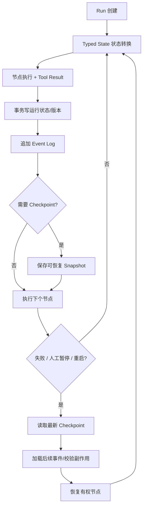

**实施顺序：**S1 → S3（真实服务需要持久化）→ S4（长任务）→ S5（深度审计/回放）→ S6（分支型项目）；S2 适合 Graph 执行。特别注意每个阶段的恢复粒度和副作用语义。

---
# 九、跨模块组合、端到端案例与实施顺序

## 9.1 最重要的主流设计结论

1. **LLM 与 Agent Loop 解耦**：模型适配器处理各供应商协议，Agent Runtime 面向统一消息和 ToolCall；来源思路参考 Pi、DeepSeek Harness。
2. **Prompt 是一次动态组装过程**：系统指令、上下文/历史、记忆、检索结果、工具和环境信息按信任级别、相关性和预算分层组装；参考 ZCode、Dify Agent V2。
3. **Memory / Knowledge / State 分家**：Memory 存跨轮可回忆信息，Knowledge 存权威业务资料，State 存运行真相源；参考 WeKnora、RAGFlow、LangGraph 和 Pi。
4. **Tool Calling ≠ Tool Execution**：模型可提出调用意图，但执行必须经过 Registry、Schema、租户权限、审批、沙箱和幂等；参考 Codex、WeKnora、DeepSeek Harness。
5. **规划与执行有不同职责**：Planner 生成任务图、条件或下一步；Executor 负责调度、并发、错误、取消、恢复；参考 ZCode Workflow Scheduler、LangGraph。
6. **企业 Workflow 通常比纯自主 Agent 更稳**：固定业务步骤用 DAG 和局部 Agent，只有未知探索和动态决策才放开 ReAct/Replanning；参考 Dify、Flowise、LangGraph。
7. **持久化 State 不代表自动可靠恢复**：需要可靠任务调度、Worker/租约、Checkpoint、幂等和恢复语义；Dify 新版独立 Agent 运行时的进程内调度限制是直观反例。
8. **架构越复杂越要证明收益**：Multi-Agent、GraphRAG、智能模型路由、长时 Memory 均需要用同一批场景评测，而不是为了“先进”直接引入。

## 9.2 六种业务场景的组合建议

| 场景 | 主要方案组合 | 主流参考 | 重点实施风险 | 验收指标 |
|---|---|---|---|---|
| 简单内部问答 | L2 + P1/P3 + M1 + T1 + PL1（或无 Planner）+ E1 + S1 | Dify、Flowise、LlamaIndex | 检索引用、权限 | 答案正确率/引用命中率 |
| 复杂企业知识问答 | L2 + P2/P3/P4 + M1/M2 + T2/T3 + PL1 + E1/E2 + S2 | RAGFlow、WeKnora、Haystack | 知识过期、上下文污染 | 有证据回答率/权限正确率 |
| 运营 Text-to-SQL 报表 | L2/L3 + P5 + M1 + T1/T4/T6 + PL4 + E2 + S3/S4 | LangGraph、Dify、Flowise | 读写权限、SQL 成本、报表正确性 | SQL 安全率/业务指标准确率 |
| Coding Agent | L2/L4 + P2/P4 + M2/M6 + T2/T4/T5 + PL1/PL3 + E1/E3 + S4/S5 | Codex、Pi、DeepSeek Harness、ZCode | 沙箱、重复修改、恢复 | 测试通过率/恢复正确率 |
| 多角色研发协作 | L2/L5 + P2 + M3/M5 + T6 + PL5/PL6 + E2/E3 + S2/S4 | AutoGen、CrewAI、LlamaIndex、LangGraph | 协调成本和产物传递 | 端到端交付成功率/成本 |
| 长任务与异步文件处理 | L3/L4 + P2/P4 + M2 + T5/T6 + PL4 + E3/E4/E6 + S3/S4/S5 | LangGraph、RAGFlow、Codex（思想参考） | 进程故障、幂等、审批过期 | 故障恢复率/重复副作用 |

**注意：**模式中如 PL1（ReAct）并非每个简单问答都必需，分类/查询等单步问题可以直接执行简单 LLM/RAG 逻辑。

## 9.3 企业 AI 中台的推荐分层架构

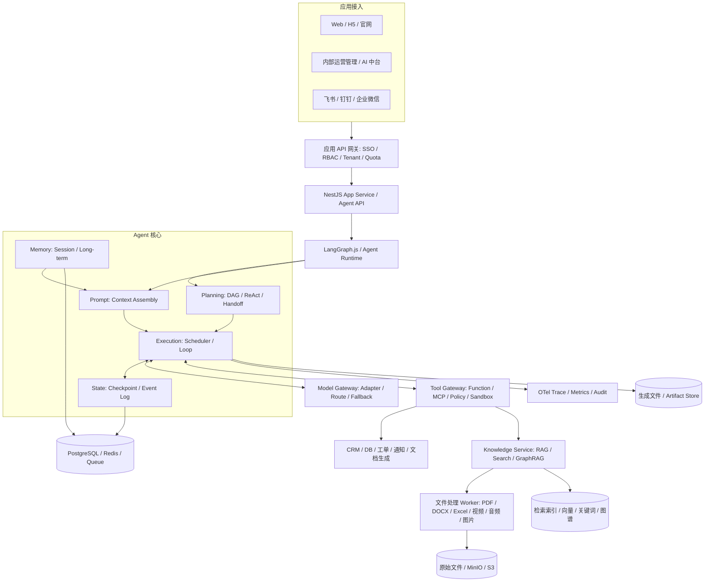

**职责边界：**若已经自研 LangGraph 编排，可将 Dify/Flowise 用于某些快速交付的独立应用，不必把同一个任务嵌在两套 Graph 调度器中。Knowledge Service 要拥有自己的文档版本、权限及重建索引能力；模型和 Agent 不应直接修改权威知识源。

## 9.4 具体场景 A：企业运营问答 → SQL 分析 → Excel → 飞书发送

**目标：**用户说「统计上个月订单、分析销售下降原因，生成 Excel 并发给运营组」。

### 背景与风险

- 数据来自业务数据库，Agent 不应获得生产数据库的任意写权限。
- SQL 生成需要表/指标语义和越权防护，不能把生成 SQL 直接执行。
- 生成文件可能耗时，向飞书发送属于有副作用的外部行为，可能需要审批。

### 推荐组合

| 模块 | 此案例选型 | 为什么 |
|---|---|---|
| LLM | L2 + 结构化输出能力检查 | SQL 生成和分析适配不同能力需求 |
| Prompt | P2 + P3 + P5 | 注入指标定义、授权 schema、JSON 输出契约 |
| Memory | M1 + 重要项目偏好（可选） | 保持当前业务上下文，避免无意义长期记忆 |
| Tools | T1 SQL 工具 + T4 Policy + T6 Excel/飞书 Tool | 数据访问与发送严格分离 |
| Planning | PL4 固定 DAG + PL1 局部分析 | 查询/分析/生成/发送顺序确定，分析中可以补充查询 |
| Execution | E2 + E4；需要长任务再 E3 | 审批和步骤状态可视 |
| State | S2 + S3 + S4 | 保存 SQL 结果引用、Excel 文件、审批进度 |

### 具体实施步骤

1. **接单与鉴权**：创建 `runId`；从服务端认证上下文提取 tenantId/userId，确定允许查询的数据库和业务指标。
2. **语义层**：提供 `orders.sales_amount` 等业务指标定义和字段白名单，不把全部库 Schema 随意暴露给模型。
3. **生成查询**：模型输出结构化 SQL 请求或调用 SQL 生成工具；AST/SQL Parser 校验只读、表/列权限、行级过滤、分页/超时。
4. **执行与校验**：只读账号查询；保存查询文本、参数、数据版本以及行数/时间限制，将结果存 `artifactId`。
5. **分析**：模型结合可信结果总结下降现象，区分“相关性/可能原因”和“已证实的因果结论”；必要时发起补充只读查询。
6. **Excel**：使用独立文档 Worker 生成 Excel，保存文件版本、校验文件结构与关键指标。
7. **审批与发送**：展示文件和接收人；必要时中断等待确认；飞书发送携带业务幂等键、防止重试重复发送。
8. **完成与追踪**：保存 SQL 证据、报表 artifact、发送结果、Trace ID、成本、状态以及可回放事件。

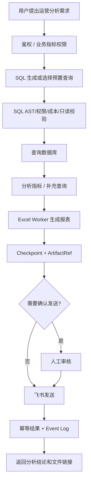

**实施效果验收：**给 30～50 个真实业务问题做标准答案/指标对照；必须检查**授权的 SQL 100% 不越权**、不能执行写语句、报表指标一致、重复发送次数为零（限测试集范围内）；性能和成本按实际负载测量。

## 9.5 具体场景 B：Coding Agent 自动修复并提交代码

**目标：**用户提出 Bug → Agent 搜索相关代码 → 修复 → 运行测试 → 总结改动；必要时等待提交或推送确认。

### 推荐组合

- **LLM：**L2 Provider Adapter + L4 错误/限流容灾。
- **Prompt：**P2 分段组装项目说明、仓库规则、Git 状态、必要代码片段；P4 压缩长历史。
- **Memory：**M2 历史摘要 + M5 代码规范技能；如需分支探索可 M6 Tree。
- **Tools：**文件读写、搜索、测试运行、Git；强制资源权限、执行沙箱、命令安全策略。
- **Planning：**默认 ReAct；复杂修复先 Plan-and-Execute，失败后有界 Replanning。
- **Execution：**E1/E2，根据任务长度增加 E3、工具并行和执行日志。
- **State：**Turn State + 文件变更引用 + Event Log + Checkpoint。

### 具体实施步骤

1. 加载仓库权限、Git 状态、AGENTS.md/项目指令和可用工具。
2. 创建 taskId/runId，记录基线 Commit / 工作树是否干净。
3. 根据任务先搜索相关代码，限制一次性加载巨量文件。
4. 计划修复范围；每次修改前对文件快照/状态做检查，避免覆盖用户变更。
5. Shell 和测试工具在受限环境执行；只读搜索可并行，修改同一文件串行。
6. 失败后先读取错误再决定下一步，不盲目重复同一命令。
7. 记录测试结果、改动 Diff、命令输出 ArtifactRef。
8. push、发布或删除等高风险操作需明确授权；发生进程异常时从任务状态和 Git 状态恢复。

**实施效果验收：**修复验证通过率、误改非目标文件率、工具失败恢复率、重复写入副作用、平均模型调用次数和审核后提交成功率。

## 9.6 模块间公共接口示例（推荐设计，非开源项目原始类型）

```ts
// 核心思想：统一约定跨模块数据边界，而不是强行统一项目的全部内部类型。
interface AgentRunContext {
  runId: string;
  sessionId: string;
  tenantId: string;       // 来自服务端认证上下文
  userId: string;         // 不信任 LLM 生成值
  traceId: string;
  deadlineAt?: string;
  maxSteps: number;
  budget: { maxInputTokens: number; maxOutputTokens: number };
}

interface TaskStep {
  id: string;
  description: string;
  dependsOn: string[];
  status: "pending" | "running" | "waiting_approval" | "succeeded" | "failed";
  toolNames: string[];
  resultArtifactIds: string[];
}

interface AgentRunState {
  runId: string;
  version: number;
  phase: "pending" | "running" | "paused" | "succeeded" | "failed" | "cancelled";
  planVersion?: number;
  steps: TaskStep[];
  completedToolCallIds: string[]; // 用于辅助幂等恢复
  checkpointId?: string;
  lastEventSeq: number;
}

interface ToolExecutionRequest {
  runId: string;
  toolCallId: string;
  toolName: string;
  args: unknown;
  idempotencyKey?: string; // 有副作用操作由宿主生成且稳定持久化
}

interface ToolExecutionResult {
  toolCallId: string;
  ok: boolean;
  outputSummary: string;
  artifactIds: string[];
  errorCode?: string;
}
```

**避免几种常见误区：**
- 把 Memory 当 State、把 RAG 当长期记忆，导致权限和更新逻辑混乱。
- 把 MCP 当安全边界，让第三方工具自行决定用户权限。
- 只保存 Checkpoint，不考虑副作用幂等，恢复后重复付款/发送。
- 把所有工具 Schema、所有文件、所有历史一次塞给 LLM。
- 任务明明是固定审批流程却采用自由规划。
- 只是 Prompt 不同就拆为十几个 Agent，造成无谓 Token 和协调成本。

## 9.7 P0～P4 的实施路线与验收门槛

| 阶段 | 实施范围 | 交付物 | 不能缺少的验收 |
|---|---|---|---|
| P0：可运行闭环 | L2、P1/P2、M1、T1/T4 最小集、PL1、E1、S1 | 一个能调用模型与受控工具的 Agent | ToolCall 端到端成功、身份不越权、Step 有上限 |
| P1：可维护 | P4、M2、T2/T3、E5、S3、Tracing | 稳定会话、Context Trace、工具目录、状态持久化 | 长上下文不溢出、回归任务通过、Trace 完整 |
| P2：可运营 | PL4、E2、S2/S4、Workflow/HITL、ArtifactStore | 多步骤报表/审批完整业务 | 节点恢复、拒绝审批、工件版本、审计可追溯 |
| P3：可容灾 | E3/E6、S5、T5 幂等、L4 Fallback | 服务重启可恢复长任务的运行体系 | 杀进程恢复、重复消息、连接断开等故障注入 |
| P4：智能优化 | M3/M4/M5、PL3/PL6、L5、Agentic RAG/GraphRAG | 长期智能协作与复杂检索 | 对基线质量/费用/延迟有可验证收益 |

**默认原则：先建立基线评测集，再新增更复杂能力；阶段上移由场景驱动，不由框架版本驱动。**

---

# 十、源码研究索引与决策清单

## 10.1 主流项目与七大模块映射

> 标识：`◎` 为此研究重点对照的原生模块；`○` 为相关能力或可参考实现；`—` 表示不是该项目的核心定位。不是全功能支持声明，更不是成熟度排名。

| 开源项目 | LLM | Prompt | Memory | Tools | Planning | Execution | State | 最值得阅读的入口 |
|---|---|---|---|---|---|---|---|---|
| [Codex](https://github.com/openai/codex) | ○ | ◎ | ○ | ◎ | ○ | ◎ | ◎ | [session/turn.rs](https://github.com/openai/codex/blob/main/codex-rs/core/src/session/turn.rs) · [tools/router.rs](https://github.com/openai/codex/blob/main/codex-rs/core/src/tools/router.rs) |
| [DeepSeek Harness](https://github.com/deepseek-ai/deepseek-harness) | ◎ | ◎ | ○ | ◎ | ○ | ◎ | ◎ | [agent.ts](https://github.com/deepseek-ai/deepseek-harness/blob/master/packages/core/agent-loop/src/agent.ts) · [tool-calls.ts](https://github.com/deepseek-ai/deepseek-harness/blob/master/packages/core/agent-loop/src/tool-calls.ts) |
| [ZCode](https://github.com/zai-org/ZCode) | ◎ | ◎ | ◎ | ◎ | ◎ | ◎ | ◎ | [turn-machine.ts](https://github.com/zai-org/ZCode/blob/main/apps/zcode-cli/packages/core/src/agent/turn-machine.ts) · [scheduler.ts](https://github.com/zai-org/ZCode/blob/main/apps/zcode-cli/packages/core/src/workflow/scheduler.ts) |
| [Pi](https://github.com/earendil-works/pi) | ◎ | ○ | ◎ | ○ | ○ | ◎ | ◎ | [agent-loop.ts](https://github.com/earendil-works/pi/blob/main/packages/agent/src/agent-loop.ts) · [session-manager.ts](https://github.com/earendil-works/pi/blob/main/packages/coding-agent/src/core/session-manager.ts) |
| [Dify](https://github.com/langgenius/dify) | ◎ | ◎ | ◎ | ◎ | ◎ | ◎ | ◎ | [dify-agent/runtime](https://github.com/langgenius/dify/tree/main/dify-agent/src/dify_agent/runtime) · [agent_v2](https://github.com/langgenius/dify/tree/main/api/core/workflow/nodes/agent_v2) |
| [LangChain](https://github.com/langchain-ai/langchain) | ◎ | ◎ | ○ | ◎ | ○ | ◎ | ◎ | [agents/factory.py](https://github.com/langchain-ai/langchain/blob/master/libs/langchain_v1/langchain/agents/factory.py) · [middleware](https://github.com/langchain-ai/langchain/tree/master/libs/langchain_v1/langchain/agents/middleware) |
| [LangGraph](https://github.com/langchain-ai/langgraph) | ○ | ○ | ○ | ○ | ◎ | ◎ | ◎ | [graph/state.py](https://github.com/langchain-ai/langgraph/blob/main/libs/langgraph/langgraph/graph/state.py) · [checkpoint](https://github.com/langchain-ai/langgraph/tree/main/libs/checkpoint) |
| [RAGFlow](https://github.com/infiniflow/ragflow) | ○ | ○ | ○ | ◎ | ○ | ◎ | ◎ | [agentic_rag](https://github.com/infiniflow/ragflow/tree/main/internal/agentic_rag) · [canvas](https://github.com/infiniflow/ragflow/tree/main/internal/agent/canvas) |
| [WeKnora](https://github.com/Tencent/WeKnora) | ○ | ◎ | ◎ | ◎ | ○ | ◎ | ○ | [engine.go](https://github.com/Tencent/WeKnora/blob/main/internal/agent/engine.go) · [tools](https://github.com/Tencent/WeKnora/tree/main/internal/agent/tools) |
| [LlamaIndex](https://github.com/run-llama/llama_index) | ○ | ○ | ◎ | ◎ | ◎ | ◎ | ○ | [agent/workflow](https://github.com/run-llama/llama_index/tree/main/llama-index-core/llama_index/core/agent/workflow) |
| [GraphRAG](https://github.com/microsoft/graphrag) | ○ | ◎ | — | ○ | — | ○ | — | [structured_search](https://github.com/microsoft/graphrag/tree/main/packages/graphrag/graphrag/query/structured_search) |
| [Haystack](https://github.com/deepset-ai/haystack) | ○ | ◎ | ○ | ◎ | ○ | ◎ | ◎ | [agents/agent.py](https://github.com/deepset-ai/haystack/blob/main/haystack/components/agents/agent.py) |
| [Flowise](https://github.com/FlowiseAI/Flowise) | ◎ | ◎ | ◎ | ◎ | ◎ | ◎ | ○ | [agentflow](https://github.com/FlowiseAI/Flowise/tree/main/packages/components/nodes/agentflow) |
| [AutoGen](https://github.com/microsoft/autogen) | ○ | ○ | ○ | ◎ | ◎ | ◎ | ◎ | [BaseGroupChat](https://github.com/microsoft/autogen/blob/main/python/packages/autogen-agentchat/src/autogen_agentchat/teams/_group_chat/_base_group_chat.py) |
| [CrewAI](https://github.com/crewAIInc/crewAI) | ○ | ○ | ○ | ◎ | ◎ | ◎ | ◎ | [Flow](https://github.com/crewAIInc/crewAI/blob/main/lib/crewai/src/crewai/flow/flow.py) |

## 10.2 做技术选型时必须回答的十个问题

1. 业务是固定流程还是未知探索？如果是固定流程，优先 Workflow。
2. 一个任务平均有几次模型调用，失败或超时的容忍度是多少？
3. 数据哪些是权威知识、哪些是长期记忆、哪些是任务 State？
4. 工具有哪些权限等级？是否会对外产生不可逆副作用？
5. 是否真的需要多模型、智能路由或多 Agent？有没有基线评测证明收益？
6. Prompt 组装后 Token 上限是什么？如何裁剪与回溯原证据？
7. 业务允许多长时间执行？浏览器断开是否继续？进程崩溃后怎么办？
8. Checkpoint 保存在哪里，恢复会不会重复执行工具？
9. 有哪些可审计工件：Trace、执行事件、模型输出、SQL、报表、外发记录？
10. 哪些能力直接复用开源组件，哪些必须在业务侧自行实现和维护？

---

# 附录：上一版完整内容归档

> 以下为上一版文件主体原文归档，供对照和追踪表述。上半篇的新研究已按每一种方案统一追加「怎么实施、如何验收、如何组合」；如两处组织方式不同，以本文件前半篇为主要学习结构。上一版的 Markdown Mermaid 图、文字、表格和源码链接均保留。


# AI Agent 七大核心模块：主流开源方案、源码架构与企业级落地（完整版）

> 资料基准：2026-10-17。本文件由两部分组成：**上半部分是提炼后的核心结论、选型和关键 Mermaid 流程图；下半部分是上一条答复的完整文字归档**。为使 Markdown 跨编辑器可用，原答复里的交互式卡片/图示转成 Mermaid、`<Cite>` 引用转换为仓库链接或合并至源码入口，不改变其技术观点。源码检查基于当时默认分支的关键文件；不是固定 Commit 的逐行审计，效果部分没有编造压测数据。

## 阅读导航

- [上篇：核心结论、选型与流程图](#上篇核心结论选型与流程图)
- [1. 一页掌握七大模块](#1-一页掌握七大模块)
- [2. 主流方案选型速查](#2-主流方案选型速查)
- [3. 核心流程图](#3-核心流程图)
- [4. 组合架构与应用场景](#4-组合架构与应用场景)
- [5. 项目与源码定位速查](#5-项目与源码定位速查)
- [6. 落地优先级、效果与验收](#6-落地优先级效果与验收)
- [下篇：上一条回答完整原文归档](#下篇上一条回答完整原文归档)

---

# 上篇：核心结论、选型与流程图

## 1. 一页掌握七大模块

### 1.1 核心认识

Agent 不是“一个 LLM + 一套提示词 + 若干工具”，而是**以 Agent Runtime 为核心，围绕模型、上下文、知识、工具、计划、运行状态和安全策略形成可控制、可恢复、可观察的闭环**。

- **LLM：**生成下一步决策或内容。主流方案是 Provider Adapter、模型网关、策略路由、重试与降级。
- **Prompt：**在每次模型调用前组装角色、约束、环境、工具、记忆、检索结果、输出协议；当前重点已从 Prompt Engineering 转向 Context Engineering。
- **Memory：**保存及选择性回忆跨轮、跨会话信息；包括短期会话、压缩摘要、情景/事实/过程记忆。
- **Tools：**把模型产生的调用意图变成真实且受控的执行；包括 Schema、Registry、MCP、授权、审批、沙箱、幂等。
- **Planning：**确定步骤及依赖；包括 ReAct、Plan-and-Execute、动态重规划、DAG、Multi-Agent。
- **Execution：**实际运行循环或图，负责任务调度、并发、重试、中断、恢复、完成判定。
- **State：**保存当前任务和运行生命周期；包括 Typed State、事件日志、检查点、快照、回放。

> **Memory ≠ State ≠ Knowledge**：Memory 是供未来推理回忆的信息；State 是当前任务执行事实；Knowledge 是相对权威、可检索的业务知识。三者可以复用基础设施，但不应共用同一套权限与生命周期规则。

### 1.2 七层速查矩阵

| 模块 | 主要矛盾 | 最小可用方案 | 企业级主流演进 | 参考源码 | 验证效果 |
|---|---|---|---|---|---|
| LLM | 模型协议、质量、成本、可用性不同 | 一个 Provider Adapter | Gateway + 任务级路由 + Fallback | Pi、DeepSeek Harness、Dify | 正确率、P95、Token 成本、故障切换成功率 |
| Prompt | 指令、上下文不断变化，窗口有限 | 模板 + 近期历史 | 分段组装 + 动态检索 + Skills 按需加载 + Token 预算 | ZCode、DeepSeek Harness、Codex | 指令遵循率、Token、格式合规率 |
| Memory | 历史变长、遗忘、过期和冲突 | 会话窗口 + 摘要 | 情景/事实/过程记忆 + 检索 + 治理 | Pi、ZCode、WeKnora、Flowise | 召回、事实准确性、过期误命中 |
| Tools | 接入外部系统的安全和可靠性 | Function Calling + Schema | Registry + MCP + Policy + 审批 + 沙箱 | Codex、DeepSeek Harness、WeKnora | 调用成功、越权拦截、重复副作用 |
| Planning | 自主性 vs 流程确定性 | ReAct | Workflow + 局部 Agent + 重规划；必要时多 Agent | LangGraph、ZCode、AutoGen、CrewAI | 任务完成率、步骤冗余、协作成本 |
| Execution | 中断、并发、失败、长任务 | Agent Loop | Graph Runtime + Checkpoint + 可靠调度 + 幂等 | DeepSeek Harness、Pi、LangGraph、RAGFlow | 恢复成功率、耗时、失败率 |
| State | 任务事实和恢复点丢失 | 类型化对象 | Typed State + Checkpoint + Event Log | LangGraph、RAGFlow、Pi、ZCode | 状态一致性、回放和恢复正确率 |

### 1.3 最值得迁移的开源设计原则

1. **Pi：**最值得学习简洁 Agent Loop、Session Tree、Compaction，保持低复杂度。
2. **DeepSeek Harness：**把模型、Prompt、Tools、Session、Agent Loop 做成可替换边界；事件日志驱动会话视图。
3. **ZCode：**明确 Turn Machine、Workflow Scheduler、Context Builder 与独立 Memory。
4. **Codex：**严格区分工具发现、路由、执行权限、审批与沙箱。
5. **LangGraph：**有状态图执行、Reducer、Checkpoint、Interrupt/HITL。
6. **RAGFlow / WeKnora：**知识解析、检索和 Agentic RAG 解耦，权威知识不直接等于 Agent Memory。
7. **Dify / Flowise：**作为应用交付层和可视化编排层，避免与自研底层编排的职责重复。
8. **LlamaIndex / Haystack / GraphRAG：**按检索特征选择框架，而不是每个数据集都上知识图谱。

## 2. 主流方案选型速查

| 业务场景 | 首选组合 | 为什么 | 不建议默认引入 |
|---|---|---|---|
| FAQ / 普通知识问答 | 固定 Prompt + 混合 RAG + 简单 Session | 易评测、可控且足够有效 | Multi-Agent、复杂 Planner |
| 复杂企业资料问答 | Agentic RAG + 检索工具 + 引用 + Context Budget | 需反复查询和核对证据 | 全部文件直接塞上下文 |
| 运营分析和报表 | 预定义 Workflow + 局部 ReAct + 只读 SQL + 报表工具 | 固定流程中保留灵活分析 | 完全放开 DB 和发信权限 |
| Coding Agent | Agent Loop + Context Assembly + Shell Sandbox + Session Tree + Compaction | 长过程、代码操作和多次工具迭代 | 仅靠静态 Prompt 限权 |
| 研发多角色协作 | Supervisor + 专用 Agent + LangGraph + Shared Typed State | 明确协作责任和任务依赖 | 每个小步骤都建独立 Agent |
| 跨小时、跨天长任务 | Checkpoint + 持久任务队列 + Worker Lease + 幂等 | 进程故障后可以恢复 | 单进程任务 + Redis 状态即宣称 Durable |
| 大量 MCP/API 工具 | Tool Registry + Registry Search + Policy + Approval | 工具可扩展、减少上下文 | 把数百个 Schema 全部固定注入 |
| 跨文档关系及宏观主题分析 | 混合检索基线 + 按需 GraphRAG | 多跳、全局知识组织可能受益 | 所有知识都先建图 |

## 3. 核心流程图

> 以下均为标准 `mermaid` 代码块，GitHub 或支持 Mermaid 的 Markdown 阅读器可直接显示。

### 图 1：企业级 AI Agent 七大模块总架构

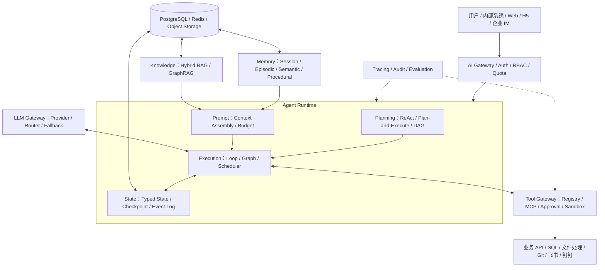

### 图 2：Agent Loop（包含失败、审批、退出）

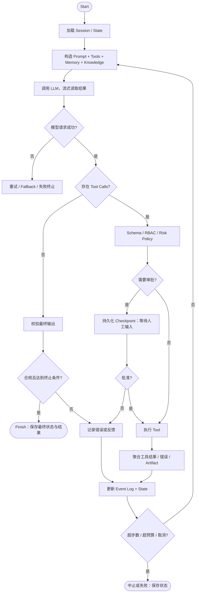

### 图 3：Planning 组合（固定流程 + 局部自主规划）

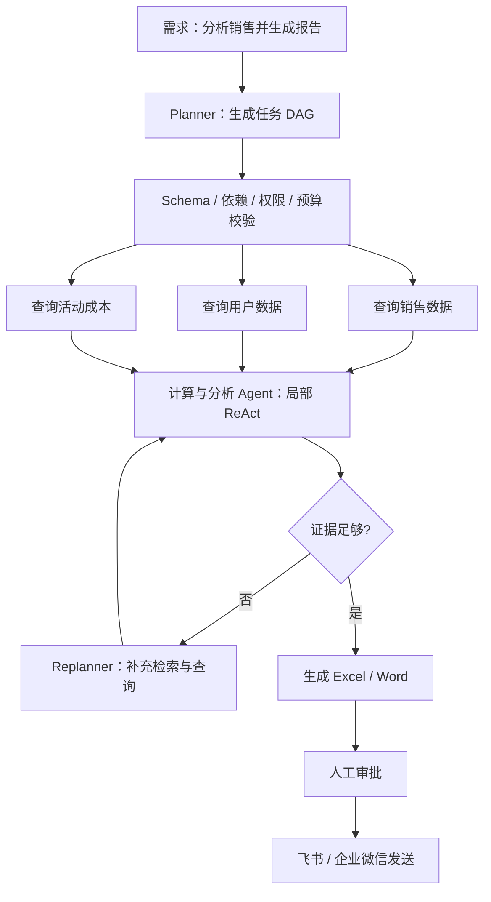

### 图 4：Memory、Knowledge、State 的边界

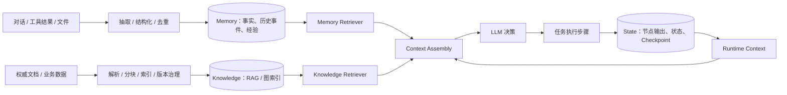

### 图 5：Tools 安全执行和幂等闭环

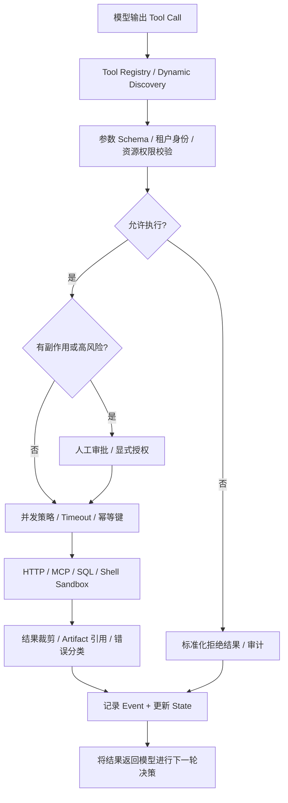

### 图 6：Durable Execution 故障恢复

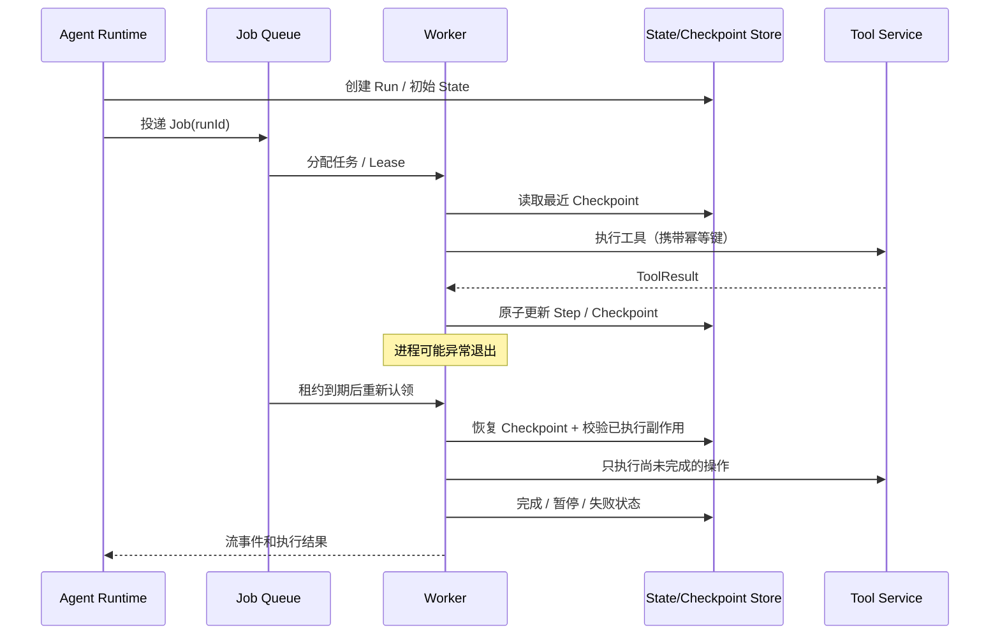

### 图 7：多模态知识摄取与 Agentic RAG

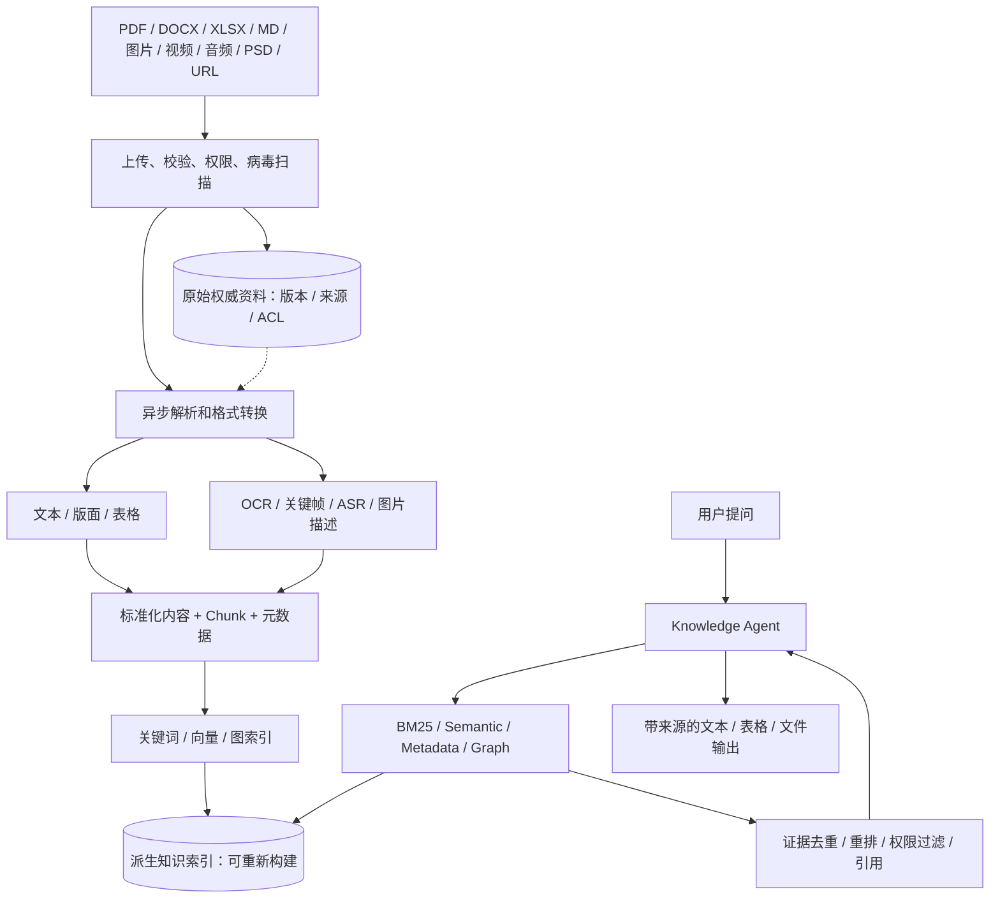

## 4. 组合架构与应用场景

### 4.1 我推荐的企业 AI 中台组合

| 层级 | 优先选择 | 备注 |
|---|---|---|
| 应用和 API | NestJS + Web/H5/Admin + SSO | 将内部丰富输出和对外能力白名单分离 |
| Agent 编排 | LangGraph.js | 主 Runtime，只选一个核心调度体系 |
| LLM | Provider Adapter + Model Gateway | 先主备和配额，后面再根据评测做智能路由 |
| Prompt | Section Assembly + Token Budget | 系统约束不能被检索内容覆盖 |
| Memory | Session + Compaction + 项目/用户记忆 | Memory 与企业 Knowledge 分离 |
| Tools | Native Function Calling + MCP Gateway | Service-side RBAC、审批、幂等、沙箱 |
| Knowledge | 评测后择一：RAGFlow / WeKnora | 多格式解析、检索引用、版本管理优先 |
| State / Queue | PostgreSQL + Checkpoint + 可靠队列/Worker | Redis 缓存不等于持久任务系统 |
| 大型文件 | MinIO / S3 类对象存储 | 原件、解析产物、Agent 生成文件分别管理 |
| 质量治理 | Trace + 审计 + 评测集 | 以任务成功率、错误率、成本为依据逐步加方案 |

### 4.2 为什么推荐“Workflow + 局部 Agent”

- 固定的合规、权限、审批、数据写入步骤由 Workflow 决定，确保顺序与边界可审计。
- 模型负责信息探索、摘要、原因分析、异常处理、任务重规划等不确定部分。
- 从小模型/单 Agent 开始；明确有角色协作的收益后，再引入 Multi-Agent。
- 不要把所有阶段都做成“自主 LLM 决策”，这样会降低复现性并增加成本。

## 5. 项目与源码定位速查

| 项目 | 重点阅读源码（均为公开仓库文件） | 最值得借鉴点 |
|---|---|---|
| Codex | [session/turn.rs](https://github.com/openai/codex/blob/main/codex-rs/core/src/session/turn.rs)、[tools/router.rs](https://github.com/openai/codex/blob/main/codex-rs/core/src/tools/router.rs)、[context_manager/history.rs](https://github.com/openai/codex/blob/main/codex-rs/core/src/context_manager/history.rs) | 生命周期、权限、上下文 |
| DeepSeek Harness | [agent.ts](https://github.com/deepseek-ai/deepseek-harness/blob/master/packages/core/agent-loop/src/agent.ts)、[tool-calls.ts](https://github.com/deepseek-ai/deepseek-harness/blob/master/packages/core/agent-loop/src/tool-calls.ts) | 组件化、事件、工具调度 |
| ZCode | [turn-machine.ts](https://github.com/zai-org/ZCode/blob/main/apps/zcode-cli/packages/core/src/agent/turn-machine.ts)、[builder.ts](https://github.com/zai-org/ZCode/blob/main/apps/zcode-cli/packages/core/src/context/builder.ts)、[scheduler.ts](https://github.com/zai-org/ZCode/blob/main/apps/zcode-cli/packages/core/src/workflow/scheduler.ts) | 状态机、Prompt 拼装、Workflow |
| Pi | [agent-loop.ts](https://github.com/earendil-works/pi/blob/main/packages/agent/src/agent-loop.ts)、[session-manager.ts](https://github.com/earendil-works/pi/blob/main/packages/coding-agent/src/core/session-manager.ts) | 极简 Loop 与会话树 |
| LangChain | [factory.py](https://github.com/langchain-ai/langchain/blob/master/libs/langchain_v1/langchain/agents/factory.py)、[human_in_the_loop.py](https://github.com/langchain-ai/langchain/blob/master/libs/langchain_v1/langchain/agents/middleware/human_in_the_loop.py) | Agent 构造、中间件、审批 |
| LangGraph | [graph/state.py](https://github.com/langchain-ai/langgraph/blob/main/libs/langgraph/langgraph/graph/state.py) | Typed State、Graph、Checkpoint |
| Dify | [Agent V2 Node](https://github.com/langgenius/dify/blob/main/api/core/workflow/nodes/agent_v2/agent_node.py)、[Agent Factory](https://github.com/langgenius/dify/blob/main/dify-agent/src/dify_agent/runtime/agent_factory.py)、[run_scheduler.py](https://github.com/langgenius/dify/blob/main/dify-agent/src/dify_agent/runtime/run_scheduler.py) | 平台与 Agent Runtime 分层；注意进程内任务调度限制 |
| Flowise | [Agent.ts](https://github.com/FlowiseAI/Flowise/blob/main/packages/components/nodes/agentflow/Agent/Agent.ts) | 可视化节点、Agentflow |
| RAGFlow | [agent.go](https://github.com/infiniflow/ragflow/blob/main/internal/agentic_rag/agent.go)、[state.go](https://github.com/infiniflow/ragflow/blob/main/internal/agent/runtime/state.go)、[checkpoint_store.go](https://github.com/infiniflow/ragflow/blob/main/internal/agent/canvas/checkpoint_store.go) | Agentic RAG、Canvas、Checkpoint |
| WeKnora | [engine.go](https://github.com/Tencent/WeKnora/blob/main/internal/agent/engine.go)、[checkpoint.go](https://github.com/Tencent/WeKnora/blob/main/internal/agent/checkpoint.go) | ReAct、会话历史与压缩状态分离 |
| LlamaIndex | [function_agent.py](https://github.com/run-llama/llama_index/blob/main/llama-index-core/llama_index/core/agent/workflow/function_agent.py)、[multi_agent_workflow.py](https://github.com/run-llama/llama_index/blob/main/llama-index-core/llama_index/core/agent/workflow/multi_agent_workflow.py) | 检索与 Agent/Handoff |
| GraphRAG | [global_search/search.py](https://github.com/microsoft/graphrag/blob/main/packages/graphrag/graphrag/query/structured_search/global_search/search.py)、[local_search/search.py](https://github.com/microsoft/graphrag/blob/main/packages/graphrag/graphrag/query/structured_search/local_search/search.py) | 全局和局部知识检索 |
| Haystack | [agents/agent.py](https://github.com/deepset-ai/haystack/blob/main/haystack/components/agents/agent.py)、[pipeline.py](https://github.com/deepset-ai/haystack/blob/main/haystack/core/pipeline/pipeline.py) | 组件化 Agent、Hooks、Pipeline |
| AutoGen | [BaseGroupChat](https://github.com/microsoft/autogen/blob/main/python/packages/autogen-agentchat/src/autogen_agentchat/teams/_group_chat/_base_group_chat.py) | 多 Agent 消息协调 |
| CrewAI | [flow.py](https://github.com/crewAIInc/crewAI/blob/main/lib/crewai/src/crewai/flow/flow.py) | Crew + Flow 组合 |

## 6. 落地优先级、效果与验收

| 优先级 | 重点建设 | 验收目标 |
|---|---|---|
| P0 | 模型适配、Prompt、Tool Calling、Agent Loop、Session、Typed State | 最小闭环可运行、可追踪、输出校验 |
| P1 | Tool Policy、沙箱、审批、MCP、Compaction、Checkpoint、幂等 | 高风险工具不可越权；任务可安全恢复 |
| P2 | 多模态知识、混合检索、任务图、Replanning、多 Agent、长期记忆 | 复杂任务质量提高，知识引用与权限正确 |
| P3 | 模型路由、动态工具发现、长任务多 Worker、全链路评测 | 有数据证据证明质量、成本或稳定性收益 |

**推荐架构结论：** 企业级 AI 中台首先落实 **LangGraph.js（有状态编排）+ NestJS（业务与工具网关）+ 可选 RAGFlow/WeKnora（独立知识服务）+ PostgreSQL/Redis/Queue/MinIO（运行和数据底座）**；借鉴 Codex 工具安全、Pi 会话与 Loop、DeepSeek Harness 组件边界。每个模块坚持“满足需求的最小有效组合”，以评测结果决定是否升级到多 Agent、GraphRAG 或复杂分布式执行。

---

# 下篇：上一条回答完整原文归档

> 说明：以下按上一条回答的章节顺序保留其解释、方案、优缺点、实施效果、技术判断、表格和源码链接。原回答的 UI 框图用等价 Mermaid 流程图转写；这类格式转换是为了让文件在 GitHub、VS Code 与 Markdown 编辑器中直接阅读。原回答中的非 URL 型聊天引用以可访问的仓库源码链接为准。

# 企业级 AI Agent 七大核心模块：主流开源项目源码架构与技术方案研究

*研究范围：LLM、Prompt、Memory、Tools、Planning、Execution、State ｜ 参考截至 2026 年 10 月 17 日可访问的开源代码*

## 一、先明确一个核心结论

通过对你列出的 GitHub 仓库进行目录定位、关键实现文件检查和官方架构资料对照，可以发现：

**当前成熟的 Agent 架构，并不是简单将七个模块组合起来，而是围绕 Agent Runtime（智能体运行时）建立一套可控制、可恢复、可扩展的执行系统。**

这七个模块的职责可以进一步划分：

| 模块 | 需要解决的核心问题 | 关键设计方向 |
|---|---|---|
| LLM | 调用哪个模型，如何兼容、路由和容错 | Model Gateway、Provider Adapter |
| Prompt | 如何让模型获得正确的指令、知识和上下文 | Prompt Assembly、Context Engineering |
| Memory | 如何记住历史、压缩上下文、长期积累信息 | Working / Episodic / Semantic Memory |
| Tools | 如何安全可靠地连接和使用外部能力 | Tool Registry、Function Calling、MCP、Sandbox |
| Planning | 如何拆解任务、选择步骤和动态调整计划 | ReAct、Plan-and-Execute、DAG、Multi-Agent |
| Execution | 如何执行、调度、重试、中断和结束任务 | Agent Loop、Graph Runtime、Durable Execution |
| State | 如何管理任务运行数据及其生命周期 | Typed State、Event Log、Checkpoint、Replay |

需要特别注意：

- **Memory 不等于 State**：Memory 用于未来推理时回忆信息；State 用于描述当前执行过程以及恢复执行所需的数据。
- **Planning 不等于 Execution**：Planning 决定要做什么，Execution 保证怎么执行。
- **Prompt 不只是 System Prompt**：动态检索结果、工具说明、历史压缩摘要、用户当前环境，都是实际上下文构建的一部分。
- **RAG、GraphRAG 不等于 Agent**：它们主要负责提供知识与检索能力，可以作为 Agent 的工具，也可以独立运行。

## 二、开源项目的架构定位

不能简单把 Codex、Dify、LangGraph、RAGFlow 当作同一类系统进行排名。它们实际解决的是不同层次的问题。

| 架构类别 | 代表项目 | 核心设计重点 |
|---|---|---|
| Coding Agent Runtime | OpenAI Codex、DeepSeek Harness、ZCode、Pi | 自主执行、工具调用、终端、会话和权限 |
| 通用 Agent 框架 | LangChain、LangGraph、AutoGen、CrewAI | Agent 编排、状态、工具和多智能体 |
| AI 应用平台 | Dify、Flowise | 应用搭建、模型接入、可视化工作流和运营 |
| RAG / 知识 Agent 平台 | RAGFlow、WeKnora | 文档解析、知识检索、引用、智能探索 |
| 知识与检索框架 | LlamaIndex、Haystack、GraphRAG | 数据接入、索引、知识组织和检索增强 |

例如，GraphRAG 的主要能力是知识图谱构建以及 Local、Global、DRIFT 等检索模式，而不是提供完整的通用 Agent 运行时。

> **研究边界：**本次查看的是各仓库当前默认分支的架构入口、关键实现模块及相应文档，并非逐行审计全部仓库。下面会提供核对过的源码路径；未进行统一版本的生产环境压测，因此“实施效果”侧重能够解释和验证的技术效果，不会编造准确率、延迟或成本改善百分比。

---

## 三、逐项目源码分析：它们实际采用了什么设计？

下面列出本次核对的关键实现入口，并总结值得借鉴的设计。

### 3.1 Coding Agent 与 Agent Harness

| 项目 | 源码核对入口 | 关键设计及适用场景 |
|---|---|---|
| **OpenAI Codex** | [session/turn.rs](https://github.com/openai/codex/blob/main/codex-rs/core/src/session/turn.rs)、[tools/router.rs](https://github.com/openai/codex/blob/main/codex-rs/core/src/tools/router.rs)、[tools/approvals.rs](https://github.com/openai/codex/blob/main/codex-rs/core/src/tools/approvals.rs) | Rust 实现的会话与执行引擎；工具路由、上下文管理、权限审批和沙箱分离。适合高自主性 Coding Agent。 |
| **DeepSeek Harness** | [agent-loop/agent.ts](https://github.com/deepseek-ai/deepseek-harness/blob/master/packages/core/agent-loop/src/agent.ts)、[tool-calls.ts](https://github.com/deepseek-ai/deepseek-harness/blob/master/packages/core/agent-loop/src/tool-calls.ts)、[架构文档](https://github.com/deepseek-ai/deepseek-harness/blob/master/docs/architecture.md) | Cordis 插件体系，Agent Loop、模型适配、Prompt 和 Session 都是可替换组件。适合开发自己的 Agent Harness。 |
| **ZCode** | [turn-machine.ts](https://github.com/zai-org/ZCode/blob/main/apps/zcode-cli/packages/core/src/agent/turn-machine.ts)、[context/builder.ts](https://github.com/zai-org/ZCode/blob/main/apps/zcode-cli/packages/core/src/context/builder.ts)、[workflow/scheduler.ts](https://github.com/zai-org/ZCode/blob/main/apps/zcode-cli/packages/core/src/workflow/scheduler.ts) | 显式 Turn 状态机、上下文组装、工具调度、Workflow 调度和独立 Memory 子系统。适合研究复杂 Agent 生命周期。 |
| **Pi** | [agent-loop.ts](https://github.com/earendil-works/pi/blob/main/packages/agent/src/agent-loop.ts)、[session-manager.ts](https://github.com/earendil-works/pi/blob/main/packages/coding-agent/src/core/session-manager.ts)、[compaction.ts](https://github.com/earendil-works/pi/blob/main/packages/coding-agent/src/core/compaction/compaction.ts) | 相对清晰的 Agent Loop 与会话管理分离；JSONL 树形会话、分支、历史压缩。适合学习和二次开发轻量 Agent 核心。 |

四个项目的设计差异很有代表性。

**Codex 重点是安全执行。** 它不仅关心大模型能否决定调用某个工具，还要判断调用是否允许、是否需要审批、如何执行命令以及怎样处理结果。其权限代码包含策略、审批来源及沙箱约束；这比只给 Agent 注册 `bash` 工具更完整。

**DeepSeek Harness 重点是插件化。** 它将 Agent 的核心流程拆为 Session、System Prompt、Tools、Agent、Agent Loop、LLM 等服务。实际执行时，由 Agent Loop 依次构造请求、调用模型、分发工具，再把结果写回事件日志。工具执行代码还区分并行任务与需要独占执行的任务。

**ZCode 重点是状态机和复杂任务管理。** `turn-state.ts` 明确区分等待模型响应、调度工具、执行工具等阶段；`workflow/scheduler.ts` 处理执行节点依赖和并发控制；`memory/` 又提供独立的记忆处理能力。这些是复杂 Coding Agent 值得参考的模块边界。

**Pi 重点是简洁的核心循环和可追溯上下文。** 它将 Agent Loop 与 SessionManager 分开；会话使用具有 `id/parentId` 关系的 JSONL 树形记录，支持分支、恢复、压缩，而不是覆盖旧历史。

### 3.2 Agent 框架和应用平台

| 项目 | 源码核对入口 | 关键设计及适用场景 |
|---|---|---|
| **LangChain** | [agents/factory.py](https://github.com/langchain-ai/langchain/blob/master/libs/langchain_v1/langchain/agents/factory.py)、[HITL middleware](https://github.com/langchain-ai/langchain/blob/master/libs/langchain_v1/langchain/agents/middleware/human_in_the_loop.py) | 通过 Agent 工厂和 Middleware 组合模型、工具、运行前后处理；适合快速开发代码驱动的 Agent。 |
| **LangGraph** | [graph/state.py](https://github.com/langchain-ai/langgraph/blob/main/libs/langgraph/langgraph/graph/state.py)、[types.py](https://github.com/langchain-ai/langgraph/blob/main/libs/langgraph/langgraph/types.py) | 状态图、节点、边、Reducer、Checkpoint、Interrupt；适合多步骤、长任务、需要恢复的 Agent。 |
| **Dify** | [Agent V2 Node](https://github.com/langgenius/dify/blob/main/api/core/workflow/nodes/agent_v2/agent_node.py)、[Agent Factory](https://github.com/langgenius/dify/blob/main/dify-agent/src/dify_agent/runtime/agent_factory.py)、[Runner](https://github.com/langgenius/dify/blob/main/dify-agent/src/dify_agent/runtime/runner.py) | 工作流与独立 Agent 运行时分层；新版 Agent Runtime 采用 Pydantic AI 组装工具集与 Capability。适合企业快速交付 AI 应用。 |
| **Flowise** | [Agentflow Agent.ts](https://github.com/FlowiseAI/Flowise/blob/main/packages/components/nodes/agentflow/Agent/Agent.ts)、[Agentflow V2 文档](https://github.com/FlowiseAI/FlowiseDocs/blob/main/en/using-flowise/agentflowv2.md) | 节点化模型、Agent、条件、循环、人工输入和 Flow State；适合可视化 Agent 和业务流程编排。 |
| **AutoGen** | [BaseGroupChat](https://github.com/microsoft/autogen/blob/main/python/packages/autogen-agentchat/src/autogen_agentchat/teams/_group_chat/_base_group_chat.py) | 消息驱动的 Agent Team、参与者与 GroupChatManager；适合研究多智能体通信。 |
| **CrewAI** | [Flow 入口](https://github.com/crewAIInc/crewAI/blob/main/lib/crewai/src/crewai/flow/flow.py) | Crew/Task 与 Flow 两类抽象，任务协作与确定性流程结合；适合角色明确的多 Agent 业务。 |

这里还存在一个重要变化：**LangChain 的当前 Agent 工厂已经直接组合 LangGraph 的 StateGraph 和 ToolNode**，因此不能简单理解为“LangChain 只负责 Chains，LangGraph 才有 Agent”。两者现在是更紧密的分层关系。

Dify 的情况也比传统印象更复杂。仓库中既有原先的 Function Calling / CoT Agent Runner，也有 Agent V2 的独立运行时；新版 `dify-agent/runtime/agent_factory.py` 使用 Pydantic AI 的原生 Agent、Toolset 和 Capability。

不过，独立运行时的 [run_scheduler.py](https://github.com/langgenius/dify/blob/main/dify-agent/src/dify_agent/runtime/run_scheduler.py) 明确说明：当前是进程内调度，Redis 保存运行状态和事件流，但并非完整的分布式持久任务队列。因此，不能单凭“支持状态持久化”就推断其具有跨进程故障自动恢复能力。

### 3.3 RAG、知识系统和检索框架

| 项目 | 源码核对入口 | 关键设计及适用场景 |
|---|---|---|
| **RAGFlow** | [agentic_rag/agent.go](https://github.com/infiniflow/ragflow/blob/main/internal/agentic_rag/agent.go)、[CanvasState](https://github.com/infiniflow/ragflow/blob/main/internal/agent/runtime/state.go)、[Checkpoint Store](https://github.com/infiniflow/ragflow/blob/main/internal/agent/canvas/checkpoint_store.go) | Agentic RAG、深度知识检索、Eino/ReAct、Canvas State 和持久化 Checkpoint；适合复杂企业知识查询。 |
| **WeKnora** | [engine.go](https://github.com/Tencent/WeKnora/blob/main/internal/agent/engine.go)、[think.go](https://github.com/Tencent/WeKnora/blob/main/internal/agent/think.go)、[checkpoint.go](https://github.com/Tencent/WeKnora/blob/main/internal/agent/checkpoint.go) | Go ReAct Engine、数据库会话重建、历史压缩、MCP、审批和工具能力；适合知识驱动的企业 Agent。 |
| **LlamaIndex** | [FunctionAgent](https://github.com/run-llama/llama_index/blob/main/llama-index-core/llama_index/core/agent/workflow/function_agent.py)、[MultiAgentWorkflow](https://github.com/run-llama/llama_index/blob/main/llama-index-core/llama_index/core/agent/workflow/multi_agent_workflow.py) | 数据查询能力与 Agent Workflow 组合，支持 Function Calling、ReAct 和 Handoff。 |
| **Microsoft GraphRAG** | [GlobalSearch](https://github.com/microsoft/graphrag/blob/main/packages/graphrag/graphrag/query/structured_search/global_search/search.py)、[LocalSearch](https://github.com/microsoft/graphrag/blob/main/packages/graphrag/graphrag/query/structured_search/local_search/search.py) | 利用实体、关系、社区摘要提供 Local / Global / DRIFT 检索。它主要解决知识组织和复杂检索，而不是通用工具执行。 |
| **Haystack** | [Agent](https://github.com/deepset-ai/haystack/blob/main/haystack/components/agents/agent.py)、[State](https://github.com/deepset-ai/haystack/blob/main/haystack/components/agents/state/state.py)、[Pipeline](https://github.com/deepset-ai/haystack/blob/main/haystack/core/pipeline/pipeline.py) | 可组合 Pipeline、Agent、工具、显式 State 和生命周期 Hooks；适合可测试的 RAG/Agent 后端。 |

其中有三处源码实现特别值得关注。

**第一，RAGFlow 已经不只是传统的 Retrieve → Generate。** 当前 Agentic RAG 代码利用 ReAct 和多种搜索工具，在需要时执行关键词、语义、结构、图谱等不同类型的知识探索。项目还提供了知识编译能力。

**第二，WeKnora 清晰分离了跨轮对话历史和单轮 Agent 引擎。** `engine.go` 的注释指出，Agent Engine 不在内部持有跨轮对话缓存，每轮历史由外部数据库重建并传入。这有利于保持单轮执行器的职责清晰，但同时要求外部会话服务正确管理历史和并发。

**第三，Haystack 的 Agent 有明确的扩展时机。** 包括 `before_run`、`before_llm`、`before_tool`、`after_tool`、`on_exit` 和 `after_run`，并且支持类型化运行状态、工具并发限制、最大执行步数等控制。

这些项目揭示了一种重要架构趋势：

**Agent Runtime 负责推理和执行，Context / Knowledge 系统负责提供模型真正需要的信息，业务平台负责权限、审批、运营和应用集成。**

三者可以分开设计，而不必全部绑定到同一个框架。

---

# 四、七大模块的具体技术方案

以下每个模块严格按这几个维度分析：

**背景和问题 → 方案原理 → 优缺点 → 实施效果 → 适合结合什么方案。**

这里的实施效果是技术上可以获得的效果及其验证方式，而不是未经测试的性能提升数据。

## 1. LLM：大模型接入、路由和治理

### 1.1 背景：为什么不能直接调用一个模型 API？

最简单的 Agent 只需要调用一次模型：

```text
用户请求 → LLM API → 模型结果
```

但企业生产环境会遇到几个问题：

- 不同模型支持的 Tool Calling、结构化输出、图像、上下文长度不同。
- 某些模型速度快、成本低，但复杂推理表现不一定最好。
- 模型超时、限流、服务异常会影响任务。
- 不同业务存在数据安全、模型供应商和部署限制。
- 一个 Agent 可能执行几十次模型请求，需要控制累计成本和延迟。

因此，LLM 层逐渐从简单的 SDK 封装发展为 **Model Adapter + Model Router + Model Gateway + Model Policy**。

### 1.2 主流方案比较

| 方案 | 原理及适用场景 | 优点 | 缺点 |
|---|---|---|---|
| A. 单模型直连 | 固定一个模型、SDK 直接调用；原型、小型项目 | 简单、延迟链路短、易调试 | 供应商耦合、容灾弱 |
| B. Provider Adapter | 统一请求、消息、工具、流式响应结构；多模型产品 | 更换模型容易，核心逻辑复用 | 不同供应商特性难完全统一 |
| C. 模型网关 | 所有调用经过统一入口，实现鉴权、配额、日志、限流 | 集中治理、便于多租户 | 增加网络节点及运维复杂度 |
| D. 主备 Fallback | 主模型报错或超时后切换备用模型 | 提高服务可用性 | 不同模型上下文、工具协议和结果可能不一致 |
| E. 任务级智能路由 | 根据任务类型、复杂度选择模型 | 可控制平均成本和延迟 | 路由错误可能降低质量 |
| F. 多模型协作 | 一个模型生成，另一个审核、验证或总结 | 高风险、复杂任务可交叉检查 | 成本、延迟上升；模型可能共享相同错误 |

### 1.3 源码体现的实现思路

**Pi：Provider 抽象。**

代码位于 [packages/ai/src/providers](https://github.com/earendil-works/pi/tree/main/packages/ai/src/providers) 和 `models.ts`。其思路是将模型服务商适配与 Agent Loop 分离，让核心执行循环不用直接绑定某一种模型协议。

**DeepSeek Harness：LLM Adapter 作为可替换服务。**

在 `packages/llm/` 下提供独立的消息、流式输出、适配、重试等模块。Agent Loop 只依赖统一 LLM 接口。

**Dify Agent V2：原生 Model 抽象。**

`agent_factory.py` 接收模型对象并创建 Pydantic AI Agent；模型能力和工具集由不同模块组合，而不是将 API 调用写死在业务节点中。

### 1.4 实际怎么实现？

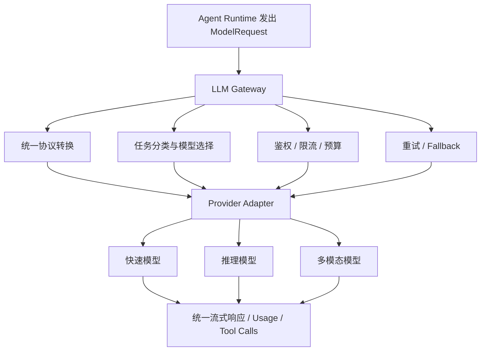

建议统一模型调用的数据结构：

```ts
interface ModelRequest {
  messages: Message[];
  tools?: ToolDefinition[];
  responseFormat?: "text" | "json";
  modelProfile: "fast" | "reasoning" | "vision";
  maxOutputTokens?: number;
  timeoutMs?: number;
  tenantId: string;
  traceId: string;
}
```

这个结构是推荐的实现抽象，不是上述项目共享的原始接口。

**实施效果与验证：**

- 多模型切换时，Agent Loop 无须重写。
- 可以统计模型错误率、P95 延迟、Token 成本和任务成功率。
- 能做任务类型、模型、工具兼容性之间的 A/B 测试。
- Fallback 可以改善特定故障下的可用性，但需专门验证工具参数、结构化输出和上下文兼容性。

**推荐组合：** Provider Adapter + 统一 Model Gateway + 主备 Fallback；当任务和评测数据积累足够后再增加智能路由。

不建议一开始就使用复杂的多模型投票机制。

---

## 2. Prompt：提示词工程与上下文工程

### 2.1 背景

简单 Agent 采用静态提示词：

```text
你是一个专业的业务分析助手，请回答用户问题。
```

复杂 Agent 无法只靠这一段完成所有任务。

例如 Coding Agent 还需要知道：

- 当前工作目录与项目技术栈。
- 项目的 `AGENTS.md`、编码规范和约束。
- 可调用的工具及其参数。
- 当前任务目标及执行进度。
- 之前已经修改了哪些文件。
- 历史压缩后保留了哪些重要信息。

因此，主流方案是将 Prompt 从一个字符串升级为**可组合、可更新、可治理的 Context Assembly（上下文组装）系统**。

### 2.2 主流方案

| 方案 | 背景和使用场景 | 实现思路 | 优点与缺点 |
|---|---|---|---|
| A. 静态 System Prompt | 单一职责的简单 Agent | 固定系统指令 | 稳定简单；适应性差 |
| B. 模板与变量注入 | 多租户、多角色、业务配置 | `{{role}}`、`{{task}}`、`{{context}}` | 易维护；变量过多容易混乱 |
| C. 分段组装 | Coding Agent、复杂企业 Agent | 将角色、环境、工具、知识和约束分成独立 Section | 模块清晰；需要优先级管理 |
| D. 动态上下文注入 | 每次请求的上下文不同 | 根据用户、环境、知识检索结果动态构建 | 针对性强；需管理 Token |
| E. Progressive Disclosure | 工具或技能数量很多 | 初始仅提供摘要，需要时再加载详细说明 | 降低上下文占用；可能遗漏需要的技能 |
| F. Prompt 版本化 | 企业生产和多环境部署 | 模板版本、灰度、评测、回滚 | 可审计；需维护测试 |
| G. 结构化输出约束 | SQL、报表、接口参数等 | JSON Schema、Typed Output、校验和修复 | 易对接程序；复杂 Schema 可能失败 |

### 2.3 源码里的具体方案

**DeepSeek Harness：Section Registry + Scope**

`packages/core/system-prompt` 支持有顺序的 Section、变量、工具 Schema 和独立 Agent Scope。

处理流程为：

```text
注册 Prompt Sections
    ↓
注册动态 Variables
    ↓
根据 Agent Scope 筛选内容
    ↓
组装 Sections 和工具 Schema
    ↓
解析变量、渲染 Prompt
    ↓
发送给 LLM
```

值得借鉴的是：未知变量、缺失变量及无效的完整 Prompt 组合会触发组装错误，而不是悄悄发送不完整 Prompt。

**ZCode：Context Builder**

在 [context/builder.ts](https://github.com/zai-org/ZCode/blob/main/apps/zcode-cli/packages/core/src/context/builder.ts) 中，可以看到明确的上下文分段构建：

- Identity：Agent 身份。
- Environment：环境和 Git 信息。
- Skills：当前可用技能。
- Memory：记忆内容。
- User Context：用户请求上下文。
- Date：动态时间信息。

这种设计适合需要不断注入环境信息的 Coding Agent。

**Pi：上下文文件与运行时组装**

Pi 结合系统提示词、会话活跃分支、工具、技能和项目上下文文件构造模型请求。它还支持修改系统 Prompt 及压缩历史会话。

### 2.4 推荐的企业级实现

```text
Prompt Assembly
├── System Policy          系统级安全和行为规则
├── Agent Profile          Agent 角色、职责和能力
├── Task Instruction       当前任务指令
├── Tool Context           可调用工具的说明
├── Knowledge Context      RAG 检索得到的知识
├── Memory Context         相关历史记忆
├── Runtime Context        当前环境和执行状态
├── Output Contract        JSON Schema / 输出约束
└── Context Budget         Token 预算和截断策略
```

需要注意信任边界：来自文档、网页、RAG 的内容是**数据**，不能因为被注入 Prompt 就拥有与系统指令相同的权限。

推荐增加 Context Budget Manager：

1. 优先保留系统级规则及当前任务。
2. 保留必要的工具 Schema。
3. 按相关度装入知识和记忆。
4. 以摘要替代部分冗长历史。
5. 超出预算时裁剪低优先级内容，必要时重新检索。

**实施效果：** 更容易定位上下文污染、指令冲突、Token 超额及工具选择异常。可用任务完成率、Prompt Token 使用量、格式合规率、检索引用准确率评估。

**推荐组合：** Section Assembly + 动态 RAG + Skills 按需加载 + Token Budget + Prompt 版本管理。

---

## 3. Memory：Agent 的记忆体系

这是七大模块中最容易和 RAG、State 混淆的部分。

### 3.1 背景

Agent 如果只记住当前一次输入，会遇到：

- 多轮对话中忘记之前的约束。
- 长时间编程任务丢失已完成的工作。
- 跨会话需要重复介绍项目背景。
- 历史工具输出占满上下文窗口。
- 用户、项目和业务知识会发生变化，旧记忆可能已经失效。

Memory 的目标不是把所有历史都塞给模型，而是：

**在正确的时间保存有价值的信息，并在需要时准确检索回来。**

### 3.2 主流方案

| 方案 | 背景和原理 | 优点 | 缺点 |
|---|---|---|---|
| A. Full History | 保存完整历史，直接放入上下文 | 信息完整 | Token 很快增长 |
| B. Sliding Window | 只保留最近 N 轮或 Token | 简单、省 Token | 丢失较早信息 |
| C. Summarization | 将旧消息归纳为摘要，保留近期消息 | 适合长任务 | 压缩可能丢失关键细节 |
| D. Episodic Memory | 将历史任务、事件、决策作为记录存储 | 适合跨会话追溯 | 需要抽取和清理策略 |
| E. Semantic Memory | 将事实、偏好、知识组织为可检索记录 | 长期个性化、跨会话复用 | 需要事实更新和冲突消解 |
| F. Procedural Memory | 保存可复用的步骤、规范、Skills | 提高重复工作一致性 | 内容可能过时 |
| G. Hierarchical Memory | 分层组织全局摘要、任务摘要、详细记录 | 适合大型长期项目 | 检索、维护更复杂 |
| H. Branching Memory | 会话形成树，支持分支和回到历史节点 | 适合探索多种方案 | 分支管理和摘要合并复杂 |

### 3.3 真实源码怎么做？

**Pi：树形会话 + 自动压缩。**

Pi 的 SessionManager 使用 JSONL 文件，记录之间通过 `id` 和 `parentId` 构成树。模型使用当前活跃分支构造上下文。

当历史过长时，它对较早消息进行摘要、保留近期内容；原始会话记录仍然保留，而不是直接删除。

其典型思路：

```text
完整历史记录（持久保存）
    ↓
选择当前活跃分支
    ↓
判断是否接近 Token 上限
    ↓
旧历史摘要 + 近期消息保留
    ↓
生成下一次 LLM 上下文
```

**ZCode：独立 Memory 子系统。**

源码位于 [core/src/memory](https://github.com/zai-org/ZCode/tree/main/apps/zcode-cli/packages/core/src/memory)，包括 `extraction.ts`、`dream.ts`、`recall/`、`memory-agent-loop.ts` 等。

它展示了将记忆提取、记忆回忆和记忆处理任务从普通执行循环中分离的设计。

**WeKnora：数据库历史 + 压缩 Checkpoint。**

单轮 Agent Engine 从外部获得历史；`compaction/` 负责压缩，`checkpoint.go` 允许保存上下文压缩结果。这里的上下文 Checkpoint 主要用于避免反复重做历史压缩，不能与任意任务节点的通用恢复机制画等号。

**Flowise：多种会话记忆后端。**

`packages/components/nodes/memory/` 提供 Buffer、Window、Summary、Redis、MongoDB、Zep、Mem0 等接入实现。说明 Memory 的保存策略、存储位置和检索机制可以分别抽象。

### 3.4 主流组合：分层记忆

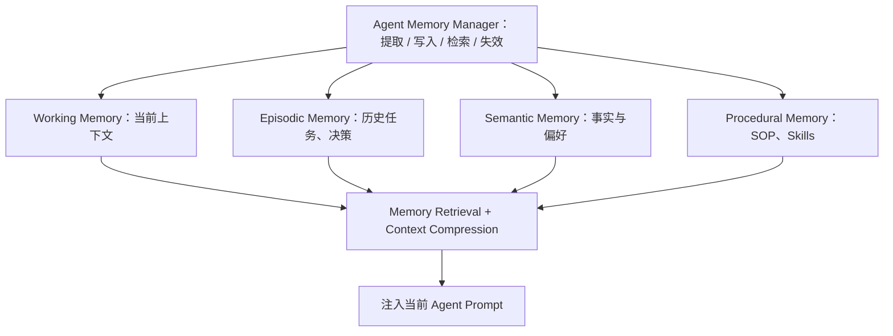

推荐的记忆处理流程：

```text
用户对话 / 任务结果
        ↓
Memory Extractor
提取事实、约束、决策、经验
        ↓
去重 / 权限校验 / 冲突检测
        ↓
Memory Store
保存类型、来源、时间、有效期
        ↓
Memory Retriever
关键词 + 语义 + 元数据检索
        ↓
按相关度与 Token 预算筛选
        ↓
注入下一次 Agent 上下文
```

企业级系统最好为每条长期记忆保存：

`tenantId`、`userId`、`projectId`、`source`、`type`、`createdAt`、`updatedAt`、`expiresAt`、`version` 等字段，并结合记录级权限控制。

特别是企业知识发生更新时，要避免旧事实长期覆盖最新的权威文档。

### 3.5 实施效果和推荐方案

| 场景 | 推荐方案 |
|---|---|
| 普通客服问答 | Window + 少量会话摘要 |
| 长文档分析 | Summary + 外部文件引用 |
| 长时间 Coding Agent | Session Tree + Compaction + 文件状态记录 |
| 跨会话个人助手 | Episodic + Semantic Memory |
| 企业级业务助手 | Session Memory + 项目级 Memory + 独立 RAG |
| 持续积累工作经验的 Agent | Episodic + Procedural Memory + 定期记忆整理 |

实施后，主要验证跨轮约束保持率、长期事实提取准确率、过期记忆误命中率、上下文 Token 消耗和错误记忆传播率。

**我的建议是不要把企业知识库直接当作 Agent Memory。**

业务文档属于企业 Knowledge，用户历史、项目决策和 Agent 执行经验属于 Memory，当前任务进度属于 State。它们可以共享检索基础设施，但应分别管理生命周期、权限与数据更新规则。

---

## 4. Tools：工具调用和外部能力执行

### 4.1 背景

LLM 只能生成调用工具的意图，本身不能保证数据库查询、文件编辑或发送消息已经真正完成。

企业 Agent 需要的 Tools 可能包括：

- 内部 HTTP API、数据库、搜索服务。
- Git、终端、文件系统、代码解释器。
- 飞书、企业微信、钉钉等外部平台。
- RAG 检索、Text-to-SQL、文档转换。
- 由其他 Agent 或 Workflow 暴露的工具。

工具越多，就越容易出现权限越界、参数错误、执行超时、结果过长、重复执行等问题。

因此 Tools 最终会演变为 **Tool Registry + Tool Discovery + Execution Policy + Tool Runtime**。

### 4.2 主流方案

| 方案 | 解决的问题、应用场景 | 实现思路 | 优缺点 |
|---|---|---|---|
| A. Native Function Calling | 模型需要调用确定的业务接口 | 将工具 JSON Schema 提供给模型，由模型生成调用参数 | 标准、稳定；模型依赖工具描述质量 |
| B. MCP | 需要接入大量独立工具服务 | MCP Client 发现并调用 MCP Server 暴露的工具 | 接入标准化；需单独设计鉴权和权限 |
| C. OpenAPI Tool | 已有大量 REST 服务 | 将 API 转换成工具定义 | 能复用现有服务；API 可能不适合直接暴露 |
| D. Dynamic Tool Retrieval | 工具数量非常多 | 按任务检索相关工具，动态提供 Schema | 节约上下文；可能漏选 |
| E. Workflow as Tool | 已有复杂稳定的业务流程 | 把整个 Workflow 包装成一个工具 | 降低 Agent 需要管理的步骤数量；灵活性相对低 |
| F. Code Interpreter / Shell | 文件处理、计算、编程、数据分析 | 在隔离环境执行代码、脚本 | 能完成复杂操作；安全隔离和资源管理成本高 |
| G. Agent as Tool | 子任务需要专门能力 | 调用专用 Agent 并返回结果 | 模块复用；成本、链路和排障更复杂 |

### 4.3 源码体现的关键设计

**Codex：工具能力与执行权限分离**

可以重点研究：

[Tool Router](https://github.com/openai/codex/blob/main/codex-rs/core/src/tools/router.rs) → [Approvals](https://github.com/openai/codex/blob/main/codex-rs/core/src/tools/approvals.rs) → [Sandboxing](https://github.com/openai/codex/blob/main/codex-rs/core/src/tools/sandboxing.rs)

其设计思想是：

```text
模型提出工具调用
       ↓
Tool Router 定位工具
       ↓
参数与策略检查
       ↓
检查沙箱权限及审批要求
       ↓
必要时人工确认
       ↓
真正执行工具
       ↓
返回结构化结果
```

权限控制不是靠 Prompt 写一句“不要执行危险操作”，而是由宿主程序在执行边界进行检查。

**DeepSeek Harness：并行、独占和确定性结果处理**

`agent-loop/src/tool-calls.ts` 中可以看到：

- 批次化调度工具调用。
- 并行工具使用有界并发池。
- 需要独占执行的工具形成调度屏障。
- 调用可以并发执行，但最终结果按模型调用顺序提交。
- 取消时为未执行调用保留可恢复的结果记录。

这是非常值得借鉴的细节。

例如，一批独立的数据库只读查询可以并发，但修改同一个文件的多个工具调用不应随意并发。

**WeKnora：MCP + 审批 + 数据操作**

在 [tools 目录](https://github.com/Tencent/WeKnora/tree/main/internal/agent/tools) 中，已经有 MCP、数据库查询、数据分析、文件操作等实现；`approval/` 独立维护审批流程。

这说明工具接入与用户授权属于两个不同模块。

### 4.4 推荐实现方案

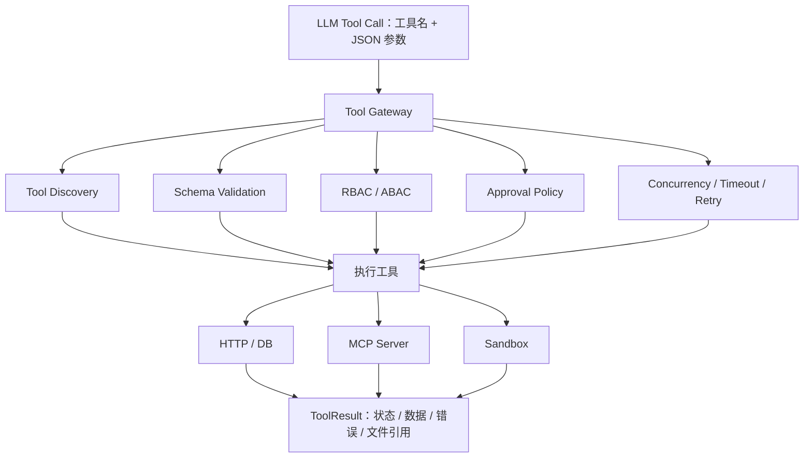

建议把工具能力设计成包含两部分的数据结构：

```ts
interface ToolDefinition {
  name: string;
  description: string;
  inputSchema: object;

  // 宿主端策略，不直接交给模型决定
  permission: string;
  riskLevel: "low" | "medium" | "high";
  requiresApproval: boolean;
  timeoutMs: number;
  concurrencySafe: boolean;
  idempotent: boolean;
}
```

这也是一种推荐的实现抽象，并非 MCP 的原生 Tool Schema。

对于工具的执行，应遵循这些原则：

- 先进行参数、租户身份和资源权限校验，再执行。
- 工具调用由服务端绑定用户身份，不信任模型生成的 `userId` 或 `tenantId`。
- 删除、发布、付款、发送对外消息等操作设置审批或其他可靠授权机制。
- 对有副作用的操作使用幂等键；不能直接把所有失败都当作安全可重试。
- 工具返回大文件时，保留 Artifact 引用，而不是把全部内容写进上下文。
- Shell、Python、浏览器等高风险执行能力放入资源受限的沙箱。

**实施效果：** 工具扩展更方便，权限边界更清晰，并可以分别统计工具选择正确率、调用成功率、审批率、超时率和重复副作用事件。

**主流推荐组合：**

`Native Function Calling + MCP + Tool Registry + Policy Engine + Sandbox`

工具规模扩大后，再增加 Tool Retrieval。MCP 本身不是权限治理系统，仍然需要宿主侧的安全控制。

---

## 5. Planning：Agent 如何规划任务

### 5.1 背景

简单任务只需要一次回答，复杂任务可能需要：

- 先获取资料，再分析，再生成文档。
- 发现数据不完整后补充查询。
- 某个工具失败后更换执行方式。
- 多个独立子任务并行。
- 在风险操作前等待审批。

这里存在两种不同需求：

**自主性：** Agent 能根据中间结果决定下一步。

**确定性：** 企业需要限定任务必须遵守的流程。

Planning 的主要设计问题，就是在自主性和确定性之间做选择。

### 5.2 七种主要方案

| 方案 | 背景和适用场景 | 思路 | 优缺点 |
|---|---|---|---|
| A. ReAct | 工具探索、信息不确定、多轮查询 | 推理与工具调用交替执行 | 灵活；调用次数不易预测 |
| B. Plan-and-Execute | 复杂多步骤任务 | 先拆解计划，再逐步执行 | 过程清晰；计划可能过时 |
| C. Replanning | 执行结果可能改变原计划 | 计划 → 执行 → 评估 → 修订计划 | 适应性更强；额外模型开销 |
| D. DAG / Workflow | 固定业务流程、审批、ETL | 预定义节点及依赖关系 | 稳定可审计；不能任意自主探索 |
| E. Dynamic Workflow | 复杂任务需要动态生成执行图 | Planner 创建任务依赖图，再由调度器执行 | 支持动态并行；校验复杂 |
| F. Multi-Agent Planning | 不同专业任务需要独立 Agent | Supervisor 分配给多个 Worker | 分工明确；通信和协调复杂 |
| G. Reflection / Critic | 生成结果需要质量检查 | 生成 → 评估 → 修改 | 适合质量敏感任务；容易增加成本和循环 |

### 5.3 ReAct：最基础的动态规划方式

```mermaid
flowchart TB
    U[用户任务] --> L[LLM 决策：调用工具还是回答]
    L --> T[Tool Action：检索 / SQL / 操作]
    T --> O[Observation：更新上下文]
    O --> C{满足终止条件?}
    C -- 否 --> L
    C -- 是 --> F[Finish]
```

Codex、Pi、DeepSeek Harness、WeKnora 等都包含这种以模型决策和工具反馈为核心的运行模式。

ReAct 的优势是动态处理未知情况，适合搜索、调试、代码修复和 Agentic RAG。

缺点是不能保证每次都选择最优工具、最短路径或正确结束，因此必须配合最大步数、Token 预算、超时及结果校验。

### 5.4 Plan-and-Execute：先拆任务，再执行

例如：

```text
目标：完成一个企业运营数据分析报告

Planner
├── T1 查询销售数据
├── T2 查询用户数据
├── T3 查询活动成本
├── T4 计算指标和分析
├── T5 生成 Excel / Word
└── T6 审核并发送报告
```

这里不必全部串行。

```mermaid
flowchart TB
    P[Planner：生成任务图] --> T1[T1 销售]
    P --> T2[T2 用户]
    P --> T3[T3 成本]
    T1 --> T4[T4 指标计算与综合分析]
    T2 --> T4
    T3 --> T4
    T4 --> T5[T5 生成报告]
    T5 --> T6[T6 审核与发送]
```

T1、T2、T3 相互独立时可以并行；T4 必须等待三者完成。

ZCode 的 [workflow/scheduler.ts](https://github.com/zai-org/ZCode/blob/main/apps/zcode-cli/packages/core/src/workflow/scheduler.ts) 是值得研究的实现：它通过就绪节点、阻塞节点、依赖图和最大并发参数组织工作流。

对于计划生成部分，应该要求 Planner 输出经过 Schema 校验的任务结构，检查循环依赖、权限和资源预算后才能调度，而不能任意执行模型生成的代码。

### 5.5 Multi-Agent：什么时候值得使用？

LlamaIndex 的 [multi_agent_workflow.py](https://github.com/run-llama/llama_index/blob/main/llama-index-core/llama_index/core/agent/workflow/multi_agent_workflow.py) 提供 Handoff 等机制；AutoGen 利用 GroupChatManager 协调参与者；CrewAI 则强调角色和任务。

主流有三种组织方式：

| 方式 | 思路 | 场景 |
|---|---|---|
| Supervisor-Worker | 一个 Agent 分配、监督多个 Worker | 有明确专业分工的复杂任务 |
| Handoff | 当前 Agent 将任务移交给下一个 Agent | 客服转工单、研发角色交接 |
| Parallel Experts | 多个 Agent 并行分析，统一汇总 | 多维度分析、独立信息收集 |

实施效果应重点衡量整体任务成功率、完成时间、模型调用数量、Agent 间消息量和协调失败率。

**推荐组合：**

- 普通问答：不需要显式 Planner。
- 检索与探索：ReAct。
- 多步骤生成：Plan-and-Execute。
- 复杂且可能变化的任务：Plan-and-Execute + Replanning。
- 有稳定业务规则的企业流程：Workflow + 局部 Agent。
- 明确需要专业协作：Supervisor + 专用 Agent。

实际开发中，我更推荐 **Workflow 负责流程控制，Agent 负责局部智能决策**，而不是所有操作都交给一个超级 Agent。

---

## 6. Execution：Agent 如何真正运行

Planning 解决任务步骤选择，Execution 解决步骤如何被可靠执行。

### 6.1 背景

在真实环境里，仅实现：

```ts
while (true) {
  const response = await llm.call(messages);
  // 根据结果调用工具
}
```

还远远不够。

生产系统还要考虑：

- 请求超时、流式响应中断。
- 并发工具执行和结果顺序。
- 工具失败后的恢复策略。
- 执行中用户追加新消息。
- 用户主动取消任务。
- 人工审批需要暂停数小时。
- 服务重启后怎样继续。
- 执行成本及无限循环控制。

### 6.2 主流执行方案

| 方案 | 背景和适用场景 | 方案思路 | 优缺点 |
|---|---|---|---|
| A. Sequential Agent Loop | 简单问答、短任务 | LLM 与工具轮流执行 | 最容易实现；复杂任务扩展有限 |
| B. Event-driven Loop | 流式任务、实时交互 | 通过事件驱动模型、工具和 UI 更新 | 可观察性强；事件一致性更复杂 |
| C. Graph Runtime | 多分支、多节点业务 | 节点、边、状态更新和任务调度 | 易表达复杂流程；有学习成本 |
| D. Parallel Executor | 多个独立工具或任务 | 有界并发、结果聚合 | 提高吞吐；存在并发与冲突风险 |
| E. Durable Execution | 长时间执行、跨服务故障 | Checkpoint + 恢复 + 幂等副作用 | 提高恢复能力；基础设施更复杂 |
| F. Human-in-the-loop | 审批和人工输入 | 暂停 → 持久化 → 收到输入 → 继续 | 安全可控；增加交互时间 |
| G. Distributed Worker | 高并发、定时任务、耗时操作 | 队列分发、Worker 执行、Lease 和重试 | 可扩展；运维与一致性成本更高 |

### 6.3 源码分析：Agent Loop 的标准生命周期

结合 DeepSeek Harness 的 `ReactLoopAgent`、Pi 的 `agentLoop` 以及 Haystack 的 Agent，实现思路可以归纳为：

```text
Start
  ↓
接受用户任务
  ↓
构建 Prompt 和上下文
  ↓
向 LLM 发起请求
  ↓
接收流式模型输出
  ↓
是否存在 Tool Calls？
  ├── 否 → 校验最终答案 → Finish
  │
  └── 是
       ↓
     检查工具 Schema 和权限
       ↓
     调度工具执行
       ↓
     收集结果或错误
       ↓
     更新 State / Session
       ↓
     检查步数、取消、预算和超时
       ↓
     继续下一次 LLM 请求
```

核心区别是：真实 Agent Runtime 要在每个步骤周围增加生命周期控制，而不是只有一个简单循环。

### 6.4 几个值得参考的实现

**DeepSeek Harness：事件和执行器结合。**

它明确区分 Turn 和 Step，并将模型输出、工具结果写入会话事件日志。这使得日志不仅用于展示，还能作为恢复历史和派生模型上下文的依据。

**LangGraph：状态图执行。**

LangGraph 提供 StateGraph、Checkpoint、Interrupt 和 Command 等机制。中断时保存图状态，恢复时通过相应会话标识定位状态。

特别需要注意：某些中断恢复会重新执行节点的前半部分。因此，节点内已经产生的外部副作用必须设计为幂等，或拆分为可以安全恢复的独立操作。

**Haystack：生命周期 Hooks。**

Haystack 允许在 LLM 调用前、工具执行前后和 Agent 退出时进行拦截。可以将脱敏、上下文压缩、结果裁剪、工具审计等能力作为 Hook 注入，而不是塞进 Agent 核心循环。

**RAGFlow：Eino + Checkpoint。**

RAGFlow 的 Go Canvas 实现中，有运行状态、图执行、Checkpoint Store 和中断恢复模块。当前代码中可以看到使用 Kvrocks/Redis 兼容存储保存 Eino Checkpoint 的实现。

### 6.5 企业级推荐执行流程

```text
Agent Runtime
   ↓
Task Scheduler
   ↓
创建执行记录 runId
   ↓
加载 State / Checkpoint
   ↓
执行节点或 Agent Loop
   ↓
Tool Policy / Approval
   ↓
Tool Executor / Sandbox
   ↓
保存结果及下一步 State
   ↓
完成 / 失败 / 暂停 / 取消
   ↓
写入事件日志和监控
```

一个任务至少应能明确表示这些状态：

`pending`、`running`、`waiting_approval`、`paused`、`succeeded`、`failed`、`cancelled`。

真正支持持久化恢复，还需要配合：

- 可持久化的任务队列或可靠调度器。
- Worker 租约及心跳。
- Checkpoint 的持久化与版本管理。
- 副作用幂等与结果去重。
- 服务崩溃后的任务认领与恢复。
- 明确的失败处理、取消及补偿策略。

不能因为框架支持 Checkpoint，就认为它自动具有完整的分布式任务恢复能力。

**实施效果：** 可以减少故障导致的任务丢失，支持长任务暂停与恢复，也便于分析哪一步失败。但需要通过进程终止、网络中断、重复消息和存储故障测试验证。

**推荐组合：**

`Graph Runtime + Checkpoint + Event Log + Durable Job Queue + Tool Idempotency`

对于短任务，不必一开始就引入分布式执行；长任务和多用户高并发再升级。

---

## 7. State：Agent 运行状态的设计与持久化

### 7.1 背景

Memory 是 Agent 未来可能需要回忆的信息，而 State 是执行器现在需要掌握的事实。

例如生成报表任务：

```json
{
  "runId": "run_1001",
  "status": "waiting_approval",
  "currentStep": "send_report",
  "completedSteps": [
    "query_data",
    "analyze_data",
    "generate_report"
  ],
  "reportArtifactId": "file_1001"
}
```

当任务等待用户确认时，即使模型没有运行，系统也必须保存这些执行状态。

### 7.2 主流方案

| 方案 | 背景和使用场景 | 实现思路 | 优缺点 |
|---|---|---|---|
| A. In-memory State | 短任务、单进程 | 使用 JS 对象、Python dict 或 Go struct | 性能好；进程退出丢失 |
| B. Typed State | 多节点、多人维护 | 用 Schema 定义字段类型和更新规则 | 清晰、可校验；存在 Schema 演进成本 |
| C. Shared Graph State | Workflow、Multi-Agent | 多节点通过统一 State 读写、合并字段 | 跨节点协作方便；要控制写冲突 |
| D. Checkpoint | 需要暂停、恢复、调试 | 定期持久化执行快照 | 恢复直接；可能增加存储开销 |
| E. Event Sourcing | 需要审计、回放、分支 | 只追加事件，通过事件重建视图 | 可追溯；事件迁移和回放复杂 |
| F. Snapshot + Event Log | 长会话、高审计要求 | 周期快照，加上增量事件 | 平衡恢复效率和审计能力；实现复杂 |
| G. Distributed State | 多 Worker、高并发 | 数据库状态、版本控制、租约和原子更新 | 支持跨进程协作；并发一致性困难 |

### 7.3 源码里的四种典型思路

**LangGraph：Typed State + Reducer + Checkpoint。**

`StateGraph` 中使用类型化状态，并可为字段定义合并语义；配套 Checkpointer 将执行状态持久化。

适合步骤明确、有并行分支和人工中断的系统。

**DeepSeek Harness：Append-only Event Log。**

Session 本身就是一组追加的 `SessionEvent`。模型历史不是唯一的源数据，而是由事件日志派生的视图。

适合需要审计、重建上下文、事件驱动扩展的 Agent Harness。

**Pi：Session Tree。**

历史会话按树形关系记录。可以在不同历史节点继续探索，同时保留已经发生的其他分支。

适合交互式 Coding Agent、历史方案探索和对话分叉。

**RAGFlow：CanvasState + Checkpoint Store。**

其 `CanvasState` 包含节点输出、系统变量、环境变量、历史、Memory、检索结果、全局变量和运行标识等字段，并通过锁保护共享 Map。

Checkpoint Store 则负责保存可恢复状态。

### 7.4 推荐组合

```mermaid
flowchart TB
    A[Agent Run / Workflow Run] --> L[Live State：当前节点和中间输出]
    A --> S[(State Store：任务状态、版本、租约)]
    A --> C[(Checkpoint Store：快照)]
    A --> E[(Event Log：事件与审计)]
    L --> R[Restore / Replay / Fork]
    S --> R
    C --> R
    E --> R
```

我建议企业级系统把下面几种数据分开保存：

| 数据 | 推荐位置 | 为什么 |
|---|---|---|
| 当前短生命周期执行状态 | 内存 / Redis | 访问快、更新频繁 |
| 任务最终状态、业务记录 | PostgreSQL | 需要事务及可靠查询 |
| Checkpoint | PostgreSQL / 兼容的持久化存储 | 支持执行恢复 |
| Event Log | PostgreSQL / 专用事件存储 | 审计、排障、回放 |
| 大型工具输出 | S3 / MinIO / 对象存储 | 避免数据库和上下文膨胀 |
| 长期 Memory | 业务库 + 可选向量索引 | 便于检索与生命周期管理 |

还应解决并发更新、乐观锁、Schema 版本迁移和状态清理等问题。高风险操作必须结合幂等机制，不能假设恢复后不会再次执行。

**实施效果：** 任务状态可见、可审计、可恢复；能统计恢复成功率、故障恢复时间、重复副作用数量和 Checkpoint 存储成本。

**推荐组合：**

- 简单 Agent：Typed State。
- 普通 Workflow：Typed State + Checkpoint。
- 长任务企业 Agent：Typed State + Checkpoint + Event Log。
- 需要审计回放、分支探索的平台：Snapshot + Event Sourcing。
- 多 Worker 分布式任务：以上方案再加租约、版本控制和幂等执行。

---

# 五、七大模块如何组合？主流架构模式

前面是各模块的独立方案。真正开发系统时，最重要的是根据业务场景组合，而不是每个模块都选功能最多的方案。

## 5.1 五种值得掌握的架构模式

| 架构模式 | 模块组合 | 适用场景 | 优势和代价 |
|---|---|---|---|
| **模式 A：轻量 ReAct Agent** | LLM + Prompt + Window Memory + Tools + ReAct + Agent Loop + In-memory State | 简单助手、搜索、短任务 | 实现快、维护低；不适合跨故障长任务 |
| **模式 B：知识增强 Agent** | Model Adapter + 动态 Prompt + Summary + RAG Tools + ReAct + Agent Loop + Session State | 企业知识问答、复杂资料检索 | 知识能力强；需要管理检索质量和上下文 |
| **模式 C：可控业务 Workflow** | Model Gateway + Template + Session Memory + 业务工具 + DAG + Graph Runtime + Checkpoint | 报表、审批、运营自动化 | 可控、易审计；动态自主能力受约束 |
| **模式 D：长任务自主 Agent** | Model Router + Context Assembly + 分层 Memory + Sandbox Tools + Replanning + Durable Execution + Event Log | Coding Agent、自动化研发、复杂分析 | 功能全面；成本和运行复杂度高 |
| **模式 E：多 Agent 协作** | 多模型 + 角色 Prompt + Shared/Private Memory + Agent Tools + Supervisor + Graph Runtime + Shared State | 多角色研发、跨领域任务 | 专业化协作；通信成本、状态一致性和排障更复杂 |

### 对应开源项目怎么选择？

**简单 Agent / 自研 Agent Loop**

参考 Pi、DeepSeek Harness 和 Haystack。前者有清晰的 Agent Loop 与 Session 抽象，后者更适合学习插件化与生命周期扩展。

**知识型 Agent**

优先考察 RAGFlow、WeKnora；需要自行构造检索 Pipeline 时看 LlamaIndex、Haystack。跨文档关系和全局主题问题再引入 GraphRAG。

**企业 Workflow / Agent 编排**

代码驱动优先 LangGraph；可视化交付优先 Dify、Flowise。多 Agent 通信还可参考 AutoGen、CrewAI。

**Coding Agent / 研发自动化**

重点研究 Codex 的执行安全、ZCode 的状态机与 Workflow 调度、Pi 的轻量 Loop、DeepSeek Harness 的可替换插件架构。

## 5.2 主流方案不是简单相加，而是分层组合

例如：

- LangGraph 管理复杂任务执行。
- RAGFlow 或 WeKnora 提供独立知识服务。
- Model Gateway 管理 LLM。
- MCP / HTTP Tool Gateway 提供业务工具。
- PostgreSQL 保存执行状态和持久数据。
- Redis 提供缓存、限流和必要的任务协作机制。
- 对象存储保存源文件、转换产物和生成结果。
- Dify / Flowise 可以作为快速构建应用的界面和编排工具，而不是必须成为整个系统的底层运行时。

避免同时引入多个承担相同职责的框架。例如：已有 LangGraph 负责全部任务编排时，不需要再增加另一套通用工作流执行器来执行同一任务，除非两者负责不同层次。

---

# 六、如果重新设计企业级 AI 中台，我会采用什么架构？

对于需要企业内部问答、多格式资料处理、报告及代码生成，同时向官网、H5、后台等应用提供 AI 能力的系统，我更倾向于以下架构。

```mermaid
flowchart TB
    APP[应用接入：内部 AI 中台 / Web / H5 / 管理后台 / 企业 IM / 外部 API] --> G[AI Gateway / App Service]
    G --> A[Agent Runtime / Orchestration]
    A --> P[Planning：ReAct / DAG / Multi-Agent]
    A --> E[Execution：Loop / Scheduler / Durable]
    A --> PR[Prompt：Sections / Context Budget]
    A --> S[State：Checkpoint / Event Log]
    A <--> L[LLM Gateway：Provider / Fallback]
    A <--> M[Memory Service：会话 / 长期记忆 / 压缩]
    A <--> T[Tool Gateway：MCP / API / 沙箱 / 审批]
    A <--> K[Knowledge Service：RAG / 混合检索 / GraphRAG]
    S --> DB[(PostgreSQL / Redis / Queue)]
    K --> V[(Vector / Search)]
    M --> DB
    T --> FILE[文件处理管线]
    FILE --> OBJ[(MinIO / S3)]
    OBS[Tracing / Audit] -.-> A
```

这里最重要的不是采用多少框架，而是各层边界清晰：

**Agent Runtime 决定和执行任务；Knowledge 提供事实资料；Memory 保留需要回忆的信息；State 确保运行过程可控、可恢复。**

## 6.1 多模态输入应该放在哪里？

PDF、DOCX、Excel、图片、视频、音频、网页、PSD 等文件的解析不应全部塞进 Agent Loop。

更合理的是独立的数据处理管线：

```text
原始资料上传
      ↓
文件格式识别 / 病毒扫描 / 权限检查
      ↓
异步解析
├── 文档文本和版面结构
├── 表格与公式信息
├── 图片 / OCR / 视觉信息
├── 视频关键帧与字幕
├── 音频转录
└── PSD 等专业格式转换
      ↓
标准化内容 + 元数据
      ↓
分块 / 关系抽取 / 索引
      ↓
知识检索服务
      ↓
Agent 按需调用检索工具
```

建议保留两类数据：

1. **原始权威资料**：原文件、来源、版本、更新时间和权限，不可随意被索引数据覆盖。
2. **派生的检索资料**：解析结果、Chunks、向量、关键词、图谱和摘要，可以重建。

对于过期知识或知识补充，不是简单维护两份互不关联的知识库，而是通过版本、有效期、来源优先级和重新索引控制更新。

RAGFlow、WeKnora 很适合研究这一层。但专业格式、超大文件、特殊视频内容的处理能力，仍需要针对文件类型逐一测试，不应假设开源 RAG 平台天然支持所有格式。

## 6.2 具体的七大模块选型

| 模块 | 推荐主方案 | 必要时扩展 |
|---|---|---|
| LLM | 统一 Provider Adapter + Gateway | 任务级路由、Fallback、多模型验证 |
| Prompt | Section Assembly + 动态 Context | Skills、Prompt 版本、上下文评测 |
| Memory | Session History + Compaction | 长期语义记忆、项目记忆、经验记忆 |
| Tools | Function Calling + MCP Gateway | Tool Retrieval、Sandbox、Agent as Tool |
| Planning | ReAct + 预定义 Workflow | Replanning、Dynamic DAG、Multi-Agent |
| Execution | LangGraph.js + 独立任务调度 | 分布式 Worker、人工审批、补偿机制 |
| State | Typed State + Checkpoint | Event Sourcing、Snapshot、可恢复执行 |

这是偏向具有自研需求的企业 AI 中台的方案，而不是所有项目都需要的最低配置。

对于 Node.js / TypeScript 体系，可以考虑：

- **NestJS**：API、认证授权、业务服务、工具接入。
- **LangGraph.js**：Agent 和 Workflow 编排。
- **PostgreSQL**：会话元数据、执行状态、业务持久化。
- **Redis + 可靠队列**：限流、缓存、异步任务和 Worker 协作。
- **RAGFlow / WeKnora**：择一作为主要知识服务，根据检索评测结果决定是否增加专门的检索组件。
- **MCP Gateway**：外部和内部工具的统一接入与授权。
- **对象存储 + 文件 Worker**：解析输入与保存生成产物。
- **OpenTelemetry 等工具**：统一 Trace、执行指标和审计关联。

## 6.3 什么情况下不建议采用复杂方案？

| 场景 | 不建议默认引入 | 原因 |
|---|---|---|
| FAQ、普通知识查询 | Multi-Agent、复杂 Planner | 常规混合检索 + 单次生成通常更容易控制 |
| 简单表单生成 | 自主式 ReAct 循环 | 结构化输出或固定 Workflow 更合适 |
| 固定审批业务 | 完全自主 Planner | 必须保证审批顺序和确定性 |
| 少量工具 | Tool Retrieval | 直接注册更简单、可预测 |
| 无关系检索需求的文档 | 全量 GraphRAG | 建图成本高，不一定提高效果 |
| 短任务 | Event Sourcing + 分布式 Worker | 运维复杂度可能超过收益 |
| 角色区别只是 Prompt | 多个独立 Agent | 可能仅增加成本和状态管理难度 |

---

# 七、实施顺序：先解决哪些问题？

如果要真正落地，不建议七个模块同时开发到最复杂的程度。

### P0：建立最小可运行的 Agent 核心

Provider Adapter、Prompt Assembly、Function Calling、Agent Loop、Session History、Typed State，以及基础鉴权和日志。

**验收：**工具调用成功、模型输出可校验、错误有明确状态、可追踪一次完整执行。

### P1：补齐企业级安全与长任务能力

MCP、Tool Policy、审批、Sandbox、Compaction、Checkpoint、超时取消、任务幂等。

**验收：**高风险工具不能越权，任务能暂停、恢复，故障重试不产生重复副作用。

### P2：完善知识与复杂编排

多模态知识处理、混合检索、Replanning、Workflow、多 Agent Handoff、长期 Memory。

**验收：**知识引用正确，复杂任务能够完成，权限过滤可靠，长任务可控。

### P3：优化成本、质量和稳定性

智能模型路由、Tool Retrieval、执行轨迹评测、长期记忆质量治理、分布式调度和复杂恢复策略。

**验收：**通过同一批评测任务证明新方案在质量、成本、延迟或可靠性上有收益。

## 7.1 实施效果应该怎么测量？

不能只用“感觉 Agent 更聪明了”判断方案有没有价值。

| 模块 | 建议测量的指标 |
|---|---|
| LLM | 首 Token 延迟、P95 耗时、错误率、成本、任务正确率 |
| Prompt | 格式符合率、上下文命中率、Token 使用量、指令遵守率 |
| Memory | 记忆召回率、错误记忆率、跨轮约束保持率、过期信息率 |
| Tools | 工具选择正确率、参数正确率、调用成功率、越权拦截率 |
| Planning | 计划可执行率、步骤冗余、最终任务成功率、重规划次数 |
| Execution | 执行成功率、超时率、恢复成功率、重复副作用数量 |
| State | Checkpoint 恢复正确率、状态一致性、回放成功率、恢复耗时 |

推荐建立基线评测集，然后分模块做消融测试：

```text
Baseline Agent
     ↓
增加 RAG
     ↓
增加 Memory
     ↓
增加 Planning
     ↓
增加 Checkpoint
     ↓
增加多模型路由
```

每增加一项能力，都用相同任务集比较完成质量、费用和延迟。没有实际改善的复杂设计，就不一定需要长期保留。

---

# 八、最终的技术判断

从这些开源项目中，我认为最值得借鉴的并不是某一个现成框架，而是以下几种设计思想：

| 设计思想 | 优先参考项目 | 借鉴重点 |
|---|---|---|
| 极简且可理解的 Agent Loop | Pi | 模型与工具的交互循环、上下文和 Session 分离 |
| 所有核心能力可插拔 | DeepSeek Harness | Service / Plugin / Event 边界 |
| 显式生命周期状态机 | ZCode | Turn Machine、工具调度、动态任务图 |
| 工具执行安全 | Codex | Router、Policy、Approval、Sandbox |
| 有状态的复杂编排 | LangGraph | StateGraph、Reducer、Checkpoint、Interrupt |
| 应用级编排和交付 | Dify、Flowise | 可配置 Agent、Workflow、业务接入 |
| 企业知识服务 | RAGFlow、WeKnora | 知识解析、检索、Agentic RAG、知识生命周期 |
| 数据检索抽象 | LlamaIndex、Haystack | Query、Retriever、Pipeline、Agent 组件化 |
| 图知识与全局推理 | Microsoft GraphRAG | Entity、Relationship、Community、Global/Local Search |
| 多 Agent 协作 | AutoGen、CrewAI | Agent Team、Handoff、任务协作 |

**如果只选择一条主流企业级开发路线：**

我会选择 **LangGraph 作为可控编排核心，借鉴 Pi / DeepSeek Harness 构建灵活的 Agent Loop 和上下文管理，借鉴 Codex 的工具安全体系，使用 RAGFlow 或 WeKnora 作为独立知识服务，再通过业务网关和持久化执行系统形成完整闭环。**

对于不需要大量自研的平台，则可以直接采用 Dify 或 Flowise，减少底层建设工作。

还应区分两个方向：

- **研究 Agent 底层原理**：优先深入 Pi、DeepSeek Harness、ZCode、Codex。
- **建设可用于生产的企业 AI 应用系统**：优先掌握 LangGraph、Dify、RAGFlow/WeKnora，并补齐权限、状态、监控、部署与评测。

这次源码比较覆盖了你指定的主要项目及其关键模块，但还不能替代固定 Commit 的逐函数审计、架构验证和实际基准测试。尤其这些仓库迭代较快，关键选型在实施前仍应锁定版本并执行集成验证。

**最终要掌握的不只是七种技术，而是七个模块之间的边界、数据流、故障处理，以及如何在不同业务场景中选择最小有效组合。**


