# AI Agent 七大核心模块：主流开源方案、源码架构与企业级落地（完整版）

> 资料基准：2026-10-17。本文件由两部分组成：**上半部分是提炼后的核心结论、选型和关键 Mermaid 流程图；下半部分是上一条答复的完整文字归档**。为使 Markdown 跨编辑器可用，原答复里的交互式卡片/图示转成 Mermaid、`<Cite>` 引用转换为仓库链接或合并至源码入口，不改变其技术观点。源码检查基于当时默认分支的关键文件；不是固定 Commit 的逐行审计，效果部分没有编造压测数据。

## 阅读导航

- [上篇：核心结论、选型与流程图](#上篇核心结论选型与流程图)
- [1. 一页掌握七大模块](#1-一页掌握七大模块)
- [2. 主流方案选型速查](#2-主流方案选型速查)
- [3. 核心流程图](#3-核心流程图)
- [4. 组合架构与应用场景](#4-组合架构与应用场景)
- [5. 项目与源码定位速查](#5-项目与源码定位速查)
- [6. 落地优先级、效果与验收](#6-落地优先级效果与验收)
- [下篇：上一条回答完整原文归档](#下篇上一条回答完整原文归档)

---

# 上篇：核心结论、选型与流程图

## 1. 一页掌握七大模块

### 1.1 核心认识

Agent 不是“一个 LLM + 一套提示词 + 若干工具”，而是**以 Agent Runtime 为核心，围绕模型、上下文、知识、工具、计划、运行状态和安全策略形成可控制、可恢复、可观察的闭环**。

- **LLM：**生成下一步决策或内容。主流方案是 Provider Adapter、模型网关、策略路由、重试与降级。
- **Prompt：**在每次模型调用前组装角色、约束、环境、工具、记忆、检索结果、输出协议；当前重点已从 Prompt Engineering 转向 Context Engineering。
- **Memory：**保存及选择性回忆跨轮、跨会话信息；包括短期会话、压缩摘要、情景/事实/过程记忆。
- **Tools：**把模型产生的调用意图变成真实且受控的执行；包括 Schema、Registry、MCP、授权、审批、沙箱、幂等。
- **Planning：**确定步骤及依赖；包括 ReAct、Plan-and-Execute、动态重规划、DAG、Multi-Agent。
- **Execution：**实际运行循环或图，负责任务调度、并发、重试、中断、恢复、完成判定。
- **State：**保存当前任务和运行生命周期；包括 Typed State、事件日志、检查点、快照、回放。

> **Memory ≠ State ≠ Knowledge**：Memory 是供未来推理回忆的信息；State 是当前任务执行事实；Knowledge 是相对权威、可检索的业务知识。三者可以复用基础设施，但不应共用同一套权限与生命周期规则。

### 1.2 七层速查矩阵

| 模块 | 主要矛盾 | 最小可用方案 | 企业级主流演进 | 参考源码 | 验证效果 |
|---|---|---|---|---|---|
| LLM | 模型协议、质量、成本、可用性不同 | 一个 Provider Adapter | Gateway + 任务级路由 + Fallback | Pi、DeepSeek Harness、Dify | 正确率、P95、Token 成本、故障切换成功率 |
| Prompt | 指令、上下文不断变化，窗口有限 | 模板 + 近期历史 | 分段组装 + 动态检索 + Skills 按需加载 + Token 预算 | ZCode、DeepSeek Harness、Codex | 指令遵循率、Token、格式合规率 |
| Memory | 历史变长、遗忘、过期和冲突 | 会话窗口 + 摘要 | 情景/事实/过程记忆 + 检索 + 治理 | Pi、ZCode、WeKnora、Flowise | 召回、事实准确性、过期误命中 |
| Tools | 接入外部系统的安全和可靠性 | Function Calling + Schema | Registry + MCP + Policy + 审批 + 沙箱 | Codex、DeepSeek Harness、WeKnora | 调用成功、越权拦截、重复副作用 |
| Planning | 自主性 vs 流程确定性 | ReAct | Workflow + 局部 Agent + 重规划；必要时多 Agent | LangGraph、ZCode、AutoGen、CrewAI | 任务完成率、步骤冗余、协作成本 |
| Execution | 中断、并发、失败、长任务 | Agent Loop | Graph Runtime + Checkpoint + 可靠调度 + 幂等 | DeepSeek Harness、Pi、LangGraph、RAGFlow | 恢复成功率、耗时、失败率 |
| State | 任务事实和恢复点丢失 | 类型化对象 | Typed State + Checkpoint + Event Log | LangGraph、RAGFlow、Pi、ZCode | 状态一致性、回放和恢复正确率 |

### 1.3 最值得迁移的开源设计原则

1. **Pi：**最值得学习简洁 Agent Loop、Session Tree、Compaction，保持低复杂度。
2. **DeepSeek Harness：**把模型、Prompt、Tools、Session、Agent Loop 做成可替换边界；事件日志驱动会话视图。
3. **ZCode：**明确 Turn Machine、Workflow Scheduler、Context Builder 与独立 Memory。
4. **Codex：**严格区分工具发现、路由、执行权限、审批与沙箱。
5. **LangGraph：**有状态图执行、Reducer、Checkpoint、Interrupt/HITL。
6. **RAGFlow / WeKnora：**知识解析、检索和 Agentic RAG 解耦，权威知识不直接等于 Agent Memory。
7. **Dify / Flowise：**作为应用交付层和可视化编排层，避免与自研底层编排的职责重复。
8. **LlamaIndex / Haystack / GraphRAG：**按检索特征选择框架，而不是每个数据集都上知识图谱。

## 2. 主流方案选型速查

| 业务场景 | 首选组合 | 为什么 | 不建议默认引入 |
|---|---|---|---|
| FAQ / 普通知识问答 | 固定 Prompt + 混合 RAG + 简单 Session | 易评测、可控且足够有效 | Multi-Agent、复杂 Planner |
| 复杂企业资料问答 | Agentic RAG + 检索工具 + 引用 + Context Budget | 需反复查询和核对证据 | 全部文件直接塞上下文 |
| 运营分析和报表 | 预定义 Workflow + 局部 ReAct + 只读 SQL + 报表工具 | 固定流程中保留灵活分析 | 完全放开 DB 和发信权限 |
| Coding Agent | Agent Loop + Context Assembly + Shell Sandbox + Session Tree + Compaction | 长过程、代码操作和多次工具迭代 | 仅靠静态 Prompt 限权 |
| 研发多角色协作 | Supervisor + 专用 Agent + LangGraph + Shared Typed State | 明确协作责任和任务依赖 | 每个小步骤都建独立 Agent |
| 跨小时、跨天长任务 | Checkpoint + 持久任务队列 + Worker Lease + 幂等 | 进程故障后可以恢复 | 单进程任务 + Redis 状态即宣称 Durable |
| 大量 MCP/API 工具 | Tool Registry + Registry Search + Policy + Approval | 工具可扩展、减少上下文 | 把数百个 Schema 全部固定注入 |
| 跨文档关系及宏观主题分析 | 混合检索基线 + 按需 GraphRAG | 多跳、全局知识组织可能受益 | 所有知识都先建图 |

## 3. 核心流程图

> 以下均为标准 `mermaid` 代码块，GitHub 或支持 Mermaid 的 Markdown 阅读器可直接显示。

### 图 1：企业级 AI Agent 七大模块总架构

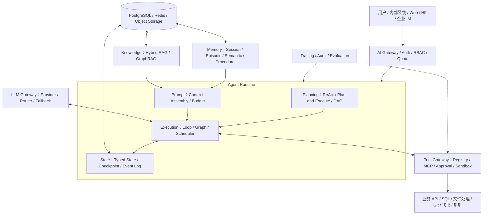

### 图 2：Agent Loop（包含失败、审批、退出）

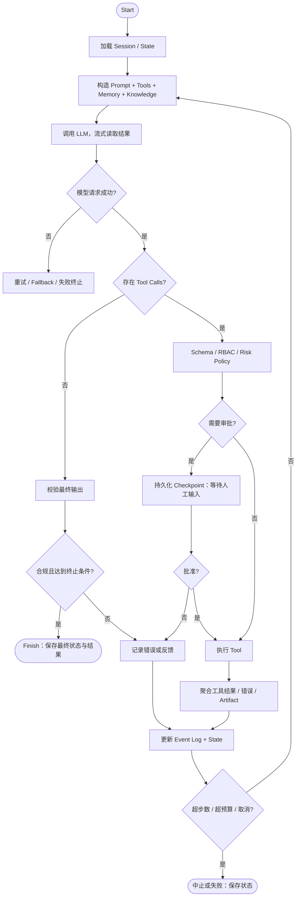

### 图 3：Planning 组合（固定流程 + 局部自主规划）

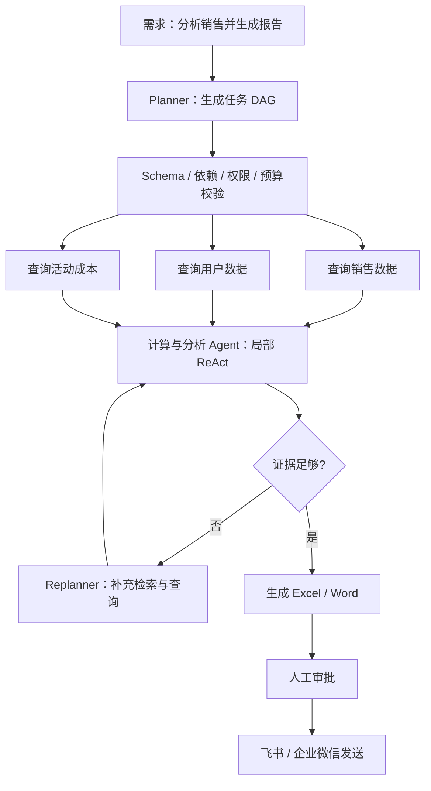

### 图 4：Memory、Knowledge、State 的边界

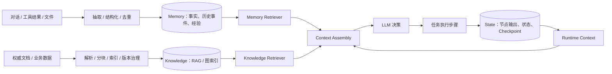

### 图 5：Tools 安全执行和幂等闭环

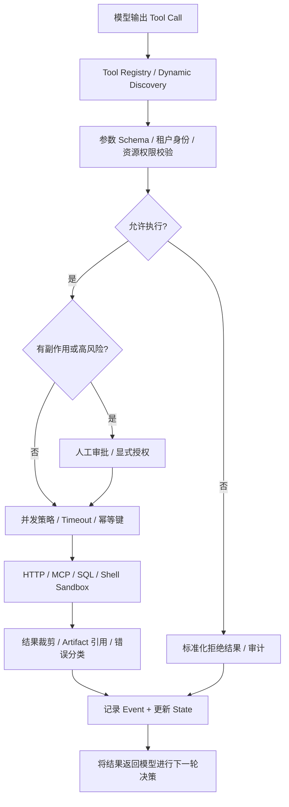

### 图 6：Durable Execution 故障恢复

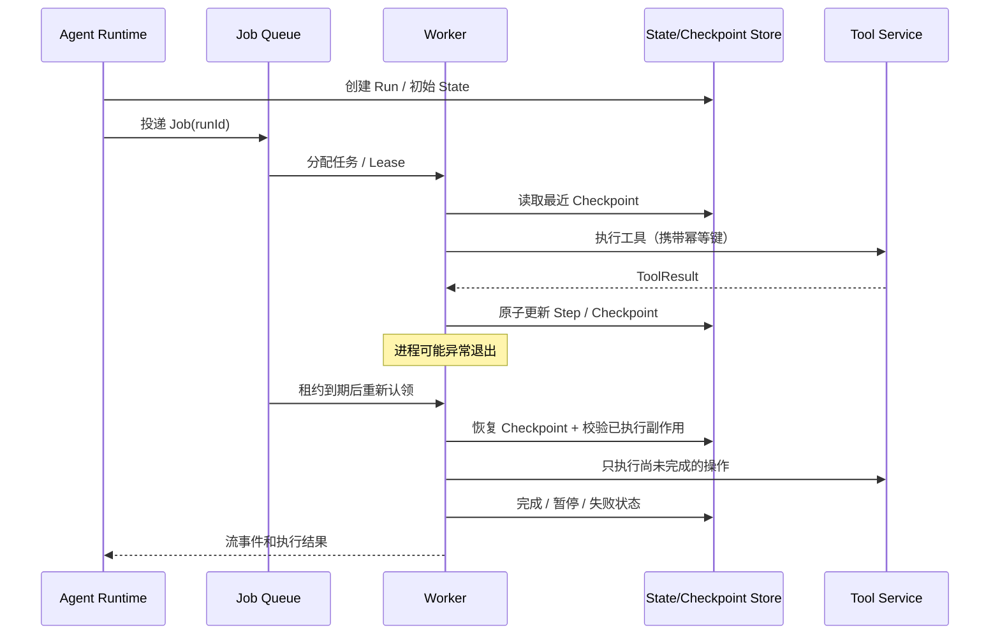

### 图 7：多模态知识摄取与 Agentic RAG

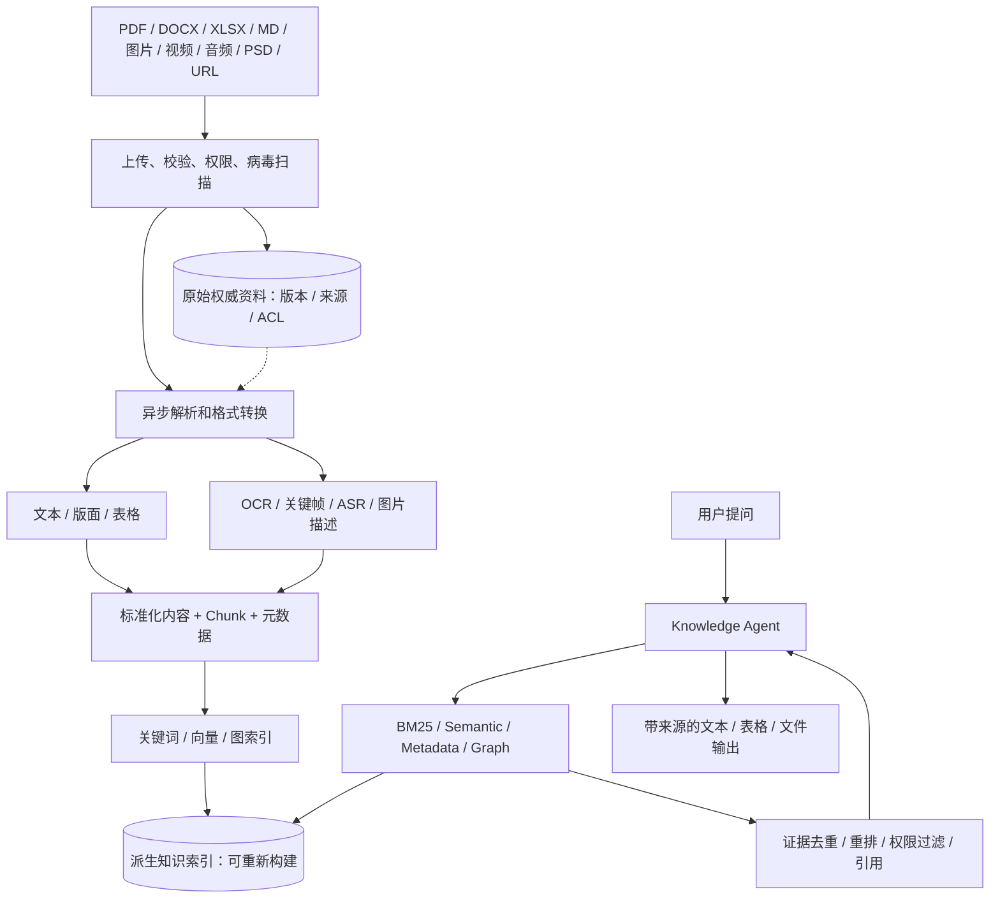

## 4. 组合架构与应用场景

### 4.1 我推荐的企业 AI 中台组合

| 层级 | 优先选择 | 备注 |
|---|---|---|
| 应用和 API | NestJS + Web/H5/Admin + SSO | 将内部丰富输出和对外能力白名单分离 |
| Agent 编排 | LangGraph.js | 主 Runtime，只选一个核心调度体系 |
| LLM | Provider Adapter + Model Gateway | 先主备和配额，后面再根据评测做智能路由 |
| Prompt | Section Assembly + Token Budget | 系统约束不能被检索内容覆盖 |
| Memory | Session + Compaction + 项目/用户记忆 | Memory 与企业 Knowledge 分离 |
| Tools | Native Function Calling + MCP Gateway | Service-side RBAC、审批、幂等、沙箱 |
| Knowledge | 评测后择一：RAGFlow / WeKnora | 多格式解析、检索引用、版本管理优先 |
| State / Queue | PostgreSQL + Checkpoint + 可靠队列/Worker | Redis 缓存不等于持久任务系统 |
| 大型文件 | MinIO / S3 类对象存储 | 原件、解析产物、Agent 生成文件分别管理 |
| 质量治理 | Trace + 审计 + 评测集 | 以任务成功率、错误率、成本为依据逐步加方案 |

### 4.2 为什么推荐“Workflow + 局部 Agent”

- 固定的合规、权限、审批、数据写入步骤由 Workflow 决定，确保顺序与边界可审计。
- 模型负责信息探索、摘要、原因分析、异常处理、任务重规划等不确定部分。
- 从小模型/单 Agent 开始；明确有角色协作的收益后，再引入 Multi-Agent。
- 不要把所有阶段都做成“自主 LLM 决策”，这样会降低复现性并增加成本。

## 5. 项目与源码定位速查

| 项目 | 重点阅读源码（均为公开仓库文件） | 最值得借鉴点 |
|---|---|---|
| Codex | [session/turn.rs](https://github.com/openai/codex/blob/main/codex-rs/core/src/session/turn.rs)、[tools/router.rs](https://github.com/openai/codex/blob/main/codex-rs/core/src/tools/router.rs)、[context_manager/history.rs](https://github.com/openai/codex/blob/main/codex-rs/core/src/context_manager/history.rs) | 生命周期、权限、上下文 |
| DeepSeek Harness | [agent.ts](https://github.com/deepseek-ai/deepseek-harness/blob/master/packages/core/agent-loop/src/agent.ts)、[tool-calls.ts](https://github.com/deepseek-ai/deepseek-harness/blob/master/packages/core/agent-loop/src/tool-calls.ts) | 组件化、事件、工具调度 |
| ZCode | [turn-machine.ts](https://github.com/zai-org/ZCode/blob/main/apps/zcode-cli/packages/core/src/agent/turn-machine.ts)、[builder.ts](https://github.com/zai-org/ZCode/blob/main/apps/zcode-cli/packages/core/src/context/builder.ts)、[scheduler.ts](https://github.com/zai-org/ZCode/blob/main/apps/zcode-cli/packages/core/src/workflow/scheduler.ts) | 状态机、Prompt 拼装、Workflow |
| Pi | [agent-loop.ts](https://github.com/earendil-works/pi/blob/main/packages/agent/src/agent-loop.ts)、[session-manager.ts](https://github.com/earendil-works/pi/blob/main/packages/coding-agent/src/core/session-manager.ts) | 极简 Loop 与会话树 |
| LangChain | [factory.py](https://github.com/langchain-ai/langchain/blob/master/libs/langchain_v1/langchain/agents/factory.py)、[human_in_the_loop.py](https://github.com/langchain-ai/langchain/blob/master/libs/langchain_v1/langchain/agents/middleware/human_in_the_loop.py) | Agent 构造、中间件、审批 |
| LangGraph | [graph/state.py](https://github.com/langchain-ai/langgraph/blob/main/libs/langgraph/langgraph/graph/state.py) | Typed State、Graph、Checkpoint |
| Dify | [Agent V2 Node](https://github.com/langgenius/dify/blob/main/api/core/workflow/nodes/agent_v2/agent_node.py)、[Agent Factory](https://github.com/langgenius/dify/blob/main/dify-agent/src/dify_agent/runtime/agent_factory.py)、[run_scheduler.py](https://github.com/langgenius/dify/blob/main/dify-agent/src/dify_agent/runtime/run_scheduler.py) | 平台与 Agent Runtime 分层；注意进程内任务调度限制 |
| Flowise | [Agent.ts](https://github.com/FlowiseAI/Flowise/blob/main/packages/components/nodes/agentflow/Agent/Agent.ts) | 可视化节点、Agentflow |
| RAGFlow | [agent.go](https://github.com/infiniflow/ragflow/blob/main/internal/agentic_rag/agent.go)、[state.go](https://github.com/infiniflow/ragflow/blob/main/internal/agent/runtime/state.go)、[checkpoint_store.go](https://github.com/infiniflow/ragflow/blob/main/internal/agent/canvas/checkpoint_store.go) | Agentic RAG、Canvas、Checkpoint |
| WeKnora | [engine.go](https://github.com/Tencent/WeKnora/blob/main/internal/agent/engine.go)、[checkpoint.go](https://github.com/Tencent/WeKnora/blob/main/internal/agent/checkpoint.go) | ReAct、会话历史与压缩状态分离 |
| LlamaIndex | [function_agent.py](https://github.com/run-llama/llama_index/blob/main/llama-index-core/llama_index/core/agent/workflow/function_agent.py)、[multi_agent_workflow.py](https://github.com/run-llama/llama_index/blob/main/llama-index-core/llama_index/core/agent/workflow/multi_agent_workflow.py) | 检索与 Agent/Handoff |
| GraphRAG | [global_search/search.py](https://github.com/microsoft/graphrag/blob/main/packages/graphrag/graphrag/query/structured_search/global_search/search.py)、[local_search/search.py](https://github.com/microsoft/graphrag/blob/main/packages/graphrag/graphrag/query/structured_search/local_search/search.py) | 全局和局部知识检索 |
| Haystack | [agents/agent.py](https://github.com/deepset-ai/haystack/blob/main/haystack/components/agents/agent.py)、[pipeline.py](https://github.com/deepset-ai/haystack/blob/main/haystack/core/pipeline/pipeline.py) | 组件化 Agent、Hooks、Pipeline |
| AutoGen | [BaseGroupChat](https://github.com/microsoft/autogen/blob/main/python/packages/autogen-agentchat/src/autogen_agentchat/teams/_group_chat/_base_group_chat.py) | 多 Agent 消息协调 |
| CrewAI | [flow.py](https://github.com/crewAIInc/crewAI/blob/main/lib/crewai/src/crewai/flow/flow.py) | Crew + Flow 组合 |

## 6. 落地优先级、效果与验收

| 优先级 | 重点建设 | 验收目标 |
|---|---|---|
| P0 | 模型适配、Prompt、Tool Calling、Agent Loop、Session、Typed State | 最小闭环可运行、可追踪、输出校验 |
| P1 | Tool Policy、沙箱、审批、MCP、Compaction、Checkpoint、幂等 | 高风险工具不可越权；任务可安全恢复 |
| P2 | 多模态知识、混合检索、任务图、Replanning、多 Agent、长期记忆 | 复杂任务质量提高，知识引用与权限正确 |
| P3 | 模型路由、动态工具发现、长任务多 Worker、全链路评测 | 有数据证据证明质量、成本或稳定性收益 |

**推荐架构结论：** 企业级 AI 中台首先落实 **LangGraph.js（有状态编排）+ NestJS（业务与工具网关）+ 可选 RAGFlow/WeKnora（独立知识服务）+ PostgreSQL/Redis/Queue/MinIO（运行和数据底座）**；借鉴 Codex 工具安全、Pi 会话与 Loop、DeepSeek Harness 组件边界。每个模块坚持“满足需求的最小有效组合”，以评测结果决定是否升级到多 Agent、GraphRAG 或复杂分布式执行。

---

# 下篇：上一条回答完整原文归档

> 说明：以下按上一条回答的章节顺序保留其解释、方案、优缺点、实施效果、技术判断、表格和源码链接。原回答的 UI 框图用等价 Mermaid 流程图转写；这类格式转换是为了让文件在 GitHub、VS Code 与 Markdown 编辑器中直接阅读。原回答中的非 URL 型聊天引用以可访问的仓库源码链接为准。

# 企业级 AI Agent 七大核心模块：主流开源项目源码架构与技术方案研究

*研究范围：LLM、Prompt、Memory、Tools、Planning、Execution、State ｜ 参考截至 2026 年 10 月 17 日可访问的开源代码*

## 一、先明确一个核心结论

通过对你列出的 GitHub 仓库进行目录定位、关键实现文件检查和官方架构资料对照，可以发现：

**当前成熟的 Agent 架构，并不是简单将七个模块组合起来，而是围绕 Agent Runtime（智能体运行时）建立一套可控制、可恢复、可扩展的执行系统。**

这七个模块的职责可以进一步划分：

| 模块 | 需要解决的核心问题 | 关键设计方向 |
|---|---|---|
| LLM | 调用哪个模型，如何兼容、路由和容错 | Model Gateway、Provider Adapter |
| Prompt | 如何让模型获得正确的指令、知识和上下文 | Prompt Assembly、Context Engineering |
| Memory | 如何记住历史、压缩上下文、长期积累信息 | Working / Episodic / Semantic Memory |
| Tools | 如何安全可靠地连接和使用外部能力 | Tool Registry、Function Calling、MCP、Sandbox |
| Planning | 如何拆解任务、选择步骤和动态调整计划 | ReAct、Plan-and-Execute、DAG、Multi-Agent |
| Execution | 如何执行、调度、重试、中断和结束任务 | Agent Loop、Graph Runtime、Durable Execution |
| State | 如何管理任务运行数据及其生命周期 | Typed State、Event Log、Checkpoint、Replay |

需要特别注意：

- **Memory 不等于 State**：Memory 用于未来推理时回忆信息；State 用于描述当前执行过程以及恢复执行所需的数据。
- **Planning 不等于 Execution**：Planning 决定要做什么，Execution 保证怎么执行。
- **Prompt 不只是 System Prompt**：动态检索结果、工具说明、历史压缩摘要、用户当前环境，都是实际上下文构建的一部分。
- **RAG、GraphRAG 不等于 Agent**：它们主要负责提供知识与检索能力，可以作为 Agent 的工具，也可以独立运行。

## 二、开源项目的架构定位

不能简单把 Codex、Dify、LangGraph、RAGFlow 当作同一类系统进行排名。它们实际解决的是不同层次的问题。

| 架构类别 | 代表项目 | 核心设计重点 |
|---|---|---|
| Coding Agent Runtime | OpenAI Codex、DeepSeek Harness、ZCode、Pi | 自主执行、工具调用、终端、会话和权限 |
| 通用 Agent 框架 | LangChain、LangGraph、AutoGen、CrewAI | Agent 编排、状态、工具和多智能体 |
| AI 应用平台 | Dify、Flowise | 应用搭建、模型接入、可视化工作流和运营 |
| RAG / 知识 Agent 平台 | RAGFlow、WeKnora | 文档解析、知识检索、引用、智能探索 |
| 知识与检索框架 | LlamaIndex、Haystack、GraphRAG | 数据接入、索引、知识组织和检索增强 |

例如，GraphRAG 的主要能力是知识图谱构建以及 Local、Global、DRIFT 等检索模式，而不是提供完整的通用 Agent 运行时。

> **研究边界：**本次查看的是各仓库当前默认分支的架构入口、关键实现模块及相应文档，并非逐行审计全部仓库。下面会提供核对过的源码路径；未进行统一版本的生产环境压测，因此“实施效果”侧重能够解释和验证的技术效果，不会编造准确率、延迟或成本改善百分比。

---

## 三、逐项目源码分析：它们实际采用了什么设计？

下面列出本次核对的关键实现入口，并总结值得借鉴的设计。

### 3.1 Coding Agent 与 Agent Harness

| 项目 | 源码核对入口 | 关键设计及适用场景 |
|---|---|---|
| **OpenAI Codex** | [session/turn.rs](https://github.com/openai/codex/blob/main/codex-rs/core/src/session/turn.rs)、[tools/router.rs](https://github.com/openai/codex/blob/main/codex-rs/core/src/tools/router.rs)、[tools/approvals.rs](https://github.com/openai/codex/blob/main/codex-rs/core/src/tools/approvals.rs) | Rust 实现的会话与执行引擎；工具路由、上下文管理、权限审批和沙箱分离。适合高自主性 Coding Agent。 |
| **DeepSeek Harness** | [agent-loop/agent.ts](https://github.com/deepseek-ai/deepseek-harness/blob/master/packages/core/agent-loop/src/agent.ts)、[tool-calls.ts](https://github.com/deepseek-ai/deepseek-harness/blob/master/packages/core/agent-loop/src/tool-calls.ts)、[架构文档](https://github.com/deepseek-ai/deepseek-harness/blob/master/docs/architecture.md) | Cordis 插件体系，Agent Loop、模型适配、Prompt 和 Session 都是可替换组件。适合开发自己的 Agent Harness。 |
| **ZCode** | [turn-machine.ts](https://github.com/zai-org/ZCode/blob/main/apps/zcode-cli/packages/core/src/agent/turn-machine.ts)、[context/builder.ts](https://github.com/zai-org/ZCode/blob/main/apps/zcode-cli/packages/core/src/context/builder.ts)、[workflow/scheduler.ts](https://github.com/zai-org/ZCode/blob/main/apps/zcode-cli/packages/core/src/workflow/scheduler.ts) | 显式 Turn 状态机、上下文组装、工具调度、Workflow 调度和独立 Memory 子系统。适合研究复杂 Agent 生命周期。 |
| **Pi** | [agent-loop.ts](https://github.com/earendil-works/pi/blob/main/packages/agent/src/agent-loop.ts)、[session-manager.ts](https://github.com/earendil-works/pi/blob/main/packages/coding-agent/src/core/session-manager.ts)、[compaction.ts](https://github.com/earendil-works/pi/blob/main/packages/coding-agent/src/core/compaction/compaction.ts) | 相对清晰的 Agent Loop 与会话管理分离；JSONL 树形会话、分支、历史压缩。适合学习和二次开发轻量 Agent 核心。 |

四个项目的设计差异很有代表性。

**Codex 重点是安全执行。** 它不仅关心大模型能否决定调用某个工具，还要判断调用是否允许、是否需要审批、如何执行命令以及怎样处理结果。其权限代码包含策略、审批来源及沙箱约束；这比只给 Agent 注册 `bash` 工具更完整。

**DeepSeek Harness 重点是插件化。** 它将 Agent 的核心流程拆为 Session、System Prompt、Tools、Agent、Agent Loop、LLM 等服务。实际执行时，由 Agent Loop 依次构造请求、调用模型、分发工具，再把结果写回事件日志。工具执行代码还区分并行任务与需要独占执行的任务。

**ZCode 重点是状态机和复杂任务管理。** `turn-state.ts` 明确区分等待模型响应、调度工具、执行工具等阶段；`workflow/scheduler.ts` 处理执行节点依赖和并发控制；`memory/` 又提供独立的记忆处理能力。这些是复杂 Coding Agent 值得参考的模块边界。

**Pi 重点是简洁的核心循环和可追溯上下文。** 它将 Agent Loop 与 SessionManager 分开；会话使用具有 `id/parentId` 关系的 JSONL 树形记录，支持分支、恢复、压缩，而不是覆盖旧历史。

### 3.2 Agent 框架和应用平台

| 项目 | 源码核对入口 | 关键设计及适用场景 |
|---|---|---|
| **LangChain** | [agents/factory.py](https://github.com/langchain-ai/langchain/blob/master/libs/langchain_v1/langchain/agents/factory.py)、[HITL middleware](https://github.com/langchain-ai/langchain/blob/master/libs/langchain_v1/langchain/agents/middleware/human_in_the_loop.py) | 通过 Agent 工厂和 Middleware 组合模型、工具、运行前后处理；适合快速开发代码驱动的 Agent。 |
| **LangGraph** | [graph/state.py](https://github.com/langchain-ai/langgraph/blob/main/libs/langgraph/langgraph/graph/state.py)、[types.py](https://github.com/langchain-ai/langgraph/blob/main/libs/langgraph/langgraph/types.py) | 状态图、节点、边、Reducer、Checkpoint、Interrupt；适合多步骤、长任务、需要恢复的 Agent。 |
| **Dify** | [Agent V2 Node](https://github.com/langgenius/dify/blob/main/api/core/workflow/nodes/agent_v2/agent_node.py)、[Agent Factory](https://github.com/langgenius/dify/blob/main/dify-agent/src/dify_agent/runtime/agent_factory.py)、[Runner](https://github.com/langgenius/dify/blob/main/dify-agent/src/dify_agent/runtime/runner.py) | 工作流与独立 Agent 运行时分层；新版 Agent Runtime 采用 Pydantic AI 组装工具集与 Capability。适合企业快速交付 AI 应用。 |
| **Flowise** | [Agentflow Agent.ts](https://github.com/FlowiseAI/Flowise/blob/main/packages/components/nodes/agentflow/Agent/Agent.ts)、[Agentflow V2 文档](https://github.com/FlowiseAI/FlowiseDocs/blob/main/en/using-flowise/agentflowv2.md) | 节点化模型、Agent、条件、循环、人工输入和 Flow State；适合可视化 Agent 和业务流程编排。 |
| **AutoGen** | [BaseGroupChat](https://github.com/microsoft/autogen/blob/main/python/packages/autogen-agentchat/src/autogen_agentchat/teams/_group_chat/_base_group_chat.py) | 消息驱动的 Agent Team、参与者与 GroupChatManager；适合研究多智能体通信。 |
| **CrewAI** | [Flow 入口](https://github.com/crewAIInc/crewAI/blob/main/lib/crewai/src/crewai/flow/flow.py) | Crew/Task 与 Flow 两类抽象，任务协作与确定性流程结合；适合角色明确的多 Agent 业务。 |

这里还存在一个重要变化：**LangChain 的当前 Agent 工厂已经直接组合 LangGraph 的 StateGraph 和 ToolNode**，因此不能简单理解为“LangChain 只负责 Chains，LangGraph 才有 Agent”。两者现在是更紧密的分层关系。

Dify 的情况也比传统印象更复杂。仓库中既有原先的 Function Calling / CoT Agent Runner，也有 Agent V2 的独立运行时；新版 `dify-agent/runtime/agent_factory.py` 使用 Pydantic AI 的原生 Agent、Toolset 和 Capability。

不过，独立运行时的 [run_scheduler.py](https://github.com/langgenius/dify/blob/main/dify-agent/src/dify_agent/runtime/run_scheduler.py) 明确说明：当前是进程内调度，Redis 保存运行状态和事件流，但并非完整的分布式持久任务队列。因此，不能单凭“支持状态持久化”就推断其具有跨进程故障自动恢复能力。

### 3.3 RAG、知识系统和检索框架

| 项目 | 源码核对入口 | 关键设计及适用场景 |
|---|---|---|
| **RAGFlow** | [agentic_rag/agent.go](https://github.com/infiniflow/ragflow/blob/main/internal/agentic_rag/agent.go)、[CanvasState](https://github.com/infiniflow/ragflow/blob/main/internal/agent/runtime/state.go)、[Checkpoint Store](https://github.com/infiniflow/ragflow/blob/main/internal/agent/canvas/checkpoint_store.go) | Agentic RAG、深度知识检索、Eino/ReAct、Canvas State 和持久化 Checkpoint；适合复杂企业知识查询。 |
| **WeKnora** | [engine.go](https://github.com/Tencent/WeKnora/blob/main/internal/agent/engine.go)、[think.go](https://github.com/Tencent/WeKnora/blob/main/internal/agent/think.go)、[checkpoint.go](https://github.com/Tencent/WeKnora/blob/main/internal/agent/checkpoint.go) | Go ReAct Engine、数据库会话重建、历史压缩、MCP、审批和工具能力；适合知识驱动的企业 Agent。 |
| **LlamaIndex** | [FunctionAgent](https://github.com/run-llama/llama_index/blob/main/llama-index-core/llama_index/core/agent/workflow/function_agent.py)、[MultiAgentWorkflow](https://github.com/run-llama/llama_index/blob/main/llama-index-core/llama_index/core/agent/workflow/multi_agent_workflow.py) | 数据查询能力与 Agent Workflow 组合，支持 Function Calling、ReAct 和 Handoff。 |
| **Microsoft GraphRAG** | [GlobalSearch](https://github.com/microsoft/graphrag/blob/main/packages/graphrag/graphrag/query/structured_search/global_search/search.py)、[LocalSearch](https://github.com/microsoft/graphrag/blob/main/packages/graphrag/graphrag/query/structured_search/local_search/search.py) | 利用实体、关系、社区摘要提供 Local / Global / DRIFT 检索。它主要解决知识组织和复杂检索，而不是通用工具执行。 |
| **Haystack** | [Agent](https://github.com/deepset-ai/haystack/blob/main/haystack/components/agents/agent.py)、[State](https://github.com/deepset-ai/haystack/blob/main/haystack/components/agents/state/state.py)、[Pipeline](https://github.com/deepset-ai/haystack/blob/main/haystack/core/pipeline/pipeline.py) | 可组合 Pipeline、Agent、工具、显式 State 和生命周期 Hooks；适合可测试的 RAG/Agent 后端。 |

其中有三处源码实现特别值得关注。

**第一，RAGFlow 已经不只是传统的 Retrieve → Generate。** 当前 Agentic RAG 代码利用 ReAct 和多种搜索工具，在需要时执行关键词、语义、结构、图谱等不同类型的知识探索。项目还提供了知识编译能力。

**第二，WeKnora 清晰分离了跨轮对话历史和单轮 Agent 引擎。** `engine.go` 的注释指出，Agent Engine 不在内部持有跨轮对话缓存，每轮历史由外部数据库重建并传入。这有利于保持单轮执行器的职责清晰，但同时要求外部会话服务正确管理历史和并发。

**第三，Haystack 的 Agent 有明确的扩展时机。** 包括 `before_run`、`before_llm`、`before_tool`、`after_tool`、`on_exit` 和 `after_run`，并且支持类型化运行状态、工具并发限制、最大执行步数等控制。

这些项目揭示了一种重要架构趋势：

**Agent Runtime 负责推理和执行，Context / Knowledge 系统负责提供模型真正需要的信息，业务平台负责权限、审批、运营和应用集成。**

三者可以分开设计，而不必全部绑定到同一个框架。

---

# 四、七大模块的具体技术方案

以下每个模块严格按这几个维度分析：

**背景和问题 → 方案原理 → 优缺点 → 实施效果 → 适合结合什么方案。**

这里的实施效果是技术上可以获得的效果及其验证方式，而不是未经测试的性能提升数据。

## 1. LLM：大模型接入、路由和治理

### 1.1 背景：为什么不能直接调用一个模型 API？

最简单的 Agent 只需要调用一次模型：

```text
用户请求 → LLM API → 模型结果
```

但企业生产环境会遇到几个问题：

- 不同模型支持的 Tool Calling、结构化输出、图像、上下文长度不同。
- 某些模型速度快、成本低，但复杂推理表现不一定最好。
- 模型超时、限流、服务异常会影响任务。
- 不同业务存在数据安全、模型供应商和部署限制。
- 一个 Agent 可能执行几十次模型请求，需要控制累计成本和延迟。

因此，LLM 层逐渐从简单的 SDK 封装发展为 **Model Adapter + Model Router + Model Gateway + Model Policy**。

### 1.2 主流方案比较

| 方案 | 原理及适用场景 | 优点 | 缺点 |
|---|---|---|---|
| A. 单模型直连 | 固定一个模型、SDK 直接调用；原型、小型项目 | 简单、延迟链路短、易调试 | 供应商耦合、容灾弱 |
| B. Provider Adapter | 统一请求、消息、工具、流式响应结构；多模型产品 | 更换模型容易，核心逻辑复用 | 不同供应商特性难完全统一 |
| C. 模型网关 | 所有调用经过统一入口，实现鉴权、配额、日志、限流 | 集中治理、便于多租户 | 增加网络节点及运维复杂度 |
| D. 主备 Fallback | 主模型报错或超时后切换备用模型 | 提高服务可用性 | 不同模型上下文、工具协议和结果可能不一致 |
| E. 任务级智能路由 | 根据任务类型、复杂度选择模型 | 可控制平均成本和延迟 | 路由错误可能降低质量 |
| F. 多模型协作 | 一个模型生成，另一个审核、验证或总结 | 高风险、复杂任务可交叉检查 | 成本、延迟上升；模型可能共享相同错误 |

### 1.3 源码体现的实现思路

**Pi：Provider 抽象。**

代码位于 [packages/ai/src/providers](https://github.com/earendil-works/pi/tree/main/packages/ai/src/providers) 和 `models.ts`。其思路是将模型服务商适配与 Agent Loop 分离，让核心执行循环不用直接绑定某一种模型协议。

**DeepSeek Harness：LLM Adapter 作为可替换服务。**

在 `packages/llm/` 下提供独立的消息、流式输出、适配、重试等模块。Agent Loop 只依赖统一 LLM 接口。

**Dify Agent V2：原生 Model 抽象。**

`agent_factory.py` 接收模型对象并创建 Pydantic AI Agent；模型能力和工具集由不同模块组合，而不是将 API 调用写死在业务节点中。

### 1.4 实际怎么实现？

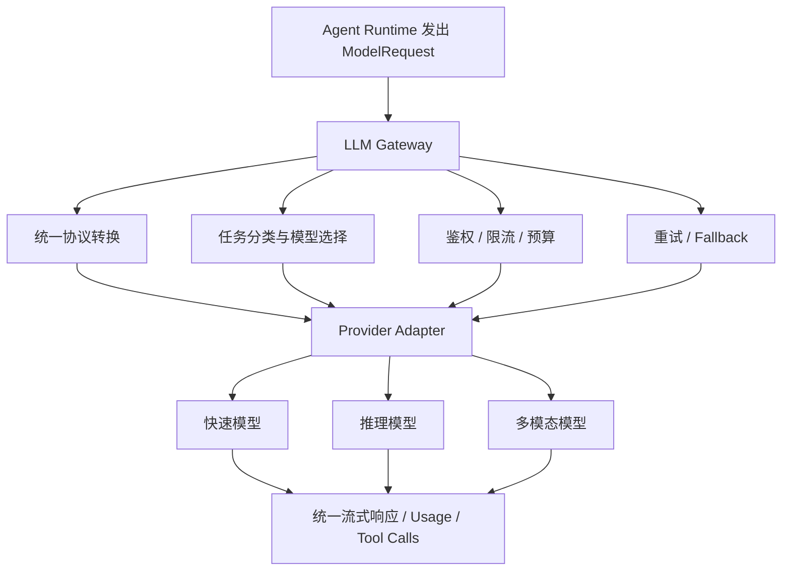

建议统一模型调用的数据结构：

```ts
interface ModelRequest {
  messages: Message[];
  tools?: ToolDefinition[];
  responseFormat?: "text" | "json";
  modelProfile: "fast" | "reasoning" | "vision";
  maxOutputTokens?: number;
  timeoutMs?: number;
  tenantId: string;
  traceId: string;
}
```

这个结构是推荐的实现抽象，不是上述项目共享的原始接口。

**实施效果与验证：**

- 多模型切换时，Agent Loop 无须重写。
- 可以统计模型错误率、P95 延迟、Token 成本和任务成功率。
- 能做任务类型、模型、工具兼容性之间的 A/B 测试。
- Fallback 可以改善特定故障下的可用性，但需专门验证工具参数、结构化输出和上下文兼容性。

**推荐组合：** Provider Adapter + 统一 Model Gateway + 主备 Fallback；当任务和评测数据积累足够后再增加智能路由。

不建议一开始就使用复杂的多模型投票机制。

---

## 2. Prompt：提示词工程与上下文工程

### 2.1 背景

简单 Agent 采用静态提示词：

```text
你是一个专业的业务分析助手，请回答用户问题。
```

复杂 Agent 无法只靠这一段完成所有任务。

例如 Coding Agent 还需要知道：

- 当前工作目录与项目技术栈。
- 项目的 `AGENTS.md`、编码规范和约束。
- 可调用的工具及其参数。
- 当前任务目标及执行进度。
- 之前已经修改了哪些文件。
- 历史压缩后保留了哪些重要信息。

因此，主流方案是将 Prompt 从一个字符串升级为**可组合、可更新、可治理的 Context Assembly（上下文组装）系统**。

### 2.2 主流方案

| 方案 | 背景和使用场景 | 实现思路 | 优点与缺点 |
|---|---|---|---|
| A. 静态 System Prompt | 单一职责的简单 Agent | 固定系统指令 | 稳定简单；适应性差 |
| B. 模板与变量注入 | 多租户、多角色、业务配置 | `{{role}}`、`{{task}}`、`{{context}}` | 易维护；变量过多容易混乱 |
| C. 分段组装 | Coding Agent、复杂企业 Agent | 将角色、环境、工具、知识和约束分成独立 Section | 模块清晰；需要优先级管理 |
| D. 动态上下文注入 | 每次请求的上下文不同 | 根据用户、环境、知识检索结果动态构建 | 针对性强；需管理 Token |
| E. Progressive Disclosure | 工具或技能数量很多 | 初始仅提供摘要，需要时再加载详细说明 | 降低上下文占用；可能遗漏需要的技能 |
| F. Prompt 版本化 | 企业生产和多环境部署 | 模板版本、灰度、评测、回滚 | 可审计；需维护测试 |
| G. 结构化输出约束 | SQL、报表、接口参数等 | JSON Schema、Typed Output、校验和修复 | 易对接程序；复杂 Schema 可能失败 |

### 2.3 源码里的具体方案

**DeepSeek Harness：Section Registry + Scope**

`packages/core/system-prompt` 支持有顺序的 Section、变量、工具 Schema 和独立 Agent Scope。

处理流程为：

```text
注册 Prompt Sections
    ↓
注册动态 Variables
    ↓
根据 Agent Scope 筛选内容
    ↓
组装 Sections 和工具 Schema
    ↓
解析变量、渲染 Prompt
    ↓
发送给 LLM
```

值得借鉴的是：未知变量、缺失变量及无效的完整 Prompt 组合会触发组装错误，而不是悄悄发送不完整 Prompt。

**ZCode：Context Builder**

在 [context/builder.ts](https://github.com/zai-org/ZCode/blob/main/apps/zcode-cli/packages/core/src/context/builder.ts) 中，可以看到明确的上下文分段构建：

- Identity：Agent 身份。
- Environment：环境和 Git 信息。
- Skills：当前可用技能。
- Memory：记忆内容。
- User Context：用户请求上下文。
- Date：动态时间信息。

这种设计适合需要不断注入环境信息的 Coding Agent。

**Pi：上下文文件与运行时组装**

Pi 结合系统提示词、会话活跃分支、工具、技能和项目上下文文件构造模型请求。它还支持修改系统 Prompt 及压缩历史会话。

### 2.4 推荐的企业级实现

```text
Prompt Assembly
├── System Policy          系统级安全和行为规则
├── Agent Profile          Agent 角色、职责和能力
├── Task Instruction       当前任务指令
├── Tool Context           可调用工具的说明
├── Knowledge Context      RAG 检索得到的知识
├── Memory Context         相关历史记忆
├── Runtime Context        当前环境和执行状态
├── Output Contract        JSON Schema / 输出约束
└── Context Budget         Token 预算和截断策略
```

需要注意信任边界：来自文档、网页、RAG 的内容是**数据**，不能因为被注入 Prompt 就拥有与系统指令相同的权限。

推荐增加 Context Budget Manager：

1. 优先保留系统级规则及当前任务。
2. 保留必要的工具 Schema。
3. 按相关度装入知识和记忆。
4. 以摘要替代部分冗长历史。
5. 超出预算时裁剪低优先级内容，必要时重新检索。

**实施效果：** 更容易定位上下文污染、指令冲突、Token 超额及工具选择异常。可用任务完成率、Prompt Token 使用量、格式合规率、检索引用准确率评估。

**推荐组合：** Section Assembly + 动态 RAG + Skills 按需加载 + Token Budget + Prompt 版本管理。

---

## 3. Memory：Agent 的记忆体系

这是七大模块中最容易和 RAG、State 混淆的部分。

### 3.1 背景

Agent 如果只记住当前一次输入，会遇到：

- 多轮对话中忘记之前的约束。
- 长时间编程任务丢失已完成的工作。
- 跨会话需要重复介绍项目背景。
- 历史工具输出占满上下文窗口。
- 用户、项目和业务知识会发生变化，旧记忆可能已经失效。

Memory 的目标不是把所有历史都塞给模型，而是：

**在正确的时间保存有价值的信息，并在需要时准确检索回来。**

### 3.2 主流方案

| 方案 | 背景和原理 | 优点 | 缺点 |
|---|---|---|---|
| A. Full History | 保存完整历史，直接放入上下文 | 信息完整 | Token 很快增长 |
| B. Sliding Window | 只保留最近 N 轮或 Token | 简单、省 Token | 丢失较早信息 |
| C. Summarization | 将旧消息归纳为摘要，保留近期消息 | 适合长任务 | 压缩可能丢失关键细节 |
| D. Episodic Memory | 将历史任务、事件、决策作为记录存储 | 适合跨会话追溯 | 需要抽取和清理策略 |
| E. Semantic Memory | 将事实、偏好、知识组织为可检索记录 | 长期个性化、跨会话复用 | 需要事实更新和冲突消解 |
| F. Procedural Memory | 保存可复用的步骤、规范、Skills | 提高重复工作一致性 | 内容可能过时 |
| G. Hierarchical Memory | 分层组织全局摘要、任务摘要、详细记录 | 适合大型长期项目 | 检索、维护更复杂 |
| H. Branching Memory | 会话形成树，支持分支和回到历史节点 | 适合探索多种方案 | 分支管理和摘要合并复杂 |

### 3.3 真实源码怎么做？

**Pi：树形会话 + 自动压缩。**

Pi 的 SessionManager 使用 JSONL 文件，记录之间通过 `id` 和 `parentId` 构成树。模型使用当前活跃分支构造上下文。

当历史过长时，它对较早消息进行摘要、保留近期内容；原始会话记录仍然保留，而不是直接删除。

其典型思路：

```text
完整历史记录（持久保存）
    ↓
选择当前活跃分支
    ↓
判断是否接近 Token 上限
    ↓
旧历史摘要 + 近期消息保留
    ↓
生成下一次 LLM 上下文
```

**ZCode：独立 Memory 子系统。**

源码位于 [core/src/memory](https://github.com/zai-org/ZCode/tree/main/apps/zcode-cli/packages/core/src/memory)，包括 `extraction.ts`、`dream.ts`、`recall/`、`memory-agent-loop.ts` 等。

它展示了将记忆提取、记忆回忆和记忆处理任务从普通执行循环中分离的设计。

**WeKnora：数据库历史 + 压缩 Checkpoint。**

单轮 Agent Engine 从外部获得历史；`compaction/` 负责压缩，`checkpoint.go` 允许保存上下文压缩结果。这里的上下文 Checkpoint 主要用于避免反复重做历史压缩，不能与任意任务节点的通用恢复机制画等号。

**Flowise：多种会话记忆后端。**

`packages/components/nodes/memory/` 提供 Buffer、Window、Summary、Redis、MongoDB、Zep、Mem0 等接入实现。说明 Memory 的保存策略、存储位置和检索机制可以分别抽象。

### 3.4 主流组合：分层记忆

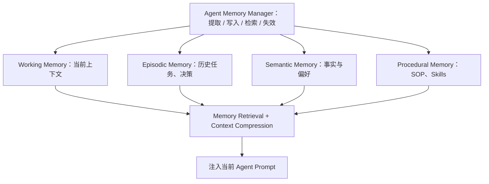

推荐的记忆处理流程：

```text
用户对话 / 任务结果
        ↓
Memory Extractor
提取事实、约束、决策、经验
        ↓
去重 / 权限校验 / 冲突检测
        ↓
Memory Store
保存类型、来源、时间、有效期
        ↓
Memory Retriever
关键词 + 语义 + 元数据检索
        ↓
按相关度与 Token 预算筛选
        ↓
注入下一次 Agent 上下文
```

企业级系统最好为每条长期记忆保存：

`tenantId`、`userId`、`projectId`、`source`、`type`、`createdAt`、`updatedAt`、`expiresAt`、`version` 等字段，并结合记录级权限控制。

特别是企业知识发生更新时，要避免旧事实长期覆盖最新的权威文档。

### 3.5 实施效果和推荐方案

| 场景 | 推荐方案 |
|---|---|
| 普通客服问答 | Window + 少量会话摘要 |
| 长文档分析 | Summary + 外部文件引用 |
| 长时间 Coding Agent | Session Tree + Compaction + 文件状态记录 |
| 跨会话个人助手 | Episodic + Semantic Memory |
| 企业级业务助手 | Session Memory + 项目级 Memory + 独立 RAG |
| 持续积累工作经验的 Agent | Episodic + Procedural Memory + 定期记忆整理 |

实施后，主要验证跨轮约束保持率、长期事实提取准确率、过期记忆误命中率、上下文 Token 消耗和错误记忆传播率。

**我的建议是不要把企业知识库直接当作 Agent Memory。**

业务文档属于企业 Knowledge，用户历史、项目决策和 Agent 执行经验属于 Memory，当前任务进度属于 State。它们可以共享检索基础设施，但应分别管理生命周期、权限与数据更新规则。

---

## 4. Tools：工具调用和外部能力执行

### 4.1 背景

LLM 只能生成调用工具的意图，本身不能保证数据库查询、文件编辑或发送消息已经真正完成。

企业 Agent 需要的 Tools 可能包括：

- 内部 HTTP API、数据库、搜索服务。
- Git、终端、文件系统、代码解释器。
- 飞书、企业微信、钉钉等外部平台。
- RAG 检索、Text-to-SQL、文档转换。
- 由其他 Agent 或 Workflow 暴露的工具。

工具越多，就越容易出现权限越界、参数错误、执行超时、结果过长、重复执行等问题。

因此 Tools 最终会演变为 **Tool Registry + Tool Discovery + Execution Policy + Tool Runtime**。

### 4.2 主流方案

| 方案 | 解决的问题、应用场景 | 实现思路 | 优缺点 |
|---|---|---|---|
| A. Native Function Calling | 模型需要调用确定的业务接口 | 将工具 JSON Schema 提供给模型，由模型生成调用参数 | 标准、稳定；模型依赖工具描述质量 |
| B. MCP | 需要接入大量独立工具服务 | MCP Client 发现并调用 MCP Server 暴露的工具 | 接入标准化；需单独设计鉴权和权限 |
| C. OpenAPI Tool | 已有大量 REST 服务 | 将 API 转换成工具定义 | 能复用现有服务；API 可能不适合直接暴露 |
| D. Dynamic Tool Retrieval | 工具数量非常多 | 按任务检索相关工具，动态提供 Schema | 节约上下文；可能漏选 |
| E. Workflow as Tool | 已有复杂稳定的业务流程 | 把整个 Workflow 包装成一个工具 | 降低 Agent 需要管理的步骤数量；灵活性相对低 |
| F. Code Interpreter / Shell | 文件处理、计算、编程、数据分析 | 在隔离环境执行代码、脚本 | 能完成复杂操作；安全隔离和资源管理成本高 |
| G. Agent as Tool | 子任务需要专门能力 | 调用专用 Agent 并返回结果 | 模块复用；成本、链路和排障更复杂 |

### 4.3 源码体现的关键设计

**Codex：工具能力与执行权限分离**

可以重点研究：

[Tool Router](https://github.com/openai/codex/blob/main/codex-rs/core/src/tools/router.rs) → [Approvals](https://github.com/openai/codex/blob/main/codex-rs/core/src/tools/approvals.rs) → [Sandboxing](https://github.com/openai/codex/blob/main/codex-rs/core/src/tools/sandboxing.rs)

其设计思想是：

```text
模型提出工具调用
       ↓
Tool Router 定位工具
       ↓
参数与策略检查
       ↓
检查沙箱权限及审批要求
       ↓
必要时人工确认
       ↓
真正执行工具
       ↓
返回结构化结果
```

权限控制不是靠 Prompt 写一句“不要执行危险操作”，而是由宿主程序在执行边界进行检查。

**DeepSeek Harness：并行、独占和确定性结果处理**

`agent-loop/src/tool-calls.ts` 中可以看到：

- 批次化调度工具调用。
- 并行工具使用有界并发池。
- 需要独占执行的工具形成调度屏障。
- 调用可以并发执行，但最终结果按模型调用顺序提交。
- 取消时为未执行调用保留可恢复的结果记录。

这是非常值得借鉴的细节。

例如，一批独立的数据库只读查询可以并发，但修改同一个文件的多个工具调用不应随意并发。

**WeKnora：MCP + 审批 + 数据操作**

在 [tools 目录](https://github.com/Tencent/WeKnora/tree/main/internal/agent/tools) 中，已经有 MCP、数据库查询、数据分析、文件操作等实现；`approval/` 独立维护审批流程。

这说明工具接入与用户授权属于两个不同模块。

### 4.4 推荐实现方案

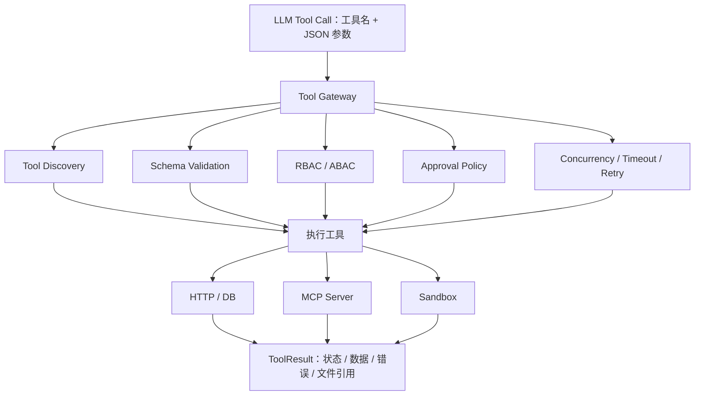

建议把工具能力设计成包含两部分的数据结构：

```ts
interface ToolDefinition {
  name: string;
  description: string;
  inputSchema: object;

  // 宿主端策略，不直接交给模型决定
  permission: string;
  riskLevel: "low" | "medium" | "high";
  requiresApproval: boolean;
  timeoutMs: number;
  concurrencySafe: boolean;
  idempotent: boolean;
}
```

这也是一种推荐的实现抽象，并非 MCP 的原生 Tool Schema。

对于工具的执行，应遵循这些原则：

- 先进行参数、租户身份和资源权限校验，再执行。
- 工具调用由服务端绑定用户身份，不信任模型生成的 `userId` 或 `tenantId`。
- 删除、发布、付款、发送对外消息等操作设置审批或其他可靠授权机制。
- 对有副作用的操作使用幂等键；不能直接把所有失败都当作安全可重试。
- 工具返回大文件时，保留 Artifact 引用，而不是把全部内容写进上下文。
- Shell、Python、浏览器等高风险执行能力放入资源受限的沙箱。

**实施效果：** 工具扩展更方便，权限边界更清晰，并可以分别统计工具选择正确率、调用成功率、审批率、超时率和重复副作用事件。

**主流推荐组合：**

`Native Function Calling + MCP + Tool Registry + Policy Engine + Sandbox`

工具规模扩大后，再增加 Tool Retrieval。MCP 本身不是权限治理系统，仍然需要宿主侧的安全控制。

---

## 5. Planning：Agent 如何规划任务

### 5.1 背景

简单任务只需要一次回答，复杂任务可能需要：

- 先获取资料，再分析，再生成文档。
- 发现数据不完整后补充查询。
- 某个工具失败后更换执行方式。
- 多个独立子任务并行。
- 在风险操作前等待审批。

这里存在两种不同需求：

**自主性：** Agent 能根据中间结果决定下一步。

**确定性：** 企业需要限定任务必须遵守的流程。

Planning 的主要设计问题，就是在自主性和确定性之间做选择。

### 5.2 七种主要方案

| 方案 | 背景和适用场景 | 思路 | 优缺点 |
|---|---|---|---|
| A. ReAct | 工具探索、信息不确定、多轮查询 | 推理与工具调用交替执行 | 灵活；调用次数不易预测 |
| B. Plan-and-Execute | 复杂多步骤任务 | 先拆解计划，再逐步执行 | 过程清晰；计划可能过时 |
| C. Replanning | 执行结果可能改变原计划 | 计划 → 执行 → 评估 → 修订计划 | 适应性更强；额外模型开销 |
| D. DAG / Workflow | 固定业务流程、审批、ETL | 预定义节点及依赖关系 | 稳定可审计；不能任意自主探索 |
| E. Dynamic Workflow | 复杂任务需要动态生成执行图 | Planner 创建任务依赖图，再由调度器执行 | 支持动态并行；校验复杂 |
| F. Multi-Agent Planning | 不同专业任务需要独立 Agent | Supervisor 分配给多个 Worker | 分工明确；通信和协调复杂 |
| G. Reflection / Critic | 生成结果需要质量检查 | 生成 → 评估 → 修改 | 适合质量敏感任务；容易增加成本和循环 |

### 5.3 ReAct：最基础的动态规划方式

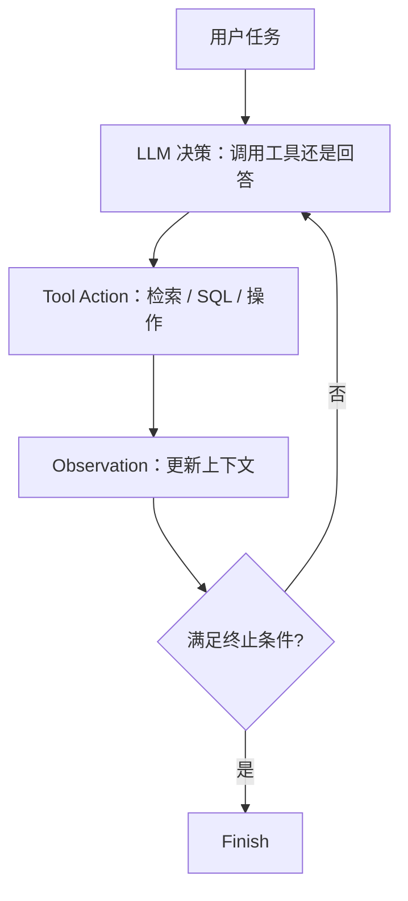

Codex、Pi、DeepSeek Harness、WeKnora 等都包含这种以模型决策和工具反馈为核心的运行模式。

ReAct 的优势是动态处理未知情况，适合搜索、调试、代码修复和 Agentic RAG。

缺点是不能保证每次都选择最优工具、最短路径或正确结束，因此必须配合最大步数、Token 预算、超时及结果校验。

### 5.4 Plan-and-Execute：先拆任务，再执行

例如：

```text
目标：完成一个企业运营数据分析报告

Planner
├── T1 查询销售数据
├── T2 查询用户数据
├── T3 查询活动成本
├── T4 计算指标和分析
├── T5 生成 Excel / Word
└── T6 审核并发送报告
```

这里不必全部串行。

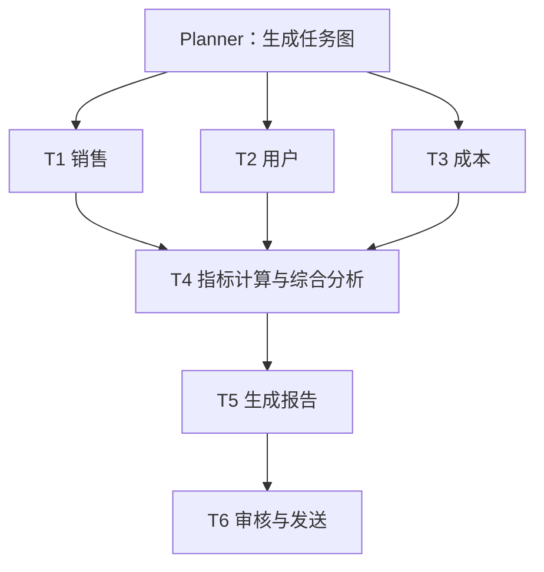

T1、T2、T3 相互独立时可以并行；T4 必须等待三者完成。

ZCode 的 [workflow/scheduler.ts](https://github.com/zai-org/ZCode/blob/main/apps/zcode-cli/packages/core/src/workflow/scheduler.ts) 是值得研究的实现：它通过就绪节点、阻塞节点、依赖图和最大并发参数组织工作流。

对于计划生成部分，应该要求 Planner 输出经过 Schema 校验的任务结构，检查循环依赖、权限和资源预算后才能调度，而不能任意执行模型生成的代码。

### 5.5 Multi-Agent：什么时候值得使用？

LlamaIndex 的 [multi_agent_workflow.py](https://github.com/run-llama/llama_index/blob/main/llama-index-core/llama_index/core/agent/workflow/multi_agent_workflow.py) 提供 Handoff 等机制；AutoGen 利用 GroupChatManager 协调参与者；CrewAI 则强调角色和任务。

主流有三种组织方式：

| 方式 | 思路 | 场景 |
|---|---|---|
| Supervisor-Worker | 一个 Agent 分配、监督多个 Worker | 有明确专业分工的复杂任务 |
| Handoff | 当前 Agent 将任务移交给下一个 Agent | 客服转工单、研发角色交接 |
| Parallel Experts | 多个 Agent 并行分析，统一汇总 | 多维度分析、独立信息收集 |

实施效果应重点衡量整体任务成功率、完成时间、模型调用数量、Agent 间消息量和协调失败率。

**推荐组合：**

- 普通问答：不需要显式 Planner。
- 检索与探索：ReAct。
- 多步骤生成：Plan-and-Execute。
- 复杂且可能变化的任务：Plan-and-Execute + Replanning。
- 有稳定业务规则的企业流程：Workflow + 局部 Agent。
- 明确需要专业协作：Supervisor + 专用 Agent。

实际开发中，我更推荐 **Workflow 负责流程控制，Agent 负责局部智能决策**，而不是所有操作都交给一个超级 Agent。

---

## 6. Execution：Agent 如何真正运行

Planning 解决任务步骤选择，Execution 解决步骤如何被可靠执行。

### 6.1 背景

在真实环境里，仅实现：

```ts
while (true) {
  const response = await llm.call(messages);
  // 根据结果调用工具
}
```

还远远不够。

生产系统还要考虑：

- 请求超时、流式响应中断。
- 并发工具执行和结果顺序。
- 工具失败后的恢复策略。
- 执行中用户追加新消息。
- 用户主动取消任务。
- 人工审批需要暂停数小时。
- 服务重启后怎样继续。
- 执行成本及无限循环控制。

### 6.2 主流执行方案

| 方案 | 背景和适用场景 | 方案思路 | 优缺点 |
|---|---|---|---|
| A. Sequential Agent Loop | 简单问答、短任务 | LLM 与工具轮流执行 | 最容易实现；复杂任务扩展有限 |
| B. Event-driven Loop | 流式任务、实时交互 | 通过事件驱动模型、工具和 UI 更新 | 可观察性强；事件一致性更复杂 |
| C. Graph Runtime | 多分支、多节点业务 | 节点、边、状态更新和任务调度 | 易表达复杂流程；有学习成本 |
| D. Parallel Executor | 多个独立工具或任务 | 有界并发、结果聚合 | 提高吞吐；存在并发与冲突风险 |
| E. Durable Execution | 长时间执行、跨服务故障 | Checkpoint + 恢复 + 幂等副作用 | 提高恢复能力；基础设施更复杂 |
| F. Human-in-the-loop | 审批和人工输入 | 暂停 → 持久化 → 收到输入 → 继续 | 安全可控；增加交互时间 |
| G. Distributed Worker | 高并发、定时任务、耗时操作 | 队列分发、Worker 执行、Lease 和重试 | 可扩展；运维与一致性成本更高 |

### 6.3 源码分析：Agent Loop 的标准生命周期

结合 DeepSeek Harness 的 `ReactLoopAgent`、Pi 的 `agentLoop` 以及 Haystack 的 Agent，实现思路可以归纳为：

```text
Start
  ↓
接受用户任务
  ↓
构建 Prompt 和上下文
  ↓
向 LLM 发起请求
  ↓
接收流式模型输出
  ↓
是否存在 Tool Calls？
  ├── 否 → 校验最终答案 → Finish
  │
  └── 是
       ↓
     检查工具 Schema 和权限
       ↓
     调度工具执行
       ↓
     收集结果或错误
       ↓
     更新 State / Session
       ↓
     检查步数、取消、预算和超时
       ↓
     继续下一次 LLM 请求
```

核心区别是：真实 Agent Runtime 要在每个步骤周围增加生命周期控制，而不是只有一个简单循环。

### 6.4 几个值得参考的实现

**DeepSeek Harness：事件和执行器结合。**

它明确区分 Turn 和 Step，并将模型输出、工具结果写入会话事件日志。这使得日志不仅用于展示，还能作为恢复历史和派生模型上下文的依据。

**LangGraph：状态图执行。**

LangGraph 提供 StateGraph、Checkpoint、Interrupt 和 Command 等机制。中断时保存图状态，恢复时通过相应会话标识定位状态。

特别需要注意：某些中断恢复会重新执行节点的前半部分。因此，节点内已经产生的外部副作用必须设计为幂等，或拆分为可以安全恢复的独立操作。

**Haystack：生命周期 Hooks。**

Haystack 允许在 LLM 调用前、工具执行前后和 Agent 退出时进行拦截。可以将脱敏、上下文压缩、结果裁剪、工具审计等能力作为 Hook 注入，而不是塞进 Agent 核心循环。

**RAGFlow：Eino + Checkpoint。**

RAGFlow 的 Go Canvas 实现中，有运行状态、图执行、Checkpoint Store 和中断恢复模块。当前代码中可以看到使用 Kvrocks/Redis 兼容存储保存 Eino Checkpoint 的实现。

### 6.5 企业级推荐执行流程

```text
Agent Runtime
   ↓
Task Scheduler
   ↓
创建执行记录 runId
   ↓
加载 State / Checkpoint
   ↓
执行节点或 Agent Loop
   ↓
Tool Policy / Approval
   ↓
Tool Executor / Sandbox
   ↓
保存结果及下一步 State
   ↓
完成 / 失败 / 暂停 / 取消
   ↓
写入事件日志和监控
```

一个任务至少应能明确表示这些状态：

`pending`、`running`、`waiting_approval`、`paused`、`succeeded`、`failed`、`cancelled`。

真正支持持久化恢复，还需要配合：

- 可持久化的任务队列或可靠调度器。
- Worker 租约及心跳。
- Checkpoint 的持久化与版本管理。
- 副作用幂等与结果去重。
- 服务崩溃后的任务认领与恢复。
- 明确的失败处理、取消及补偿策略。

不能因为框架支持 Checkpoint，就认为它自动具有完整的分布式任务恢复能力。

**实施效果：** 可以减少故障导致的任务丢失，支持长任务暂停与恢复，也便于分析哪一步失败。但需要通过进程终止、网络中断、重复消息和存储故障测试验证。

**推荐组合：**

`Graph Runtime + Checkpoint + Event Log + Durable Job Queue + Tool Idempotency`

对于短任务，不必一开始就引入分布式执行；长任务和多用户高并发再升级。

---

## 7. State：Agent 运行状态的设计与持久化

### 7.1 背景

Memory 是 Agent 未来可能需要回忆的信息，而 State 是执行器现在需要掌握的事实。

例如生成报表任务：

```json
{
  "runId": "run_1001",
  "status": "waiting_approval",
  "currentStep": "send_report",
  "completedSteps": [
    "query_data",
    "analyze_data",
    "generate_report"
  ],
  "reportArtifactId": "file_1001"
}
```

当任务等待用户确认时，即使模型没有运行，系统也必须保存这些执行状态。

### 7.2 主流方案

| 方案 | 背景和使用场景 | 实现思路 | 优缺点 |
|---|---|---|---|
| A. In-memory State | 短任务、单进程 | 使用 JS 对象、Python dict 或 Go struct | 性能好；进程退出丢失 |
| B. Typed State | 多节点、多人维护 | 用 Schema 定义字段类型和更新规则 | 清晰、可校验；存在 Schema 演进成本 |
| C. Shared Graph State | Workflow、Multi-Agent | 多节点通过统一 State 读写、合并字段 | 跨节点协作方便；要控制写冲突 |
| D. Checkpoint | 需要暂停、恢复、调试 | 定期持久化执行快照 | 恢复直接；可能增加存储开销 |
| E. Event Sourcing | 需要审计、回放、分支 | 只追加事件，通过事件重建视图 | 可追溯；事件迁移和回放复杂 |
| F. Snapshot + Event Log | 长会话、高审计要求 | 周期快照，加上增量事件 | 平衡恢复效率和审计能力；实现复杂 |
| G. Distributed State | 多 Worker、高并发 | 数据库状态、版本控制、租约和原子更新 | 支持跨进程协作；并发一致性困难 |

### 7.3 源码里的四种典型思路

**LangGraph：Typed State + Reducer + Checkpoint。**

`StateGraph` 中使用类型化状态，并可为字段定义合并语义；配套 Checkpointer 将执行状态持久化。

适合步骤明确、有并行分支和人工中断的系统。

**DeepSeek Harness：Append-only Event Log。**

Session 本身就是一组追加的 `SessionEvent`。模型历史不是唯一的源数据，而是由事件日志派生的视图。

适合需要审计、重建上下文、事件驱动扩展的 Agent Harness。

**Pi：Session Tree。**

历史会话按树形关系记录。可以在不同历史节点继续探索，同时保留已经发生的其他分支。

适合交互式 Coding Agent、历史方案探索和对话分叉。

**RAGFlow：CanvasState + Checkpoint Store。**

其 `CanvasState` 包含节点输出、系统变量、环境变量、历史、Memory、检索结果、全局变量和运行标识等字段，并通过锁保护共享 Map。

Checkpoint Store 则负责保存可恢复状态。

### 7.4 推荐组合

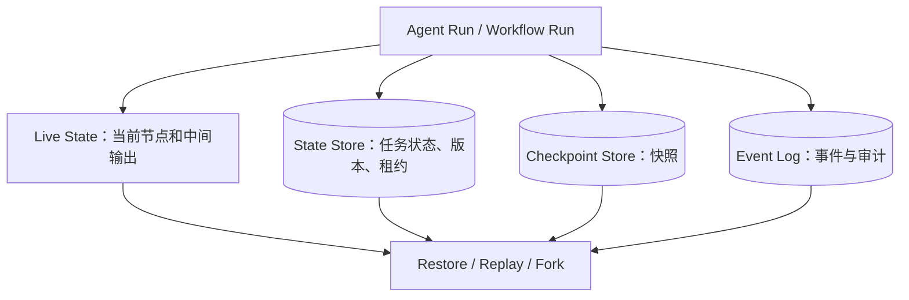

我建议企业级系统把下面几种数据分开保存：

| 数据 | 推荐位置 | 为什么 |
|---|---|---|
| 当前短生命周期执行状态 | 内存 / Redis | 访问快、更新频繁 |
| 任务最终状态、业务记录 | PostgreSQL | 需要事务及可靠查询 |
| Checkpoint | PostgreSQL / 兼容的持久化存储 | 支持执行恢复 |
| Event Log | PostgreSQL / 专用事件存储 | 审计、排障、回放 |
| 大型工具输出 | S3 / MinIO / 对象存储 | 避免数据库和上下文膨胀 |
| 长期 Memory | 业务库 + 可选向量索引 | 便于检索与生命周期管理 |

还应解决并发更新、乐观锁、Schema 版本迁移和状态清理等问题。高风险操作必须结合幂等机制，不能假设恢复后不会再次执行。

**实施效果：** 任务状态可见、可审计、可恢复；能统计恢复成功率、故障恢复时间、重复副作用数量和 Checkpoint 存储成本。

**推荐组合：**

- 简单 Agent：Typed State。
- 普通 Workflow：Typed State + Checkpoint。
- 长任务企业 Agent：Typed State + Checkpoint + Event Log。
- 需要审计回放、分支探索的平台：Snapshot + Event Sourcing。
- 多 Worker 分布式任务：以上方案再加租约、版本控制和幂等执行。

---

# 五、七大模块如何组合？主流架构模式

前面是各模块的独立方案。真正开发系统时，最重要的是根据业务场景组合，而不是每个模块都选功能最多的方案。

## 5.1 五种值得掌握的架构模式

| 架构模式 | 模块组合 | 适用场景 | 优势和代价 |
|---|---|---|---|
| **模式 A：轻量 ReAct Agent** | LLM + Prompt + Window Memory + Tools + ReAct + Agent Loop + In-memory State | 简单助手、搜索、短任务 | 实现快、维护低；不适合跨故障长任务 |
| **模式 B：知识增强 Agent** | Model Adapter + 动态 Prompt + Summary + RAG Tools + ReAct + Agent Loop + Session State | 企业知识问答、复杂资料检索 | 知识能力强；需要管理检索质量和上下文 |
| **模式 C：可控业务 Workflow** | Model Gateway + Template + Session Memory + 业务工具 + DAG + Graph Runtime + Checkpoint | 报表、审批、运营自动化 | 可控、易审计；动态自主能力受约束 |
| **模式 D：长任务自主 Agent** | Model Router + Context Assembly + 分层 Memory + Sandbox Tools + Replanning + Durable Execution + Event Log | Coding Agent、自动化研发、复杂分析 | 功能全面；成本和运行复杂度高 |
| **模式 E：多 Agent 协作** | 多模型 + 角色 Prompt + Shared/Private Memory + Agent Tools + Supervisor + Graph Runtime + Shared State | 多角色研发、跨领域任务 | 专业化协作；通信成本、状态一致性和排障更复杂 |

### 对应开源项目怎么选择？

**简单 Agent / 自研 Agent Loop**

参考 Pi、DeepSeek Harness 和 Haystack。前者有清晰的 Agent Loop 与 Session 抽象，后者更适合学习插件化与生命周期扩展。

**知识型 Agent**

优先考察 RAGFlow、WeKnora；需要自行构造检索 Pipeline 时看 LlamaIndex、Haystack。跨文档关系和全局主题问题再引入 GraphRAG。

**企业 Workflow / Agent 编排**

代码驱动优先 LangGraph；可视化交付优先 Dify、Flowise。多 Agent 通信还可参考 AutoGen、CrewAI。

**Coding Agent / 研发自动化**

重点研究 Codex 的执行安全、ZCode 的状态机与 Workflow 调度、Pi 的轻量 Loop、DeepSeek Harness 的可替换插件架构。

## 5.2 主流方案不是简单相加，而是分层组合

例如：

- LangGraph 管理复杂任务执行。
- RAGFlow 或 WeKnora 提供独立知识服务。
- Model Gateway 管理 LLM。
- MCP / HTTP Tool Gateway 提供业务工具。
- PostgreSQL 保存执行状态和持久数据。
- Redis 提供缓存、限流和必要的任务协作机制。
- 对象存储保存源文件、转换产物和生成结果。
- Dify / Flowise 可以作为快速构建应用的界面和编排工具，而不是必须成为整个系统的底层运行时。

避免同时引入多个承担相同职责的框架。例如：已有 LangGraph 负责全部任务编排时，不需要再增加另一套通用工作流执行器来执行同一任务，除非两者负责不同层次。

---

# 六、如果重新设计企业级 AI 中台，我会采用什么架构？

对于需要企业内部问答、多格式资料处理、报告及代码生成，同时向官网、H5、后台等应用提供 AI 能力的系统，我更倾向于以下架构。

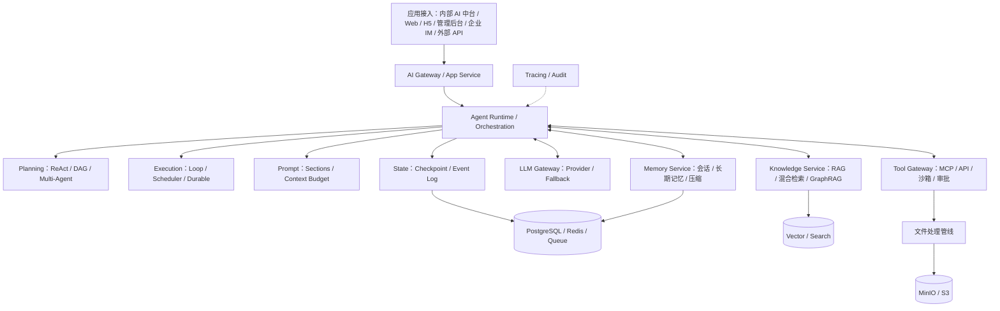

这里最重要的不是采用多少框架，而是各层边界清晰：

**Agent Runtime 决定和执行任务；Knowledge 提供事实资料；Memory 保留需要回忆的信息；State 确保运行过程可控、可恢复。**

## 6.1 多模态输入应该放在哪里？

PDF、DOCX、Excel、图片、视频、音频、网页、PSD 等文件的解析不应全部塞进 Agent Loop。

更合理的是独立的数据处理管线：

```text
原始资料上传
      ↓
文件格式识别 / 病毒扫描 / 权限检查
      ↓
异步解析
├── 文档文本和版面结构
├── 表格与公式信息
├── 图片 / OCR / 视觉信息
├── 视频关键帧与字幕
├── 音频转录
└── PSD 等专业格式转换
      ↓
标准化内容 + 元数据
      ↓
分块 / 关系抽取 / 索引
      ↓
知识检索服务
      ↓
Agent 按需调用检索工具
```

建议保留两类数据：

1. **原始权威资料**：原文件、来源、版本、更新时间和权限，不可随意被索引数据覆盖。
2. **派生的检索资料**：解析结果、Chunks、向量、关键词、图谱和摘要，可以重建。

对于过期知识或知识补充，不是简单维护两份互不关联的知识库，而是通过版本、有效期、来源优先级和重新索引控制更新。

RAGFlow、WeKnora 很适合研究这一层。但专业格式、超大文件、特殊视频内容的处理能力，仍需要针对文件类型逐一测试，不应假设开源 RAG 平台天然支持所有格式。

## 6.2 具体的七大模块选型

| 模块 | 推荐主方案 | 必要时扩展 |
|---|---|---|
| LLM | 统一 Provider Adapter + Gateway | 任务级路由、Fallback、多模型验证 |
| Prompt | Section Assembly + 动态 Context | Skills、Prompt 版本、上下文评测 |
| Memory | Session History + Compaction | 长期语义记忆、项目记忆、经验记忆 |
| Tools | Function Calling + MCP Gateway | Tool Retrieval、Sandbox、Agent as Tool |
| Planning | ReAct + 预定义 Workflow | Replanning、Dynamic DAG、Multi-Agent |
| Execution | LangGraph.js + 独立任务调度 | 分布式 Worker、人工审批、补偿机制 |
| State | Typed State + Checkpoint | Event Sourcing、Snapshot、可恢复执行 |

这是偏向具有自研需求的企业 AI 中台的方案，而不是所有项目都需要的最低配置。

对于 Node.js / TypeScript 体系，可以考虑：

- **NestJS**：API、认证授权、业务服务、工具接入。
- **LangGraph.js**：Agent 和 Workflow 编排。
- **PostgreSQL**：会话元数据、执行状态、业务持久化。
- **Redis + 可靠队列**：限流、缓存、异步任务和 Worker 协作。
- **RAGFlow / WeKnora**：择一作为主要知识服务，根据检索评测结果决定是否增加专门的检索组件。
- **MCP Gateway**：外部和内部工具的统一接入与授权。
- **对象存储 + 文件 Worker**：解析输入与保存生成产物。
- **OpenTelemetry 等工具**：统一 Trace、执行指标和审计关联。

## 6.3 什么情况下不建议采用复杂方案？

| 场景 | 不建议默认引入 | 原因 |
|---|---|---|
| FAQ、普通知识查询 | Multi-Agent、复杂 Planner | 常规混合检索 + 单次生成通常更容易控制 |
| 简单表单生成 | 自主式 ReAct 循环 | 结构化输出或固定 Workflow 更合适 |
| 固定审批业务 | 完全自主 Planner | 必须保证审批顺序和确定性 |
| 少量工具 | Tool Retrieval | 直接注册更简单、可预测 |
| 无关系检索需求的文档 | 全量 GraphRAG | 建图成本高，不一定提高效果 |
| 短任务 | Event Sourcing + 分布式 Worker | 运维复杂度可能超过收益 |
| 角色区别只是 Prompt | 多个独立 Agent | 可能仅增加成本和状态管理难度 |

---

# 七、实施顺序：先解决哪些问题？

如果要真正落地，不建议七个模块同时开发到最复杂的程度。

### P0：建立最小可运行的 Agent 核心

Provider Adapter、Prompt Assembly、Function Calling、Agent Loop、Session History、Typed State，以及基础鉴权和日志。

**验收：**工具调用成功、模型输出可校验、错误有明确状态、可追踪一次完整执行。

### P1：补齐企业级安全与长任务能力

MCP、Tool Policy、审批、Sandbox、Compaction、Checkpoint、超时取消、任务幂等。

**验收：**高风险工具不能越权，任务能暂停、恢复，故障重试不产生重复副作用。

### P2：完善知识与复杂编排

多模态知识处理、混合检索、Replanning、Workflow、多 Agent Handoff、长期 Memory。

**验收：**知识引用正确，复杂任务能够完成，权限过滤可靠，长任务可控。

### P3：优化成本、质量和稳定性

智能模型路由、Tool Retrieval、执行轨迹评测、长期记忆质量治理、分布式调度和复杂恢复策略。

**验收：**通过同一批评测任务证明新方案在质量、成本、延迟或可靠性上有收益。

## 7.1 实施效果应该怎么测量？

不能只用“感觉 Agent 更聪明了”判断方案有没有价值。

| 模块 | 建议测量的指标 |
|---|---|
| LLM | 首 Token 延迟、P95 耗时、错误率、成本、任务正确率 |
| Prompt | 格式符合率、上下文命中率、Token 使用量、指令遵守率 |
| Memory | 记忆召回率、错误记忆率、跨轮约束保持率、过期信息率 |
| Tools | 工具选择正确率、参数正确率、调用成功率、越权拦截率 |
| Planning | 计划可执行率、步骤冗余、最终任务成功率、重规划次数 |
| Execution | 执行成功率、超时率、恢复成功率、重复副作用数量 |
| State | Checkpoint 恢复正确率、状态一致性、回放成功率、恢复耗时 |

推荐建立基线评测集，然后分模块做消融测试：

```text
Baseline Agent
     ↓
增加 RAG
     ↓
增加 Memory
     ↓
增加 Planning
     ↓
增加 Checkpoint
     ↓
增加多模型路由
```

每增加一项能力，都用相同任务集比较完成质量、费用和延迟。没有实际改善的复杂设计，就不一定需要长期保留。

---

# 八、最终的技术判断

从这些开源项目中，我认为最值得借鉴的并不是某一个现成框架，而是以下几种设计思想：

| 设计思想 | 优先参考项目 | 借鉴重点 |
|---|---|---|
| 极简且可理解的 Agent Loop | Pi | 模型与工具的交互循环、上下文和 Session 分离 |
| 所有核心能力可插拔 | DeepSeek Harness | Service / Plugin / Event 边界 |
| 显式生命周期状态机 | ZCode | Turn Machine、工具调度、动态任务图 |
| 工具执行安全 | Codex | Router、Policy、Approval、Sandbox |
| 有状态的复杂编排 | LangGraph | StateGraph、Reducer、Checkpoint、Interrupt |
| 应用级编排和交付 | Dify、Flowise | 可配置 Agent、Workflow、业务接入 |
| 企业知识服务 | RAGFlow、WeKnora | 知识解析、检索、Agentic RAG、知识生命周期 |
| 数据检索抽象 | LlamaIndex、Haystack | Query、Retriever、Pipeline、Agent 组件化 |
| 图知识与全局推理 | Microsoft GraphRAG | Entity、Relationship、Community、Global/Local Search |
| 多 Agent 协作 | AutoGen、CrewAI | Agent Team、Handoff、任务协作 |

**如果只选择一条主流企业级开发路线：**

我会选择 **LangGraph 作为可控编排核心，借鉴 Pi / DeepSeek Harness 构建灵活的 Agent Loop 和上下文管理，借鉴 Codex 的工具安全体系，使用 RAGFlow 或 WeKnora 作为独立知识服务，再通过业务网关和持久化执行系统形成完整闭环。**

对于不需要大量自研的平台，则可以直接采用 Dify 或 Flowise，减少底层建设工作。

还应区分两个方向：

- **研究 Agent 底层原理**：优先深入 Pi、DeepSeek Harness、ZCode、Codex。
- **建设可用于生产的企业 AI 应用系统**：优先掌握 LangGraph、Dify、RAGFlow/WeKnora，并补齐权限、状态、监控、部署与评测。

这次源码比较覆盖了你指定的主要项目及其关键模块，但还不能替代固定 Commit 的逐函数审计、架构验证和实际基准测试。尤其这些仓库迭代较快，关键选型在实施前仍应锁定版本并执行集成验证。

**最终要掌握的不只是七种技术，而是七个模块之间的边界、数据流、故障处理，以及如何在不同业务场景中选择最小有效组合。**

